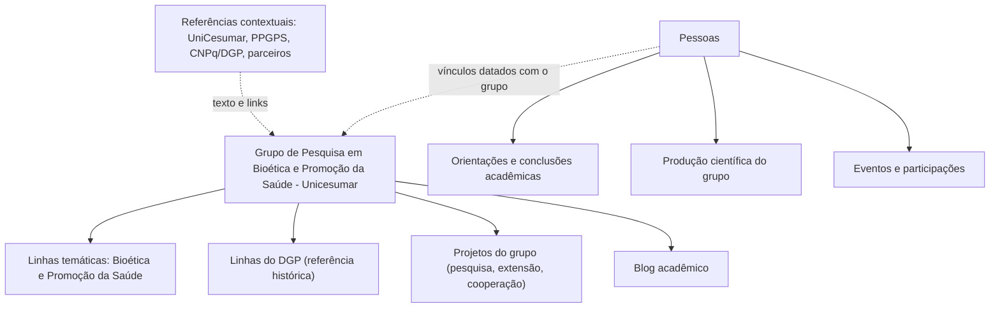
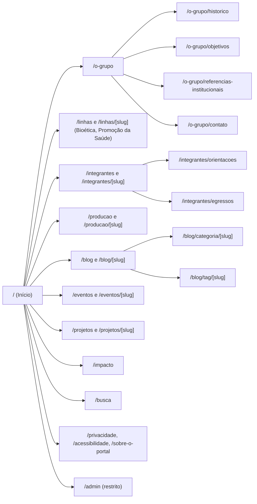
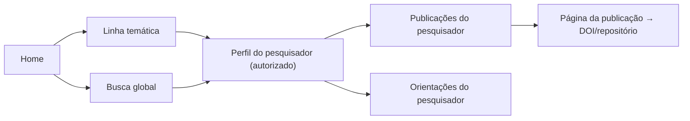
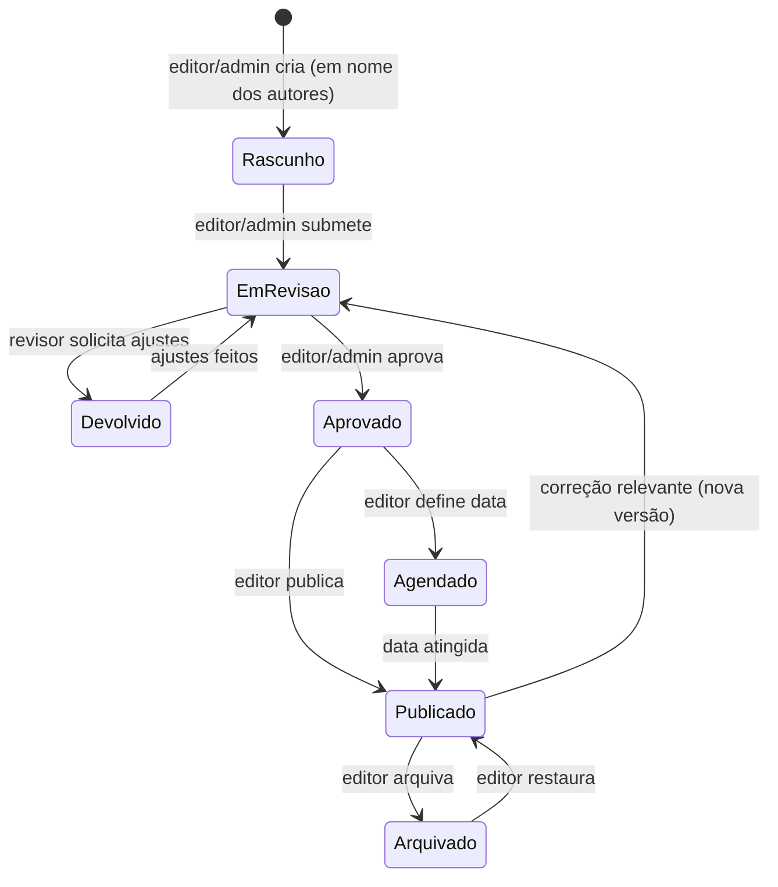
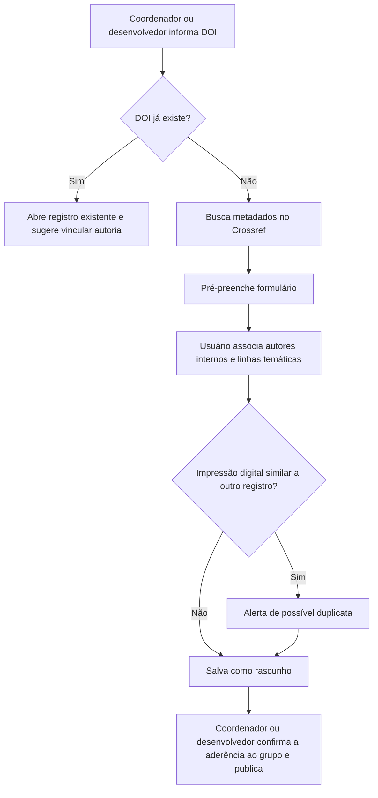
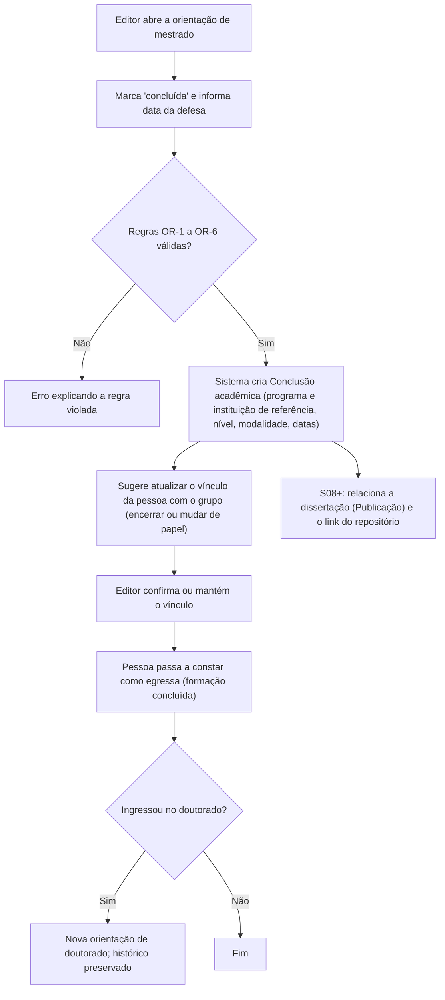
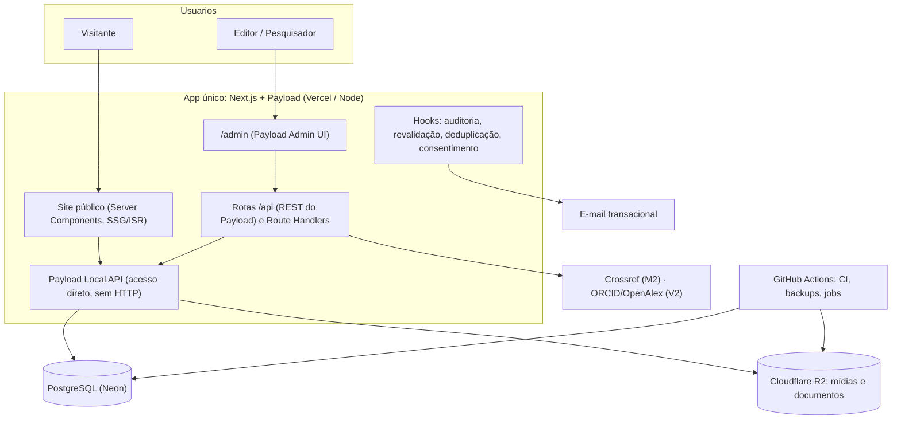
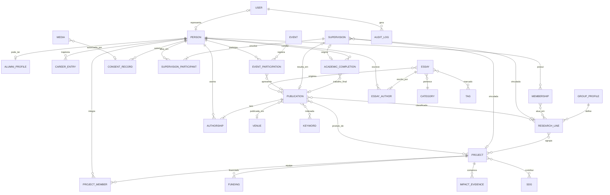
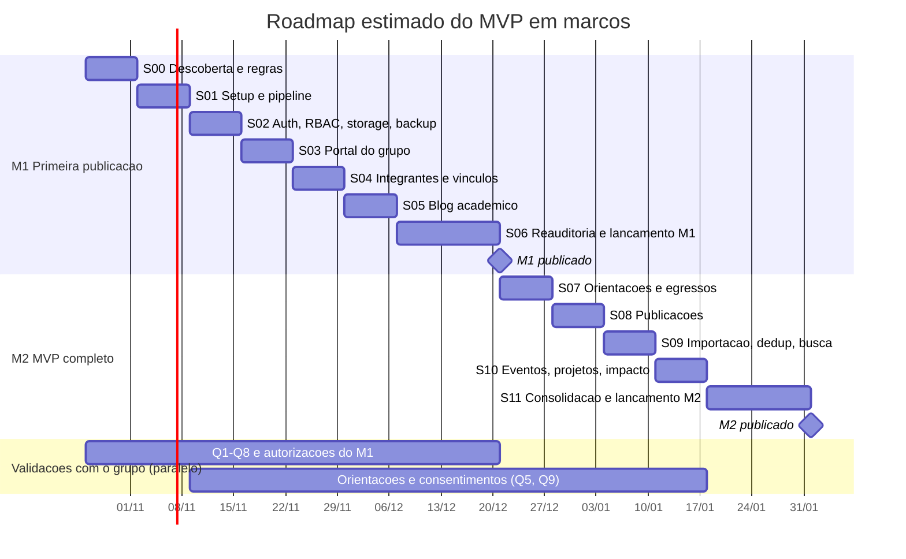
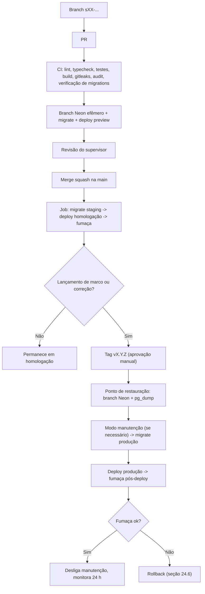

# Planejamento do Portal Acadêmico do Grupo de Pesquisa "Bioética e Promoção da Saúde"

> **Plano diretor técnico e funcional** do portal acadêmico do **Grupo de Pesquisa em Bioética e Promoção da Saúde - Unicesumar** (nome de exibição definido pelo coordenador, Q2), registrado no Diretório de Grupos de Pesquisa do CNPq, com foco temático em **Bioética** e **Promoção da Saúde**, seus integrantes e atividades. O portal é uma **iniciativa do grupo** (Q1): não é site oficial da UniCesumar nem do Programa de Pós-Graduação em Promoção da Saúde (PPGPS), que aparecem apenas como referências textuais, sem logotipos.
>
> | Item | Valor |
> |---|---|
> | Versão do documento | **1.3** |
> | Data da versão | 22/10/2026 |
> | Situação | Planejamento v1.2 aprovado pelo responsável técnico como base (22/10/2026). Respostas do coordenador às Q1–Q12 incorporadas (seção 32; ADR-0010). Publicação do portal autorizada como iniciativa do grupo; **uso de logotipos institucionais não autorizado**; dados pessoais exigem registro individual por titular (Q4) |
> | Execução prevista | Agente de IA (Claude Code ou similar), sob supervisão de um desenvolvedor responsável |
> | Idioma do MVP | Português (inglês planejado para a V2) |
> | Nome do arquivo | Mantido como `PLANEJAMENTO_PORTAL_PPGPS.md` (e o repositório como `PPGPS-Portal`) para não quebrar referências; o nome técnico não indica vínculo oficial com o programa |
>
> **Convenções de confiabilidade usadas neste documento**
>
> - **[VERIFICADO]**: informação consultada diretamente nas fontes públicas em 19/10/2026.
> - **[PREMISSA]**: decisão ou suposição adotada para viabilizar o planejamento; precisa ser confirmada.
> - **[SUGESTÃO]**: funcionalidade ou prática proposta, não exigida pelas fontes nem pelo solicitante.
> - **[ESTIMADO]**: valor (custo, esforço, prazo) não confirmado em fonte oficial ou dependente de uso real.
>
> **Marcos de entrega usados neste documento**
>
> - **M1 – Primeira publicação:** identidade do grupo, linhas temáticas (Bioética e Promoção da Saúde), integrantes com autorização registrada e blog acadêmico em produção (sprints S00–S06). O laboratório fica fora do escopo atual (Q6).
> - **M2 – MVP completo:** orientações, egressos, produção científica do grupo, busca, eventos, projetos, impacto e indicadores simples (sprints S07–S11).
> - **V2 / V3 – Evoluções:** expansão funcional (S12–S17) e inteligência/indicadores (S18–S20).

## Histórico de mudanças

| Versão | Data | Resumo |
|---|---|---|
| 1.0 | 19/10/2026 | Versão inicial do plano diretor (33 seções, MVP em 12 sprints com lançamento único) |
| 1.1 | 19/10/2026 | Revisão técnica: marcos M1/M2, blog antecipado, renumeração de sprints, egressos remodelados, pipeline de migrations/ambientes/backup, estimativas, segurança progressiva |
| 1.2 | 20/10/2026 | **Correção de escopo:** o portal passa a ser exclusivo do grupo de pesquisa "Bioética e Promoção da Saúde" e de suas atividades/laboratório, e não do PPGPS inteiro. Detalhes abaixo |
| 1.3 | 22/10/2026 | **Respostas do coordenador (Q1–Q12) e aprovações do responsável técnico:** nome e identidade visual, publicação como iniciativa do grupo sem aviso ostensivo, apenas dois usuários administrativos, foco em Bioética e Promoção da Saúde, laboratório fora do escopo atual. Detalhes abaixo |

**Alterações da versão 1.3** (stack Next.js + Payload CMS 3 + PostgreSQL + Cloudflare R2, arquitetura técnica, ambientes, marcos, módulos acadêmicos e sequência de sprints preservados; decisões em ADR-0010)

1. **Aprovações registradas (22/10/2026):** o responsável técnico aprovou o planejamento v1.2 como base, os ADRs 0001–0009 (agora *Aceitos*), o teste em ambiente limpo da S01 e o merge do PR #7. Escopo exclusivo do grupo reafirmado.
2. **Publicação e identidade (Q1, Q2):**
   - Portal publicado como iniciativa do grupo, com o nome "Grupo de Pesquisa em Bioética e Promoção da Saúde - Unicesumar".
   - **Removida a obrigação do aviso ostensivo** de portal não oficial (rodapé e páginas); `/sobre-o-portal` identifica discretamente o grupo como mantenedor.
   - Identidade visual **azul-marinho e branco**; nenhum logotipo institucional sem autorização formal.
   - Seções 1, 5.4, 8.1, 16.1 e 16.7.
3. **Hospedagem (Q3):** hospedagem própria, independente do site institucional; domínio próprio a adquirir no futuro (seções 24.1 e 25.1).
4. **Acesso (Q5, Q8, Q9):**
   - Somente **coordenador** (`editor`) e **desenvolvedor** (`admin`) têm contas.
   - Papel `researcher`, edição de perfil por integrantes, submissões de pesquisadores e convites em massa removidos do MVP; integrantes são registros acadêmicos.
   - Fluxo editorial operado pelos dois usuários.
   - Seções 4, 10.2, 13.3, 14 e 15.
5. **Dados pessoais e imagens (Q4, Q12):** as autorizações informadas pelo coordenador ficam registradas como autorizações do grupo. **Não** substituem o registro individual por titular (`ConsentRecord`) nem os controles de imagem, origem e licença (seções 8.2, 17.2 e 17.3).
6. **Foco temático (Q7):**
   - As linhas temáticas do portal passam a ser **Bioética** e **Promoção da Saúde** (coleção `research-lines`, rótulo "Linhas temáticas").
   - As quatro linhas do DGP ficam como **referência histórica** em `GroupProfile.dgpResearchLines`, sem páginas próprias e sem serem tratadas como extintas.
   - Seções 3.1, 5, 8.1, 13.3 e 18.
7. **Laboratório (Q6):** fora do escopo atual. Removidos a página `/o-grupo/laboratorio`, a chamada na homepage e o tipo `laboratory` de projetos; caminho futuro na seção 13.7.
8. **Orientações, egressos e conteúdo (Q10, Q11):** módulos confirmados e geridos pelo coordenador e pelo desenvolvedor; sem conteúdo prioritário; critérios de conteúdo do M2 passam a "se houver"; regra de evidência de impacto mantida.
9. **Sprints:** a seção 19.5 lista as mudanças por sprint; S00 e S01 encerradas (`docs/PROGRESS.md`). Validações remanescentes na seção 32.

**Alterações da versão 1.2 (stack, arquitetura técnica, marcos e sequência de sprints preservados)**

1. **Escopo:** portal exclusivo do grupo de pesquisa "Bioética e Promoção da Saúde" (DGP/CNPq), suas linhas, integrantes, laboratório e atividades. Foi **removida a obrigação** de cadastrar todos os docentes, grupos, linhas, projetos integradores, discentes e produções do PPGPS. Seções 1, 3, 4, 5 e 18.
2. **Referências institucionais:** UniCesumar, PPGPS e CNPq aparecem somente como vínculos contextuais (texto e links). Sem logotipos ou identidade visual institucional sem autorização formal; aviso permanente de que o portal não é site oficial. Nova seção 5.4; seções 8.1, 9 e 16.1.
3. **Páginas institucionais reorganizadas** em torno do grupo: "O grupo" (apresentação, objetivos, histórico, referências institucionais, contato), linhas do grupo, laboratório e atividades, integrantes. Seções 8.1 e 9.
4. **Modelagem simplificada** (seção 13): `Program` e `ResearchGroup` deixam de ser coleções — o grupo passa a ser o global `GroupProfile` e programas/instituições externas viram campos de referência; `ResearchLine` perde o escopo programa/grupo; `Membership` é sempre relativo ao grupo (com linhas de atuação); `Project` perde o tipo "integrador" e nasce na S10; papel `group_manager` e `User.managedGroups` removidos; identificadores externos como campos validados (sem coleção `ExternalId`); `Publication.groups` removido. Pontos de expansão futura documentados (seção 13.7).
5. **Privacidade:** nenhuma pessoa — inclusive docentes e líderes — tem perfil público sem autorização registrada (`ConsentRecord`), pois não há base institucional para exibir dados de docentes do programa. Seções 8.2 e 17.2.
6. **Egressos e orientações adaptados ao grupo:** orientações registradas são as conduzidas por pesquisadores do grupo (ou de estudantes integrantes); egresso é a pessoa com conclusão acadêmica registrada nesse contexto, em qualquer programa (registrado como referência). Ex-integrante continua derivado de vínculo encerrado. Regras OR-4 e OR-6 adaptadas. Seções 8.3, 8.4 e 10.4.
7. **Validações institucionais** substituídas por **12 questões dirigidas aos responsáveis do grupo** (Q1–Q12 da v1.2), com tabela de correspondência às Q1–Q20 da v1.1. Removidas as que só faziam sentido para o portal do programa (7 grupos, permanentes × colaboradores, conceito CAPES, OAI-PMH do RDU). Nova questão sobre o laboratório do grupo. Seção 32.
8. **Requisitos, backlog, critérios de publicação, sprints e critérios de fase** reavaliados (seções 6, 18–21 e 30). As sprints mantêm numeração e ordem; a S03 passa a ser "Portal do grupo: identidade, linhas, laboratório e homepage v1". A seção 20 passa a conter o resumo de cada sprint; **as fichas em `docs/sprints/` são a referência detalhada e normativa de escopo** (evita duplicação divergente).
9. **Autorização:** a aprovação conceitual do responsável pelo grupo **não** equivale a autorização para publicação, uso de marcas ou divulgação de dados pessoais. Essas autorizações são validações explícitas e registradas (seção 32).

**Alterações da versão 1.1 (resumo; arquitetura preservada: Next.js + Payload CMS 3 + PostgreSQL + R2)**

1. MVP entregue em dois marcos (M1 e M2); formulário de contato movido para a V2.
2. Blog antecipado para a S05; relação "ensaio originou publicação" na S08.
3. Sprints renumeradas conforme a ordem de execução (correspondência na seção 19.3).
4. Egressos remodelados com Conclusão acadêmica e Trajetória profissional; distinção entre egresso e ex-integrante de grupo; regras de participação em orientações.
5. Migrations fora do `next build`, verificação de *drift*, *expand/contract*, previews com banco efêmero, homologação isolada, backup criptografado com cópia externa, restauração verificada e matriz de rollback.
6. Estimativas separadas em esforço de IA, supervisão, esforço institucional e calendário.
7. Segurança, privacidade e qualidade progressivas por sprint (seção 17.7).
8. Consistência entre requisitos, backlog, roadmap, sprints e critérios; novos RF-021, RF-119, RF-120, RNF-17 e RNF-18.

---

## Sumário

1. [Resumo executivo](#1-resumo-executivo)
2. [Contexto e análise das fontes](#2-contexto-e-análise-das-fontes)
3. [Objetivos e proposta de valor](#3-objetivos-e-proposta-de-valor)
4. [Público-alvo e perfis de usuários](#4-público-alvo-e-perfis-de-usuários)
5. [Delimitação do escopo](#5-delimitação-do-escopo)
6. [Requisitos funcionais](#6-requisitos-funcionais)
7. [Requisitos não funcionais](#7-requisitos-não-funcionais)
8. [Módulos e funcionalidades detalhadas](#8-módulos-e-funcionalidades-detalhadas)
9. [Arquitetura de informação e sitemap](#9-arquitetura-de-informação-e-sitemap)
10. [Fluxos principais de navegação e administração](#10-fluxos-principais-de-navegação-e-administração)
11. [Comparação e definição da stack](#11-comparação-e-definição-da-stack)
12. [Arquitetura técnica](#12-arquitetura-técnica)
13. [Modelagem de dados](#13-modelagem-de-dados)
14. [Estratégia de autenticação e permissões](#14-estratégia-de-autenticação-e-permissões)
15. [Estratégia editorial e governança de dados](#15-estratégia-editorial-e-governança-de-dados)
16. [Estratégia de UX/UI](#16-estratégia-de-uxui)
17. [Segurança, privacidade e acessibilidade](#17-segurança-privacidade-e-acessibilidade)
18. [Definição e escopo do MVP](#18-definição-e-escopo-do-mvp)
19. [Roadmap por fases](#19-roadmap-por-fases)
20. [Planejamento detalhado de sprints](#20-planejamento-detalhado-de-sprints)
21. [Backlog priorizado](#21-backlog-priorizado)
22. [Critérios de aceite e qualidade](#22-critérios-de-aceite-e-qualidade)
23. [Testes e estratégia de homologação](#23-testes-e-estratégia-de-homologação)
24. [Infraestrutura, deploy e CI/CD](#24-infraestrutura-deploy-e-cicd)
25. [Custos e riscos](#25-custos-e-riscos)
26. [Indicadores científicos futuros](#26-indicadores-científicos-futuros)
27. [Integrações acadêmicas futuras](#27-integrações-acadêmicas-futuras)
28. [Organização do repositório](#28-organização-do-repositório)
29. [Estratégia de desenvolvimento com IA](#29-estratégia-de-desenvolvimento-com-ia)
30. [Critérios de conclusão de cada fase](#30-critérios-de-conclusão-de-cada-fase)
31. [Evoluções futuras](#31-evoluções-futuras)
32. [Validações com o coordenador do grupo (Q1–Q12)](#32-validações-com-o-coordenador-do-grupo-q1q12)
33. [Fontes e referências consultadas](#33-fontes-e-referências-consultadas)

---

## 1. Resumo executivo

**O que será construído.** Um portal acadêmico próprio do grupo de pesquisa **Bioética e Promoção da Saúde**, que funcione como ponto focal de informação, divulgação científica e acompanhamento da produção do grupo, de seus eixos temáticos (Bioética e Promoção da Saúde) e de suas atividades. O portal organiza em dados estruturados as pessoas, os vínculos com o grupo, as orientações conduzidas por seus pesquisadores, os egressos, as publicações, os eventos, os projetos e as ações de impacto social, além de oferecer um **blog acadêmico de ensaios reflexivos** com fluxo editorial.

**Por que.** O grupo tem informações públicas dispersas (espelho no DGP, currículos Lattes, menções na página do PPGPS) e nenhum canal próprio de divulgação. O espelho do DGP mostra um grupo ativo (certificado desde 2021; 4 linhas; 11 pesquisadores e 14 estudantes; 36 registros de ex-integrantes; parceria com instituição do RS), cuja trajetória de pessoas (estudantes que se tornam pesquisadores) e produção não está organizada em lugar algum. O portal transforma esse acervo em informação navegável, relacionada e atualizável sem alterar código.

**Escopo institucional.** O portal representa **exclusivamente o grupo** e é publicado como **iniciativa do grupo** (Q1). A UniCesumar (instituição que certifica o grupo e integra seu nome de exibição, Q2), o PPGPS e o CNPq/DGP aparecem **somente como referências textuais**, com links, sem logotipos e sem falar em nome dessas instituições (seção 5.4). Não há aviso ostensivo de portal não oficial; `/sobre-o-portal` identifica o grupo como mantenedor. Não há obrigação de cadastrar docentes, grupos, linhas, projetos ou produção do programa que não pertençam ao grupo.

**Decisões principais.**

| Tema | Decisão |
|---|---|
| Arquitetura | Monólito modular: **um único app Next.js (App Router) + Payload CMS 3** no mesmo repositório e processo (inalterado) |
| Banco | PostgreSQL (adaptador oficial do Payload, baseado em Drizzle) com migrations versionadas, executadas por job dedicado antes do deploy |
| UI pública | Tailwind CSS + shadcn/ui (Radix), renderização estática/ISR para SEO; identidade visual própria do grupo em azul-marinho e branco (Q2) |
| Admin | Painel do Payload em `/admin`, com RBAC de dois papéis: `admin` (desenvolvedor) e `editor` (coordenador); versões e rascunhos. Site público sem login (Q5) |
| Modelo | Grupo único (global `GroupProfile`); instituições e programas como referências; pontos de expansão documentados sem antecipar complexidade (seção 13.7) |
| Arquivos | Cloudflare R2 (S3 compatível) |
| Ambientes | Local, preview por PR (banco efêmero), homologação protegida e produção, isolados entre si (seção 24.2) |
| Hospedagem até M1 | Planos gratuitos (Vercel Hobby, Neon Free, R2 Free, GitHub Actions) |
| Hospedagem em produção | Decisão registrada em ADR na S06, antes do M1 (seção 25) |
| Privacidade | Nenhuma pessoa exibida publicamente sem autorização individual registrada, inclusive docentes; a autorização do grupo informada pelo coordenador (Q4) não a substitui |
| Execução | Sprints com *timebox* nominal de 1 semana, implementadas por agente de IA, com revisão humana obrigatória ao fim de cada uma |

**Entrega incremental em marcos.**

| Marco | Conteúdo | Sprints | Calendário estimado [ESTIMADO] |
|---|---|---|---|
| **M1 – Primeira publicação** | Identidade do grupo, linhas temáticas (Bioética e Promoção da Saúde), integrantes autorizados, blog com fluxo editorial, páginas legais | S00–S06 | 7 a 10 semanas a partir do início |
| **M2 – MVP completo** | + Orientações, egressos e ex-integrantes, produção científica do grupo, importação e deduplicação, busca global, eventos, projetos, impacto, indicadores públicos simples | S07–S11 | + 6 a 9 semanas após o M1 |
| **V2** | Inglês, ORCID, OpenAlex, newsletter, relatórios de curadoria (área do integrante condicionada a nova decisão, Q5) | S12–S17 | Após o M2 |
| **V3** | Indicadores administrativos, dashboards, métricas de veículos, relatórios | S18–S20 | Após dados curados por ≥ 1 ano |

O gargalo previsto não é escrever código, e sim **revisão humana, coleta de autorizações individuais dos integrantes e produção/validação de conteúdo pelo coordenador** — que, com o desenvolvedor, é o único mantenedor do conteúdo (Q9). Essas dependências nunca bloqueiam o desenvolvimento (usa-se dado público verificado ou fictício), mas bloqueiam a publicação de cada marco (seções 20.1 e 32).

**Segurança, privacidade e qualidade** são implementadas progressivamente desde a S01 (seção 17.7); a última sprint de cada marco apenas reaudita.

**Riscos centrais.** Falta de atualização do conteúdo (concentrado em duas pessoas), ausência de autorizações individuais de titulares, uso indevido de marcas institucionais, dados acadêmicos duplicados, falha de migration em produção e dependência de poucas pessoas. As mitigações (guia do editor, lembretes de atualização, consentimento por escopo, referências institucionais apenas textuais, deduplicação por DOI, pipeline de deploy com ponto de restauração, documentação para agentes) são tratadas como requisitos, não como apêndices.

---

## 2. Contexto e análise das fontes

> **Nota da v1.2.** Esta seção registra a análise feita na v1.1, quando o portal abrangia todo o PPGPS, e é mantida como **contexto**. A partir da v1.2: a **fonte principal** é o espelho do grupo no DGP (seção 2.2), complementado pelas informações fornecidas e autorizadas pelos responsáveis do grupo; a página do PPGPS (seção 2.1) é usada apenas para **referências contextuais** (vínculo do grupo com o programa, atividades do grupo divulgadas pelo programa) e **não** é carregada integralmente no portal. Os problemas de qualidade da seção 2.1.4 continuam úteis como alerta para a transcrição de dados de pesquisadores do grupo. Dados atualizados, com fonte e situação de validação, ficam em `docs/content/inventario.md`.

### 2.1. Fonte 1: página do PPGPS na UniCesumar

URL: <https://www.unicesumar.edu.br/mestrado-e-doutorado/promocao-da-saude/>. Acesso: 19/10/2026. **Acessível.**

#### 2.1.1. Identidade e estrutura do programa [VERIFICADO]

| Item | Informação |
|---|---|
| Início | Mestrado aprovado pela CAPES, atividades iniciadas em agosto de 2011 |
| Doutorado | Funcionamento autorizado pela CAPES em abril de 2019 |
| Área de concentração | Promoção da Saúde |
| Linha 1 | **Promoção da Saúde no Envelhecimento** |
| Linha 2 | **Educação e Tecnologias na Promoção da Saúde** |
| Projetos integradores | P1 – Estilo de vida e fatores biopsicossociais e econômicos no processo de envelhecimento (L1); P2 – Espaços e práticas para a promoção da saúde do idoso (L1); P3 – Tecnologias, comunicação e educação na promoção da saúde (L2); P4 – Promoção da saúde em diferentes ambientes, espaços e contextos de aprendizagem, assistência e trabalho (L2) |
| Fomento citado | CAPES, CNPq, Fundação Araucária e FUNADESP |
| Público-alvo do curso | Graduados em Biomedicina, Educação Física, Enfermagem, Farmácia, Fisioterapia, Fonoaudiologia, Medicina, Nutrição, Odontologia, Psicologia, Serviço Social, Terapia Ocupacional e áreas afins |
| Objetivo geral (resumo) | Formação integral de pesquisadores e docentes com competências para diagnosticar, planejar, avaliar e desenvolver ações e intervenções que melhorem indicadores de saúde da população |
| Objetivo de divulgação | Um dos objetivos específicos é "Divulgar o conhecimento das pesquisas científicas para a sociedade", o que se alinha diretamente à proposta deste portal |
| Contato | Secretaria do PPGPS, Bloco 07, Av. Guedner, 1610, Jardim Aclimação, Maringá-PR; ppgps@unicesumar.edu.br |
| Coordenação | Prof. Dr. Braulio Henrique Magnani Branco (coordenador do programa) |
| Conceito CAPES | **Não confirmado em texto.** Há apenas uma imagem cujo nome de arquivo é `selo-conceito-5-mestrado.jpg`. Exige validação antes de qualquer exibição |

#### 2.1.2. Pessoas [VERIFICADO]

- **Corpo docente:** 12 docentes listados (mais 1 docente convidado internacional), cada um com foto, e-mail, link para o Currículo Lattes e uma linha de titulação. **Nenhum docente permanente tem ORCID informado.** A página **não distingue** docentes permanentes de colaboradores.
- A vinculação docente ↔ projeto integrador aparece apenas na seção de linhas de pesquisa; uma docente do corpo docente não aparece em nenhum projeto integrador.
- **Corpo discente:** listas por ano de ingresso (mestrado desde 2013, doutorado desde 2019), com nome e link Lattes; ≈355 registros no total. **Não há indicação de orientador** em nenhum registro.
- Turmas **MINTER** (Corumbá) e **DINTER** listadas separadamente.
- **Pós-doutorado:** 19 registros com período, financiamento e supervisor.

#### 2.1.3. Pesquisa, produção e extensão [VERIFICADO]

| Seção | Situação observada |
|---|---|
| Grupos de pesquisa | 7 grupos com líder e docentes participantes, com links para o DGP. **2 links quebrados** (caminho relativo a uma pasta local "Desktop") e 1 link com ID em formato diferente dos demais |
| Produção científica | Link para a revista *Saúde e Pesquisa* (ISSN 2176-9206 on-line; 1983-1870 impressa) e 7 livros do programa (1 link aponta para conteúdo não relacionado) |
| Publicações | 2 materiais educativos (cartilha e guia) |
| Dissertações e teses | ≈190 dissertações de 2013 a 2022 como PDFs nomeados apenas pelo autor (em maiúsculas). **Nenhuma tese de doutorado listada.** Existem duplicações entre anos. O repositório oficial (RDU) aparece só como link lateral |
| Bancas | Agendas em PDF até 2020; seção de bancas MINTER vazia |
| Laboratório | LIIPS (vinculado ao ICETI), com histórico desde 2017 e números de atendimentos e captação declarados pelo próprio programa |
| Extensão | 13 projetos ativos com coordenação e descrição; alguns com fomento (Fundação Araucária, Universidade Sem Fronteiras) |
| Internacionalização | Tabela de 36 instituições parceiras e notícias de ações de 2025 e 2026 |
| Notícias | 6 cartões que levam ao blog institucional (1 duplicado) |
| Autoavaliação | Relatórios de 2021 a 2024 em PDF |
| Redes sociais | Não há perfil próprio do PPGPS linkado (apenas redes institucionais; Instagram do LIIPS e do PPGPS citado sem link) |

#### 2.1.4. Problemas de qualidade identificados (oportunidades do portal)

1. Informação em PDFs e listas sem estrutura: impossível filtrar por orientador, linha, ano ou tema.
2. Links quebrados e inconsistentes (DGP, Lattes divergentes para a mesma docente, link Lattes que aponta para outro docente).
3. Grafias divergentes para a mesma pessoa (ex.: "Natalia"/"Natália", "Tania"/"Tânia", "Braulio"/"Bráulio").
4. Conteúdo desatualizado (bancas até 2020; dissertações até 2022).
5. Ausência de ORCID e DOI, o que dificulta integrações e deduplicação.
6. Ausência de relação orientador–orientando–dissertação, que é justamente o módulo central pedido.

> Esses problemas justificam três decisões do plano: (a) cada pessoa é uma entidade única com nome canônico e variantes; (b) identificadores externos (Lattes, ORCID, DOI) são campos validados; (c) o portal **referencia** os documentos oficiais (editais, regimento, RDU) em vez de duplicá-los.

#### 2.1.5. Informações que o portal deve apenas referenciar (não duplicar)

Editais e processos seletivos, investimento/mensalidades, bolsas, regimento, regulamento, matriz curricular, PDI, autoavaliação, ações afirmativas, credenciamento docente e o repositório RDU. **Motivo:** são documentos normativos sob governança da universidade; duplicá-los cria risco de versões conflitantes. O portal terá uma página "Documentos oficiais" com links para as fontes, mantidos no CMS.

### 2.2. Fonte 2: Diretório de Grupos de Pesquisa do CNPq

URL informada: <http://dgp.cnpq.br/dgp/espelhogrupo/719693>. Acesso: 19/10/2026. **Acessível.** O espelho exibido informa o endereço canônico `dgp.cnpq.br/dgp/espelhogrupo/5367326681852422`.

| Item | Informação [VERIFICADO] |
|---|---|
| Nome do grupo | **Bioética e Promoção da Saúde** |
| Situação | Certificado (pela instituição), desde 14/04/2021 |
| Ano de formação | 2021 |
| Líderes | Lucas França Garcia; Leonardo Pestillo de Oliveira |
| Área predominante | Ciências da Saúde; Saúde Coletiva |
| Instituição | Centro de Ensino Superior de Maringá – CESUMAR (Diretoria de Pós-Graduação, Pesquisa e Extensão) |
| Repercussões | Texto refere-se ao grupo como "Bioética e Promoção da Saúde Global no Envelhecimento", com foco em trabalhos interdisciplinares e de métodos mistos em bioética e promoção da saúde no envelhecimento |
| Linhas do grupo | (1) Bioética e o processo de envelhecimento; (2) Determinantes sociais da saúde e aspectos biopsicossociais no processo de envelhecimento; (3) Espaços e práticas para a promoção da saúde do idoso; (4) Tecnologias na promoção da saúde no processo de envelhecimento |
| Recursos humanos | 11 pesquisadores e 14 estudantes (graduação, MBA, mestrado, doutorado), com data de inclusão e links para Lattes |
| Egressos | Lista com período de participação (4 entradas de pesquisadores e 32 de estudantes; algumas pessoas aparecem como egressas de um papel e ativas em outro) |
| Instituição parceira | Diretoria de Pesquisa – DIPE (RS) |
| Indicadores de RH | 12 doutores, 3 mestres, 5 graduação, 5 outros (total 25) |

**Observações relevantes para a arquitetura**

1. **Divergência de nome:** no site do programa o grupo é "Bioética e Promoção da Saúde Global no Envelhecimento"; no título do DGP é "Bioética e Promoção da Saúde". O modelo precisa de `nome oficial` + `nome alternativo` e da fonte de cada um. **Validar o nome a exibir.**
2. **Linhas do grupo ≠ linhas do programa:** o grupo tem 4 linhas próprias. Logo, `Linha de pesquisa` precisa de escopo (programa ou grupo) e de relação opcional "linha de grupo → linha do programa". **[v1.2]** Com o portal restrito ao grupo, as linhas são somente do grupo; a eventual relação com linhas do programa é uma referência textual opcional (seção 13.3).
3. **Mudança de papel ao longo do tempo:** o DGP mostra pessoas que foram estudantes e passaram a pesquisadoras (ex.: entradas de egresso como estudante e ativas como pesquisadoras). Isso confirma a necessidade de **vínculos com data de início e fim** em vez de um campo "tipo de pessoa".
4. **O DGP não oferece API pública documentada [PREMISSA]**; os dados serão transcritos manualmente ou importados por planilha com revisão humana, citando a fonte e a data da coleta.
5. **Nomes de estudantes:** embora públicos no DGP, a republicação no portal segue a política de consentimento da seção 17 (dados de estudantes só são exibidos com autorização).

### 2.3. Fontes técnicas consultadas (preços e APIs)

| Fonte | Informação [VERIFICADO em 19/10/2026] |
|---|---|
| Vercel Pricing | Hobby US$ 0/mês, **destinado a uso pessoal e não comercial**; Pro US$ 20/mês por assento, com crédito de uso; Hobby inclui 100 GB de transferência, 1M invocações de função e 5 mil transformações de imagem por mês |
| Neon Pricing | Free: 100 CU-horas/projeto, 1 GB de armazenamento por projeto, 10 branches, histórico de 6 h, scale-to-zero após 5 min, 5 GB de egress. Planos pagos: Launch US$ 0,106/CU-hora e US$ 0,35/GB-mês, sem mínimo mensal |
| Cloudflare R2 | Free: 10 GB-mês, 1M operações classe A, 10M operações classe B; depois US$ 0,015/GB-mês; **egress gratuito** |
| Payload CMS docs | "Next.js fullstack framework": painel admin, banco com migrations, REST/GraphQL, autenticação, controle de acesso por documento/campo/operação e uploads em uma base TypeScript |
| OpenAlex | Dados gratuitos; uso básico sem chave; chave gratuita aumenta o orçamento diário em 10× (orçamento gratuito de US$ 1/dia com chave); limite de 10 req/s sem chave e 30 req/s com chave |
| ORCID Public API | Gratuita para não membros: login com ORCID, coleta de iDs validados, leitura de dados públicos e busca no registro |

### 2.4. Síntese: verificado × premissa × sugestão (revisada na v1.2)

| Categoria | Itens |
|---|---|
| **Verificado** | Dados do grupo no DGP (nome, certificação, ano de formação, líderes, área, 4 linhas, recursos humanos, egressos no sentido de ex-integrantes, instituição parceira); menção do grupo na página do PPGPS com nome alternativo; existência de pesquisadores do grupo no corpo docente do PPGPS; preços e limites dos serviços citados |
| **Premissas** | Portal do grupo (iniciativa do grupo, Q1); MVP só em português; hospedagem gratuita até o lançamento e própria em produção (Q3); DGP, Lattes e Sucupira sem API utilizável (transcrição ou importação de arquivos exportados); coordenador e desenvolvedor como instância editorial (Q8); laboratório fora do escopo atual (Q6); nome curto "Bioética e Promoção da Saúde" para títulos [a confirmar] |
| **Sugestões** | Blog com ciclo Ideia → Ensaio → Publicação; perfis com ORCID; índice de orientações dos pesquisadores do grupo; indicadores públicos resumidos do grupo; newsletter; área do integrante; integrações ORCID, Crossref e OpenAlex; versão em inglês |

---

## 3. Objetivos e proposta de valor

### 3.1. Objetivos

| # | Objetivo | Métrica de sucesso sugerida |
|---|---|---|
| O1 | Centralizar a informação do grupo em dados estruturados e relacionados | Identidade do grupo, as 2 linhas temáticas (Bioética e Promoção da Saúde) e perfis de todos os integrantes que autorizaram cadastrados no lançamento |
| O2 | Dar visibilidade aos pesquisadores e à produção científica do grupo | Perfis autorizados com Lattes/ORCID (M1); catálogo com a produção do grupo dos últimos 5 anos (M2) [PREMISSA] |
| O3 | Tornar rastreável a formação acadêmica conduzida no grupo (orientações e egressos) | Orientações em andamento (autorizadas) e concluídas consultáveis por orientador, linha e ano |
| O4 | Fortalecer a comunicação científica com a sociedade | Ensaios publicados com regularidade (meta sugerida: 2 por mês após o lançamento) |
| O5 | Permitir atualização sem alterar código | Todo conteúdo editável pelo painel pelo coordenador; zero deploys necessários para alterar conteúdo |
| O6 | Preparar a base para indicadores do grupo | Modelo de dados apto a calcular os indicadores da seção 26 sem migração estrutural |

### 3.2. Proposta de valor por público

| Público | Valor entregue |
|---|---|
| Sociedade e imprensa | Linguagem acessível no blog; projetos e ações de impacto social do grupo com evidências |
| Estudantes interessados em integrar o grupo ou ser orientados | Entender linhas, pesquisadores, temas de orientação e trajetória de egressos |
| Pesquisadores do grupo | Perfil acadêmico consolidado (mantido pela coordenação), espaço editorial para ensaios, visibilidade da produção |
| Estudantes integrantes | Visibilidade da pesquisa em andamento (com consentimento), participação no blog |
| Coordenador do grupo | Visão organizada da produção, das orientações e das atividades; publicação sem depender de código; base para relatórios (ex.: atualização do DGP) |
| Parceiros e financiadores | Evidências de projetos, resultados e colaborações do grupo |

### 3.3. O que o portal **não** é

- Não é site oficial da UniCesumar nem do PPGPS (é iniciativa do grupo), não fala em nome dessas instituições e não substitui seus sistemas (secretaria, Lyceum, Studeo, RDU) nem o espelho do grupo no DGP.
- Não é portal do programa: não apresenta todos os docentes, grupos, linhas, editais ou processos seletivos do PPGPS (apenas link para o site oficial).
- Não é um periódico científico: ensaios do blog não passam por revisão por pares e são identificados como tal.
- Não é sistema de avaliação CAPES nem fonte oficial para a Plataforma Sucupira ou para o DGP.
- Não armazena dados clínicos, prontuários ou dados de participantes de pesquisa.

---

## 4. Público-alvo e perfis de usuários

### 4.1. Personas

| Persona | Descrição | Necessidades principais |
|---|---|---|
| **Ana, candidata** | Fisioterapeuta interessada em pesquisar bioética e envelhecimento | Linhas, pesquisadores, temas de orientação, egressos; link para o programa oficial onde se candidatar |
| **Carlos, cidadão** | Leitor interessado em envelhecimento saudável e bioética | Textos acessíveis, projetos e ações abertas à comunidade |
| **Profa. Marta, pesquisadora do grupo** | Pesquisadora com orientações e produção (sem conta no portal) | Perfil e produção atualizados pela coordenação; encaminhar ensaios para revisão |
| **João, doutorando integrante** | Estudante do grupo com pesquisa em andamento (sem conta no portal) | Aparecer como integrante (se autorizar), propor ensaios à coordenação |
| **Coordenador do grupo** (`editor`) | Responsável pelo grupo e por seu conteúdo | Cadastrar, revisar, aprovar, agendar e publicar todo o conteúdo acadêmico e editorial; colher autorizações dos integrantes |
| **Desenvolvedor responsável** (`admin`) | Responsável técnico | Usuários, papéis, backups, deploy, integrações; também revisa e publica conteúdo (Q8, Q9) |

### 4.2. Perfis de acesso (resumo; detalhes na seção 14)

| Perfil | Autenticado | Escopo |
|---|---|---|
| Visitante | Não | Somente conteúdo publicado e com visibilidade pública |
| Editor (`editor`) | Sim | Coordenador do grupo: todo o conteúdo editorial e acadêmico; revisa, aprova e publica; consentimentos e importações; lê a auditoria |
| Administrador (`admin`) | Sim | Desenvolvedor responsável: tudo, incluindo usuários, papéis, configurações técnicas e auditoria |

> **v1.3 (Q5):** apenas duas contas administrativas. O papel `researcher` foi removido do MVP; integrantes são registros acadêmicos (`Person`) sem conta. O papel `group_manager` (v1.1) continua removido. Reintroduzir qualquer papel exige ADR (seção 13.7).

---

## 5. Delimitação do escopo

### 5.1. Escopo do grupo



- **Nível 1 – Grupo:** identidade, objetivos, histórico (incluindo as linhas registradas no DGP como referência), linhas temáticas Bioética e Promoção da Saúde, referências institucionais textuais, contato do grupo. O laboratório não é apresentado nesta versão (Q6).
- **Nível 2 – Integrantes:** perfis (somente com autorização) que agregam vínculos com o grupo, linhas de atuação, produção, orientações, eventos, projetos e ensaios.
- **Nível 3 – Atividades e produção:** orientações, publicações, eventos, projetos, evidências de impacto e ensaios.

**Grupo único, expansão possível.** O MVP representa um único grupo, modelado como configuração global (`GroupProfile`). Hospedar outros grupos no futuro exige migração planejada (seção 13.7), mas não é suportado nem antecipado no MVP [PREMISSA].

### 5.2. Escopo por marco

**M1 – Primeira publicação (S00–S06).** Colocar no ar, o quanto antes, um portal confiável do grupo, com o menor volume possível de dados pessoais e de dependências externas.

- Portal público em português, sem login: Início, O grupo (apresentação, objetivos, histórico, referências institucionais, contato do grupo), Linhas temáticas (Bioética e Promoção da Saúde), Integrantes (somente quem autorizou) e Blog.
- Painel administrativo com dois papéis (coordenador e desenvolvedor), fluxo editorial, versões, auditoria, consentimentos e mídias seguras.
- Páginas de privacidade, acessibilidade e "sobre o portal" (com identificação discreta do grupo como mantenedor).
- SEO técnico, monitoramento, backups e pipeline de deploy seguro.

**M2 – MVP completo (S07–S11).** Acrescenta os módulos de dados acadêmicos que dependem de levantamento mais demorado:

- Orientações conduzidas por pesquisadores do grupo (públicas conforme regras de visibilidade), conclusões acadêmicas, egressos com trajetória autorizada e ex-integrantes.
- Catálogo da produção científica do grupo, cadastro por DOI (Crossref), importação CSV/BibTeX/RIS com deduplicação, citação e exportação.
- Busca global.
- Eventos e participações; projetos do grupo (sem atividades do laboratório nesta versão, Q6); evidências de impacto e ODS — conforme houver conteúdo (Q11).
- Indicadores públicos **simples** do grupo (contagens com data de corte).

**Justificativa da divisão.** O M1 depende de textos do grupo e das autorizações de poucos titulares (líderes e pesquisadores). O M2 depende de dados que **não existem em fonte pública** (relação orientador–orientando), de consentimentos de estudantes e egressos e de curadoria de produção.

### 5.3. Fora do escopo do MVP (M1 + M2)

| Item | Destino |
|---|---|
| Docentes, grupos, linhas, projetos integradores, discentes, editais e produção do PPGPS que não pertençam ao grupo | **Fora de escopo permanente** (apenas link para o site oficial) |
| Uso de logotipos ou identidade visual da UniCesumar, do PPGPS ou do CNPq | Somente com autorização formal específica; não concedida na Q2; não previsto no MVP |
| Laboratório do grupo (página, atividades, projetos `laboratory`) | Fora do escopo atual por decisão do coordenador (Q6); reavaliar com nova manifestação |
| Conceito CAPES, números e avaliações do programa | Fora de escopo (não pertencem ao grupo) |
| Hospedagem de múltiplos grupos | Evolução futura (seção 31), com migração planejada |
| Versão em inglês | V2 |
| Formulário de contato com proteção anti-spam (MVP usa o e-mail do grupo) | V2 |
| Contas de integrantes e área do integrante com conteúdos restritos | Fora do MVP (Q5); reavaliar na V2 somente com ADR e decisão do coordenador |
| Sincronização automática com ORCID e OpenAlex | V2 |
| Dashboards e indicadores administrativos, exportações | V3 |
| Login com ORCID ou SSO institucional | V2/V3 |
| Inscrições em eventos, emissão de certificados | V3 (avaliar necessidade) |
| Comentários públicos no blog | Não planejado; avaliar na V2 |
| Integração com Lattes, DGP ou Sucupira | Somente por transcrição autorizada ou importação de arquivos exportados |
| Dados clínicos ou de participantes de pesquisa | Fora de escopo permanente |

### 5.4. Relação com instituições (referências contextuais)

| Permitido (referência contextual) | Proibido sem autorização formal registrada |
|---|---|
| Texto factual: "grupo certificado pela UniCesumar no Diretório dos Grupos de Pesquisa do CNPq"; "pesquisadores vinculados ao PPGPS/UniCesumar" | Logotipos, selos e marcas da UniCesumar, do PPGPS ou do CNPq |
| Links para o site oficial do PPGPS, o espelho do grupo no DGP, Currículos Lattes, RDU e páginas oficiais de parceiros | Layout, elementos gráficos ou cores que imitem o site institucional; uso do nome da instituição além do nome de exibição definido (Q2) e das referências textuais; domínio institucional sem cessão formal |
| Afiliação institucional de cada pessoa no próprio perfil (com autorização da pessoa) | Falar em nome da instituição ou do programa; divulgar editais, processos seletivos ou números do programa como conteúdo próprio |

- **v1.3 (Q1):** o portal é publicado como iniciativa do grupo, **sem aviso ostensivo** de portal não oficial. `/sobre-o-portal` informa de forma discreta que o portal é mantido pelo grupo, que o conteúdo é de sua responsabilidade e onde encontrar as informações oficiais do programa (link). Texto configurável em `GroupProfile.responsibilityNote` (opcional).
- As referências ficam no global `GroupProfile.institutionalReferences` (somente texto e URL), exibidas em "O grupo › Referências institucionais" e, se marcadas, no rodapé.
- **Risco residual:** a resposta à Q1 não informou se a UniCesumar exige comunicação prévia sobre sites de grupos que mencionem a instituição. A decisão é do coordenador; o agente não contata a universidade. Menções e marcas são retiradas imediatamente a pedido da instituição (seção 15.6).

---

## 6. Requisitos funcionais

Prioridade MoSCoW: **M** (Must), **S** (Should), **C** (Could), **W** (Won't nesta versão). Marco: **M1**, **M2**, **V2**, **V3**. "M1 → M2" indica requisito entregue em parte no M1 e completado no M2. Os identificadores da v1.1 foram mantidos; a coluna "v1.2" indica o que mudou com a correção de escopo e, quando marcado, com a v1.3 (respostas Q1–Q12).

### 6.1. Portal público

| ID | Requisito | Prior. | Marco | Sprint | v1.2 |
|---|---|---|---|---|---|
| RF-001 | Homepage com apresentação do grupo, linhas temáticas, ensaios e integrantes em destaque (M1); produção recente, eventos, projetos e indicadores resumidos (M2) | M | M1 → M2 | S03, S05, S08, S10 | Reescrito para o grupo; v1.3: sem laboratório |
| RF-002 | Páginas "O grupo" (apresentação, objetivos, histórico, referências institucionais, contato do grupo) editáveis no CMS | M | M1 | S03 | Substitui as páginas do programa |
| RF-003 | Página de cada linha temática (Bioética; Promoção da Saúde) com integrantes que nela atuam (M1) e produção, orientações e projetos relacionados (M2); linhas do DGP exibidas como referência histórica em "O grupo", sem páginas próprias | M | M1 → M2 | S03, S04, S07, S08, S10 | v1.3: 2 eixos temáticos (Q7) |
| RF-004 | Página do laboratório e das atividades do grupo | W | — | — | v1.3: fora do escopo atual por decisão do coordenador (Q6) |
| RF-005 | Diretório de integrantes com filtros por papel, linha e situação (atual/ex-integrante) (M1); egressos (M2) | M | M1 → M2 | S04, S07 | Somente integrantes do grupo, com autorização |
| RF-006 | Perfil de pessoa com apresentação, formação, vínculos com o grupo, afiliações, Lattes e ORCID (M1); ensaios (M1); orientações, publicações, projetos e eventos (M2) | M | M1 → M2 | S04, S05, S07, S08, S10 | Perfil exige autorização |
| RF-007 | Orientações conduzidas por pesquisadores do grupo (em andamento e concluídas), com filtros por orientador, nível, linha, programa de referência, situação e ano | M | M2 | S07 | Restrito ao grupo |
| RF-008 | Diretório de egressos com conclusões, orientador, pesquisa e trajetória (quando autorizada) | M | M2 | S07 | Egresso no contexto do grupo |
| RF-009 | Catálogo da produção científica do grupo com filtros por autor, ano, tipo, linha, projeto (S10) e palavra-chave | M | M2 | S08, S10 | Sem filtro por grupo; produção curada do grupo |
| RF-010 | Página de publicação com metadados completos, citação formatada e links (DOI, PDF autorizado, repositório) | M | M2 | S08 | — |
| RF-011 | Blog com listagem, categorias, tags, página do ensaio, autores e indicação de natureza do texto | M | M1 | S05 | — |
| RF-012 | Eventos do grupo (futuros e passados) e participações de integrantes, com trabalhos apresentados | M | M2 | S10 | Restrito ao grupo |
| RF-013 | Projetos do grupo (pesquisa, extensão e cooperação; sem laboratório nesta versão, Q6) com equipe, período, financiamento, resultados e ODS | M | M2 | S10 | Removidos os projetos integradores do programa |
| RF-014 | Página de impacto social com evidências verificadas e ODS | S | M2 | S10 | — |
| RF-015 | Busca global por pessoas, publicações, ensaios, projetos, eventos e páginas | M | M2 | S09, S10 | — |
| RF-016 | Citação em ABNT e APA; exportação BibTeX/RIS | S | M2 | S08 | — |
| RF-017 | Feed RSS/Atom do blog | S | M1 | S05 | — |
| RF-018 | Página "Referências institucionais" com links para UniCesumar, PPGPS, espelho DGP, RDU e parceiros, sem duplicar documentos oficiais | S | M1 | S03 | Antes "Documentos oficiais" do programa (M) |
| RF-019 | Versão em inglês das páginas do grupo e perfis | S | V2 | S12 | — |
| RF-020 | Inscrição em newsletter | C | V2 | S16 | — |
| RF-021 | Páginas de privacidade, acessibilidade e "sobre o portal" editáveis no CMS; "sobre o portal" identifica discretamente o grupo como mantenedor | M | M1 | S06 | v1.3: sem aviso ostensivo no rodapé (Q1) |
| RF-022 | Formulário de contato com proteção anti-spam (MVP exibe o e-mail do grupo) | C | V2 | S16 | — |

### 6.2. Administração e conteúdo

| ID | Requisito | Prior. | Marco | Sprint | v1.2 |
|---|---|---|---|---|---|
| RF-101 | CRUD das entidades pelo painel, sem alterar código (cada coleção entra na sprint do seu módulo) | M | M1 → M2 | S02–S10 | — |
| RF-102 | Rascunhos, versões e restauração de versão para conteúdos editoriais e acadêmicos | M | M1 | S03, S05 | — |
| RF-103 | Fluxo editorial de ensaios: rascunho → em revisão → aprovado → publicado → arquivado (com devolução), operado pelo coordenador e pelo desenvolvedor | M | M1 | S05 | v1.3: dois revisores (Q8) |
| RF-104 | Publicação agendada de ensaios | S | M1 | S05 | — |
| RF-105 | Gestão de mídias e documentos com texto alternativo, créditos, licença e autorização de uso | M | M1 | S02 | — |
| RF-106 | Gestão de usuários e papéis (`admin`, `editor`); contas criadas pelo admin | M | M1 | S02 | v1.3: sem `researcher` (Q5) |
| RF-107 | Registro de auditoria das operações administrativas (quem, o quê, quando) | M | M1 | S02 | — |
| RF-108 | Registro de autorização (consentimento) para exibição de dados pessoais e de imagem de **qualquer** pessoa, inclusive docentes e líderes | M | M1 | S04 | Ampliado |
| RF-109 | Importação de publicação por DOI (metadados Crossref) | M | M2 | S08 | — |
| RF-110 | Importação em lote de publicações (CSV, BibTeX, RIS) com pré-visualização e detecção de duplicatas | S | M2 | S09 | — |
| RF-111 | Importação de pessoas e vínculos com o grupo por planilha (carga inicial a partir do DGP, somente com autorização individual registrada) | S | M1 | S04 | Restrito ao grupo |
| RF-112 | Fila de revisão de possíveis duplicatas (pessoas e publicações) com mesclagem | S | M2 | S09 | — |
| RF-113 | Pré-visualização do conteúdo antes de publicar | M | M1 | S03, S05 | — |
| RF-114 | Notificação por e-mail entre os usuários quando um ensaio entra em revisão ou é devolvido | C | M1 | S05 | v1.3: opcional (apenas dois usuários) |
| RF-115 | Pesquisador edita o próprio perfil; alterações sensíveis passam por aprovação | W | — | — | v1.3: removido (Q5, Q9): só coordenador e desenvolvedor editam |
| RF-116 | Sincronização ORCID (leitura de obras públicas) com revisão, operada pelos usuários administrativos | S | V2 | S14 | v1.3: sem login de pesquisadores |
| RF-117 | Enriquecimento via OpenAlex (conceitos, citações, open access) | C | V2 | S15 | — |
| RF-118 | Dashboard de indicadores administrativos do grupo com filtros e exportação CSV | S | V3 | S18 | Do grupo |
| RF-119 | Registro de conclusões acadêmicas (mestrado, doutorado, pós-doutorado) vinculadas a orientações de pesquisadores do grupo, com programa e instituição de referência | M | M2 | S07 | Programa como referência |
| RF-120 | Registro de trajetória profissional e acadêmica de egressos (múltiplas entradas, com consentimento) | S | M2 | S07 | — |

---

## 7. Requisitos não funcionais

| ID | Categoria | Requisito | Verificação |
|---|---|---|---|
| RNF-01 | Desempenho | LCP ≤ 2,5 s, INP ≤ 200 ms, CLS ≤ 0,1 no percentil 75 (mobile) nas páginas públicas | Lighthouse CI e Speed Insights |
| RNF-02 | Desempenho | Páginas públicas servidas por SSG/ISR; TTFB com cache ≤ 200 ms | Medição em produção |
| RNF-03 | SEO | Metadados, Open Graph, sitemap.xml, robots.txt, URLs canônicas e JSON-LD (Person, ScholarlyArticle, BlogPosting, Event, Organization) | Testes automatizados e Rich Results Test |
| RNF-04 | Acessibilidade | WCAG 2.2 nível AA nas páginas públicas e nos componentes próprios | axe-core em E2E e revisão manual com teclado e leitor de tela |
| RNF-05 | Segurança | OWASP ASVS nível 1 como referência; cabeçalhos de segurança (CSP, HSTS, X-Content-Type-Options, Referrer-Policy) | Controles progressivos (seção 17.7), checklist nas reauditorias S06 e S11 e teste automatizado de cabeçalhos |
| RNF-06 | Privacidade | Conformidade com a LGPD: base legal registrada, consentimento revogável, minimização de dados | Revisão da política e testes de visibilidade |
| RNF-07 | Disponibilidade | Meta de 99,5% mensal após o lançamento [PREMISSA] | Monitor de uptime |
| RNF-08 | Backup | RPO ≤ 24 h (backup diário) e ponto de restauração antes de cada deploy com migration; RTO ≤ 4 h; restauração verificada automaticamente todo mês e manualmente antes de cada marco e trimestralmente | Job de verificação, runbook e registro de teste |
| RNF-09 | Manutenibilidade | TypeScript estrito, lint sem erros, cobertura ≥ 70% em regras de domínio (access, hooks, utilitários) | CI |
| RNF-10 | Responsividade | Layout funcional de 320 px a 1920 px; alvos de toque ≥ 24×24 px | E2E em 3 viewports |
| RNF-11 | Compatibilidade | Duas últimas versões de Chrome, Edge, Firefox e Safari (desktop e mobile) | Playwright (Chromium, Firefox, WebKit) |
| RNF-12 | Internacionalização | Modelo preparado para campos localizados (pt-BR padrão, en futuro) | Configuração de localização desde a S01 |
| RNF-13 | Auditoria | Toda criação, alteração, publicação e exclusão no admin registrada com usuário e data | Teste de integração |
| RNF-14 | Custo | Operar em planos gratuitos até o lançamento; custo de produção inicial ≤ US$ 40/mês [ESTIMADO] | Painéis de uso |
| RNF-15 | Portabilidade | Sem dependência proprietária no domínio: banco Postgres padrão, armazenamento S3 compatível, app executável em Node/Docker | Execução local via Docker |
| RNF-16 | Observabilidade | Logs estruturados, captura de erros no servidor e no cliente (desde a S02), alerta de indisponibilidade (desde a S06) | Sentry (ou similar) e uptime |
| RNF-17 | Deploy seguro | Migrations executadas por job dedicado (nunca no build), com verificação de *drift*, regra *expand/contract*, ponto de restauração pré-deploy, modo de manutenção e rollback documentado | CI e runbooks (seção 24) |
| RNF-18 | Isolamento de ambientes | Preview por PR com banco efêmero e dados fictícios; homologação protegida; nenhum ambiente não produtivo acessa dados ou segredos de produção | Configuração dos ambientes e teste de acesso (seção 24.2) |

---

## 8. Módulos e funcionalidades detalhadas

Cada módulo indica objetivo, conteúdo, regras, visibilidade e versão.

### 8.1. Página inicial e páginas do grupo

**Hierarquia da homepage (de cima para baixo):**

1. **Hero:** nome do grupo ("Grupo de Pesquisa em Bioética e Promoção da Saúde - Unicesumar", Q2), frase de propósito (editável), duas chamadas ("Conheça as linhas temáticas" e "Leia o blog").
2. **Linhas temáticas:** cartões de Bioética e Promoção da Saúde com descrição curta e link.
3. **Destaques editoriais:** os 3 ensaios mais recentes (ou fixados pelo editor).
4. **Produção recente:** as 5 publicações mais recentes do grupo, com tipo e veículo (M2).
5. **Agenda:** próximos eventos do grupo (até 3) e o último realizado (M2).
6. **Integrantes em destaque:** seleção editorial entre perfis **autorizados**.
7. **Projetos e impacto:** até 3 projetos com evidência verificada e selos ODS (M2, se houver). Sem chamada para o laboratório nesta versão (Q6).
8. **Indicadores públicos resumidos:** contagens do grupo (publicações nos últimos 5 anos, orientações concluídas, projetos ativos, integrantes). Exibidos apenas quando a base estiver validada (flag no CMS) (M2).
9. **Referências institucionais:** faixa discreta, somente texto e links (UniCesumar, PPGPS, espelho DGP, parceiros).
10. **Rodapé:** nome do grupo, contato, links úteis, páginas legais e referências institucionais marcadas para o rodapé (somente texto). Sem aviso ostensivo de portal não oficial (Q1, seção 5.4).

**Regras:** todas as seções podem ser ocultadas ou reordenadas pelo *global* "Homepage"; seções sem conteúdo não são renderizadas.

**Por marco:** no M1 a homepage exibe hero, linhas temáticas, destaques editoriais, integrantes em destaque e referências; produção recente (S08), agenda, projetos/impacto e indicadores (S10) entram no M2 sem alteração de layout, conforme houver conteúdo.

**Páginas "O grupo" (M1):** apresentação (repercussões e propósito), objetivos, histórico (formação em 2021, certificação, marcos e as **quatro linhas registradas no DGP como referência histórica**, sem páginas próprias e sem indicação de extinção, Q7), líderes, referências institucionais (seção 5.4), contato do grupo e link para o espelho do DGP. Dados vêm do global `GroupProfile` e de `pages`.

**Laboratório (v1.3, Q6):** o grupo possui laboratório, mas suas informações **não** são incluídas nesta versão: sem página, sem chamada na homepage, sem projetos `laboratory`. Não se inventam nome, atividades ou vínculos, e laboratórios de terceiros (ex.: LIIPS) não são atribuídos ao grupo. Reintrodução somente com nova manifestação do coordenador (seção 13.7).

### 8.2. Pesquisadores e integrantes

- **Entidade `Pessoa`** única por indivíduo. Campos: nome canônico, nome de citação e variantes, slug, foto (com autorização), mini-biografia, apresentação acadêmica (rich text), formação (titulações derivadas das Conclusões acadêmicas registradas no portal, seção 8.4, mais formação externa estruturada), áreas de atuação, **afiliações institucionais** (texto + URL, ex.: "Docente — PPGPS/UniCesumar", "UFRGS"; referência contextual), e-mail público opcional, Lattes (URL validada), ORCID (formato e dígito verificador validados), outros perfis e situação de consentimento.
- **Vínculos com o grupo (`Membership`)** com papel, nível de treinamento (para estudantes), linhas de atuação, data de início, data de fim, situação, motivo de encerramento e fonte. Papéis (alinhados ao DGP): líder, pesquisador, estudante (graduação/IC, especialização/MBA, mestrado, doutorado, pós-doutorado), técnico, colaborador estrangeiro, colaborador externo.
- **Múltiplos papéis ao longo do tempo:** linha do tempo de vínculos ("Estudante de mestrado 2021–2023 → Pesquisadora 2023–atual"). O papel em destaque é o vínculo ativo de maior hierarquia.
- **Seções agregadas automaticamente no perfil:** publicações (via autoria), orientações, projetos, participações em eventos e ensaios.
- **Visibilidade:** **todo** perfil público — inclusive de docentes e líderes — exige autorização individual registrada (`ConsentRecord` com escopo `public_profile`); foto exige escopo `photo`; e-mail público exige escopo `email`. Sem autorização, a pessoa aparece apenas como nome em autorias já públicas e em contagens agregadas, sem página própria. **v1.3 (Q4):** a autorização do grupo informada pelo coordenador é registrada como contexto, mas não substitui o registro individual (LGPD: vontade do titular, evidência e revogação). O coordenador pode colher e encaminhar os registros.
- **Manutenção:** perfis, vínculos e afiliações são cadastrados e atualizados somente pelo coordenador e pelo desenvolvedor (Q5, Q9). Integrantes não têm conta; pedidos de correção chegam pelo contato do grupo.

### 8.3. Orientações acadêmicas (módulo central, M2)

- **Abrangência:** orientações em que o orientador, coorientador ou supervisor de pós-doutorado é pesquisador do grupo, ou cujo orientando é estudante integrante do grupo. Não se cadastram orientações do programa sem relação com o grupo.
- **Entidade `Orientação`:** título ou tema, indicação de título provisório, resumo opcional, nível (IC, TCC, especialização, mestrado, doutorado, pós-doutorado), modalidade (acadêmica, MINTER, DINTER, sanduíche), **programa e instituição de referência** (texto + URL; ex.: PPGPS/UniCesumar), linha do grupo, projeto do grupo (a partir da S10), ano de início, ano de conclusão, situação (em andamento, concluída, interrompida, transferida), produto resultante (relação com `Publicação`, a partir da S08) e link para o repositório.
- **Participantes:** entidade de participação com papel (orientador, coorientador, orientando, supervisor de pós-doutorado) e período próprio.
- **Conclusão:** orientações de mestrado, doutorado e pós-doutorado concluídas geram (ou se ligam a) uma **Conclusão acadêmica** (seção 8.4).

**Regras de participação** (validadas em hooks e testadas):

| # | Regra |
|---|---|
| OR-1 | Toda orientação tem **exatamente um** orientando durante toda a sua existência; o orientando não pode ser orientador ou coorientador da mesma orientação |
| OR-2 | Em qualquer data do período há **exatamente um** orientador principal ativo; coorientadores são 0..N |
| OR-3 | Troca de orientador é registrada encerrando a participação anterior e criando outra; os períodos ficam dentro do período da orientação e não se sobrepõem para o papel de orientador principal |
| OR-4 | O orientador deve ter vínculo de pesquisador com o grupo válido no período **ou** ser marcado como externo, com instituição informada (somente editor registra orientador externo); nesse caso, a orientação só é registrada se o orientando for integrante do grupo ou houver coorientador do grupo |
| OR-5 | Situação "concluída" exige ano de conclusão e um orientador principal ativo na data de conclusão (exibido publicamente) |
| OR-6 | Para mestrado, doutorado e pós-doutorado, "concluída" exige uma Conclusão acadêmica correspondente (criada no mesmo fluxo); nível, programa e instituição de referência devem coincidir |
| OR-7 | Após a conclusão, participantes, nível, programa e datas ficam **bloqueados**; somente `editor`/`admin` alteram, com justificativa obrigatória registrada na auditoria |
| OR-8 | "Interrompida" nunca é exibida individualmente ao público e não gera egresso; conta apenas em indicadores administrativos |
| OR-9 | Mudança de orientador é troca de participação (OR-3); mudança de programa encerra a orientação como "transferida" e, se for o caso, inicia outra |
| OR-10 | Bancas (S10) relacionam-se com a orientação via evento do tipo "banca"; membros de banca não são participantes da orientação |

**Visibilidade pública** (módulo autorizado pelo coordenador na Q10; regra de exibição de orientações concluídas a confirmar no item em aberto da Q4)

- **Concluídas:** título, nível, ano, programa de referência, orientador(es) e nome do orientando (dados já públicos no trabalho depositado). O nome do orientando só vira link para perfil se houver consentimento de perfil público. Se o titular se opuser, a orientação é exibida como "Orientação concluída (dados restritos)" e entra apenas em contagens agregadas.
- **Em andamento:** públicas **somente** com consentimento do orientando; título provisório só aparece se marcado como divulgável.
- **Área interna:** fora do MVP (Q5, sem contas de integrantes); dados não públicos ficam visíveis apenas aos dois usuários administrativos.

### 8.4. Egressos e ex-integrantes (M2)

**Conceitos (distinção obrigatória)**

| Conceito | Definição | Onde aparece |
|---|---|---|
| **Egresso (formação concluída)** | Pessoa com ao menos uma **Conclusão acadêmica** registrada no portal (mestrado, doutorado ou pós-doutorado) orientada/supervisionada por pesquisador do grupo ou realizada como estudante integrante do grupo, em qualquer programa de referência | Página "Egressos" e perfil |
| **Ex-integrante** | Pessoa com vínculo encerrado com o grupo e sem vínculo ativo, por qualquer motivo (inclui pesquisadores que saíram e estudantes de IC). Equivale aos "egressos" do DGP | Filtro/seção "Ex-integrantes" em Integrantes |
| **Desligado sem titulação** | Orientação interrompida ou vínculo de estudante encerrado sem conclusão | Não é exibido publicamente; apenas indicadores administrativos |

**Múltiplos vínculos, formações e programas**

- Uma pessoa pode ter **várias Conclusões acadêmicas** (ex.: mestrado em 2016 e doutorado em 2022; pós-doutorado em 2025), cada uma com sua orientação e trabalho final; cada conclusão é um registro, nunca um campo sobrescrito.
- Uma pessoa pode ser **egressa e integrante ativa** ao mesmo tempo (ex.: concluiu o doutorado e hoje é pesquisadora do grupo). O diretório de egressos mostra o selo do papel atual.
- O **programa e a instituição** de cada conclusão são referências textuais (ex.: PPGPS/UniCesumar); a interface não filtra por programa no MVP além de exibir essa informação.
- **Formação no perfil** = titulações derivadas das Conclusões acadêmicas + formação externa digitada, sem duplicação.
- Modalidades MINTER, DINTER e sanduíche e a instituição parceira ficam registradas na conclusão e na orientação.

**Perfil e trajetória (somente com consentimento de escopo `alumni_info`)**

- `Perfil de egresso` (1 por pessoa): depoimento, contribuições posteriores ao grupo, preferências de exibição.
- `Trajetória profissional` (N por pessoa): tipo (acadêmica, profissional, gestão pública, setor privado, terceiro setor), instituição, cargo/função, cidade/país, início, fim, indicador de atual.
- Dados de trajetória sem consentimento ficam restritos ao admin e só alimentam indicadores agregados quando a política permitir (seção 26).

**Página "Egressos":** filtros por ano de conclusão, nível, modalidade, orientador e linha; trajetórias autorizadas; contagens agregadas sem identificar quem não consentiu.

### 8.5. Publicações científicas

- **Abrangência:** produção **relacionada ao grupo** — publicações com ao menos um autor interno com vínculo ativo com o grupo no ano da publicação e aderência a ao menos uma linha temática (Bioética ou Promoção da Saúde), confirmada pelo coordenador ou pelo desenvolvedor. A inclusão é curada; **não** há obrigação de cadastrar toda a produção dos integrantes nem a do PPGPS.
- **Tipos controlados:** artigo em periódico, livro, capítulo de livro, trabalho completo em anais, resumo, resumo expandido, dissertação, tese, produto técnico/tecnológico, material educativo, relatório técnico, preprint, outro.
- **Campos:** título, subtítulo, ano, data de publicação, autoria ordenada, veículo, volume, número, páginas, DOI, ISBN, ISSN (do veículo), resumo, palavras-chave, idioma, links, arquivo PDF (apenas com licença compatível), licença, acesso aberto, linhas do grupo, projetos (S10) e orientação de origem.
- **Autoria:** cada autor é uma `Autoria` com ordem, nome como publicado e vínculo opcional a uma `Pessoa` interna (autores externos ficam apenas com o nome publicado).
- **Filtros e busca:** autor interno, ano (intervalo), tipo, linha, projeto, palavra-chave e acesso aberto; busca textual em título, resumo e palavras-chave.
- **Deduplicação:** DOI normalizado é único; sem DOI, impressão digital (título normalizado + ano + sobrenome do primeiro autor) e similaridade de título geram alerta (seção 15.4).
- **Integrações:** Crossref (S08); ORCID e OpenAlex (V2). Lattes e Sucupira sem API aberta para este uso [PREMISSA]; importar arquivos exportados pelos pesquisadores e encaminhados à coordenação.

### 8.6. Eventos científicos

- **Entidade `Evento`:** nome, tipo (congresso, simpósio, seminário, workshop, palestra, banca, ciclo de palestras, research day, outro), datas, local (cidade/país ou on-line), organizador, instituições envolvidas, site, descrição, se é organizado pelo grupo, imagem de capa. Registram-se eventos organizados pelo grupo ou com participação de integrantes.
- **Participação:** pessoa, tipo (organizador, palestrante, apresentador oral, pôster, ouvinte, membro de banca, avaliador, mediador), trabalho apresentado (relação opcional com `Publicação`), premiação.
- **Mídias:** fotos somente com autorização registrada; certificados **não** são publicados.
- **Bancas:** evento do tipo "banca", ligado à orientação; a data futura gera divulgação na agenda.
- **Eventos futuros** aparecem na home e na agenda; após a data, passam automaticamente para "realizados".

### 8.7. Projetos e impacto social

- **Entidade `Projeto`:** tipo (pesquisa, extensão, cooperação), título, descrição, objetivos, período, situação, coordenação e equipe (participação com papel), financiadores (nome, edital, valor opcional e público só se autorizado), parceiros (texto/URL), instituição executora de referência, públicos atendidos, local, ODS relacionados (com justificativa), produtos gerados e galeria. Registram-se apenas projetos **do grupo** ou com participação formal de integrantes, confirmada pelo coordenador. Não há projetos prioritários definidos (Q11).
- **Laboratório:** fora do escopo atual (Q6, seção 8.1). Nem página, nem tipo `laboratory`, nem coleção própria no MVP (seção 13.7).
- **Evidência de impacto:** descrição, indicador, valor, período, **fonte da evidência**, documento/link comprobatório, responsável e data da verificação e **nível de evidência** (declarado / documentado / publicado com revisão por pares).
- **Regra anti-alegação sem comprovação:** evidências sem fonte não são exibidas; números exibem sempre a fonte e o período.
- **ODS:** tabela fixa dos 17 ODS; associação exige justificativa curta.

### 8.8. Blog acadêmico e ensaios reflexivos (prioridade elevada)

- **Natureza do conteúdo (campo obrigatório e exibido como selo):** ensaio reflexivo, divulgação científica, análise crítica, opinião acadêmica fundamentada, resenha, notícia do grupo, entrevista.
- **Aviso fixo:** "Texto de natureza ensaística, sem revisão por pares. As opiniões são de responsabilidade dos autores e não representam posição institucional." (configurável por natureza).
- **Editor:** rich text (Lexical) com títulos, listas, citações, imagens com legenda e crédito, links, notas e blocos de referências estruturadas; colagem do Word higienizada.
- **Autoria:** autor principal e coautores ligados a `Pessoa`; autores convidados externos permitidos (nome e mini-bio). Os autores não precisam de conta: o coordenador ou o desenvolvedor cadastram o texto em nome deles (Q5, Q9).
- **Taxonomia:** categorias controladas pelo editor, com **Bioética** e **Promoção da Saúde** como principais (Q7); outras (ex.: Envelhecimento, Saúde Global, Tecnologias em Saúde, Políticas Públicas) a critério do coordenador. Tags criadas pelos usuários administrativos.
- **Fluxo editorial:** seção 15.2.
- **Ciclo de maturação [SUGESTÃO]:** campo `estágio de desenvolvimento` (ideia, ensaio, em discussão, em desenvolvimento acadêmico, publicado como artigo) e relação "resultou em" com `Publicação` (S08).
- **SEO e compartilhamento:** título SEO, descrição, imagem OG automática, URL canônica, JSON-LD `BlogPosting`, tempo de leitura e compartilhamento sem rastreadores.
- **Arquivamento:** ensaio arquivado acessível pela URL com aviso, fora das listagens.
- **Discussão:** sem comentários públicos no MVP; discussão interna no fluxo editorial.

### 8.9. Administração e gerenciamento de conteúdo

- Painel do Payload em `/admin`, em português, usado apenas pelo coordenador e pelo desenvolvedor, com grupos de navegação: **Grupo** (perfil do grupo, linhas temáticas, páginas), **Integrantes** (pessoas, vínculos, orientações, conclusões, egressos), **Produção** (publicações, veículos, importações, duplicatas), **Editorial** (ensaios, categorias, tags), **Atividades** (eventos, projetos, evidências), **Mídia** (imagens, documentos), **Governança** (consentimentos, auditoria, usuários) e **Configurações** (homepage, navegação, rodapé, SEO global).
- Visões em lista com colunas e filtros salvos; ações em lote (publicar, arquivar).
- Pré-visualização das páginas públicas a partir do rascunho.
- Campos de ajuda explicando regras e consentimento.

---

## 9. Arquitetura de informação e sitemap

### 9.1. Navegação principal

`Início · O grupo · Linhas temáticas · Integrantes · Produção · Blog · Eventos · Projetos e impacto` + ícone de busca. Itens de módulos do M2 (Produção, Eventos, Projetos e impacto) ficam ocultos até existirem dados.

### 9.2. Sitemap



### 9.3. Regras de URL

- Slugs em português, sem acentos, gerados a partir do título e editáveis; alteração de slug cria redirecionamento 301 automático (plugin de redirects).
- Perfis em `/integrantes/nome-sobrenome` (slugs `orientacoes` e `egressos` são reservados); publicações em `/producao/ano-titulo-curto`.
- Ex-integrantes são um filtro de `/integrantes` (`?situacao=ex-integrante`).
- Filtros refletidos em query string, permitindo compartilhar buscas.

---

## 10. Fluxos principais de navegação e administração

### 10.1. Visitante: descoberta de pesquisador



### 10.2. Fluxo editorial de ensaio

> **v1.3 (Q8, Q9):** todas as transições são feitas pelo coordenador (`editor`) ou pelo desenvolvedor (`admin`). Os autores enviam os textos por fora do sistema. A auditoria registra quem submeteu, aprovou e publicou; recomenda-se que a aprovação seja feita por quem não redigiu o texto, quando possível [SUGESTÃO].



### 10.3. Cadastro de publicação



### 10.4. Registro de conclusão (ex.: estudante do grupo defende o mestrado e segue para o doutorado)



1. A operação inteira roda em transação: ou orientação, conclusão e vínculo ficam consistentes, ou nada é gravado.
2. A orientação concluída fica bloqueada para edição (OR-7).
3. Se houver consentimento de escopo `alumni_info`, o editor pode registrar a trajetória profissional.
4. Toda a operação é registrada na auditoria.

### 10.5. Concessão e revogação de consentimento

1. O coordenador coleta a autorização individual do titular (termo a definir, item em aberto da Q4); o coordenador ou o desenvolvedor registra o consentimento (escopos: perfil público, foto, e-mail, orientação em andamento, informações de egresso), data, meio e documento comprobatório (armazenado de forma privada).
2. A visibilidade pública é calculada a partir do consentimento vigente.
3. Revogação: o coordenador ou o desenvolvedor registra a revogação e o conteúdo deixa de ser exibido imediatamente (revalidação do cache), mantendo apenas o necessário (ex.: autoria em publicação já pública).

---

## 11. Comparação e definição da stack

### 11.1. Alternativas avaliadas

| Critério | **A. Next.js + Payload CMS 3 (monólito)** | B. Next.js + Prisma + Better Auth + admin próprio | C. Astro + CMS SaaS (Sanity/Strapi Cloud) |
|---|---|---|---|
| Painel administrativo | Gerado a partir do schema, com listas, filtros, versões, rascunhos, uploads e pré-visualização | Construído do zero (≈30–40% do esforço total) | Fornecido pelo SaaS |
| RBAC por documento/campo | Nativo (funções de acesso) | Implementação própria | Limitado ou pago em planos superiores |
| Relações acadêmicas complexas | Relacionamentos e joins nativos em Postgres | Totalmente flexível | Modelos de documento; relações N:N com atributos ficam artificiais |
| Versões, rascunhos e agendamento | Nativos | Implementação própria | Nativos |
| SEO e desempenho | SSG/ISR do Next.js; API local sem HTTP | Igual | Excelente (Astro), mas com outro framework para o admin |
| Custo | Open source; roda em qualquer host Node | Open source | Dependente do plano do SaaS; dados fora do seu banco |
| Adequação a agentes de IA | Alta: config tipada e declarativa, tipos gerados | Alta, mas muito mais código e superfície de erro | Média: duas plataformas e conceitos distintos |
| Lock-in | Baixo (Postgres e código próprios) | Muito baixo | Alto |
| Manutenção por 1 pessoa | **Melhor**: menos código próprio | Pior | Média |
| Riscos | Curva de aprendizado do Payload; atualizações de versão maior | Escopo explode; bugs de segurança no admin | Custos, limites e migração futura |

### 11.2. Decisão: Alternativa A

**Next.js (App Router) + Payload CMS 3 + PostgreSQL + Tailwind + shadcn/ui**, em um único repositório e um único deploy.

| Camada | Escolha | Justificativa |
|---|---|---|
| Linguagem | TypeScript (strict) | Experiência do responsável; tipos gerados pelo Payload reduzem erros de agentes |
| Framework web | Next.js App Router (versão estável suportada pelo Payload no início da S01) | SSG/ISR para SEO, Server Components, rotas de API, ecossistema maduro |
| CMS/Backend | Payload CMS 3 instalado **dentro** do app Next.js | Admin, auth, RBAC, versões, uploads, migrations e API local sem servidor separado |
| ORM/Banco | `@payloadcms/db-postgres` (Drizzle internamente) + PostgreSQL 16+ | **Não usar Prisma**: seria uma segunda fonte de schema conflitante com o Payload. Consultas especiais (indicadores) usam Drizzle/SQL via adaptador |
| Migrations | `payload migrate:create` versionadas no repositório; `push` só no banco local descartável; execução por job dedicado antes do deploy, nunca no build (seção 24.3) | Reprodutibilidade entre ambientes e rollback seguro |
| Editor rich text | Lexical (`@payloadcms/richtext-lexical`) | Nativo, saída em JSON estruturado, renderização segura sem `dangerouslySetInnerHTML` |
| UI pública | Tailwind CSS + shadcn/ui (Radix UI) + lucide-react | Componentes acessíveis e copiados para o repositório (sem dependência de biblioteca fechada); agentes conhecem bem o padrão |
| Formulários públicos | React Hook Form + Zod (contato) | Validação compartilhada cliente/servidor |
| Validação de domínio | Zod para utilitários (DOI, ORCID, Lattes, ISSN) e hooks do Payload | Regras testáveis isoladamente |
| Busca | Postgres FTS (`portuguese` + `unaccent`) + `pg_trgm` sobre uma coleção de índice (`@payloadcms/plugin-search`) | Sem serviço externo no MVP; reavaliar Meilisearch/Typesense apenas se a busca degradar |
| SEO | `@payloadcms/plugin-seo` + Metadata API do Next.js + `next-sitemap` ou rota `sitemap.ts` | Padrão do ecossistema |
| Redirecionamentos | `@payloadcms/plugin-redirects` | Preserva URLs após mudança de slug |
| Arquivos | `@payloadcms/storage-s3` apontando para Cloudflare R2 | 10 GB grátis, egress gratuito |
| E-mail transacional | Adaptador de e-mail do Payload com SMTP/Resend (plano gratuito) [ESTIMADO] | Recuperação de senha e notificações editoriais |
| Testes | Vitest (unidade e integração), Playwright + @axe-core/playwright (E2E e acessibilidade) | Rápidos e bem suportados por agentes |
| Qualidade | ESLint, Prettier, `tsc --noEmit`, Husky + lint-staged, Commitlint (Conventional Commits) | Barreiras automáticas contra regressões |
| Observabilidade | Sentry (plano gratuito) [ESTIMADO] + logs da plataforma + monitor de uptime gratuito | Captura de erros e alerta de queda |
| Gerenciador de pacotes | pnpm | Rápido, lockfile determinístico |
| Node | LTS vigente (fixado em `.nvmrc` e `engines`) | Reprodutibilidade |

> **Regra de versões:** a S01 fixa as versões exatas (Next, Payload, React) compatíveis entre si, registrando-as em ADR. Atualizações de versão maior só ocorrem em sprint dedicada.

### 11.3. Decisões explicitamente rejeitadas

| Opção | Motivo da rejeição |
|---|---|
| Backend separado (NestJS/Express) | Duplica autenticação, deploy e tipos sem benefício na escala prevista |
| Microsserviços | Complexidade operacional incompatível com uma pessoa |
| Angular | Ecossistema de SSG/ISR e de CMS headless integrado menos direto que Next.js + Payload |
| GraphQL público | REST/API local do Payload são suficientes; GraphQL desativado para reduzir superfície de ataque |
| WordPress | Já é a plataforma do site institucional; modelagem relacional acadêmica ficaria baseada em plugins e campos personalizados frágeis |
| Elasticsearch/Algolia no MVP | Custo e operação desnecessários para o volume previsto (milhares de registros) |

---

## 12. Arquitetura técnica

### 12.1. Visão geral



### 12.2. Princípios

1. **Monólito modular:** código organizado por módulo de domínio (`people`, `supervisions`, `publications`, `editorial`, `events`, `projects`, `governance`), cada um com coleções, acesso, hooks, consultas e componentes.
2. **Leitura pública via Local API em Server Components**, com `overrideAccess: false` e usuário anônimo, garantindo que as regras de acesso valham também no site público.
3. **Renderização:** páginas públicas estáticas com ISR por tag; hooks `afterChange`/`afterDelete` chamam `revalidateTag`/`revalidatePath` para as páginas afetadas (ex.: alterar uma publicação revalida a publicação, os perfis dos autores, a listagem e a home).
4. **Sem lógica de negócio no cliente:** componentes cliente apenas para interatividade (filtros, menu, busca instantânea).
5. **Visibilidade em uma única função** (`canViewPublic(doc)`) reutilizada por acesso, consultas e sitemap, evitando vazamento de dados não autorizados.
6. **Jobs:** importações e enriquecimentos assíncronos usam a fila de jobs do Payload ou Route Handlers acionados por cron (GitHub Actions/Vercel Cron), nunca processos longos em requisições do usuário.

### 12.3. Ambientes

Resumo; o detalhamento de isolamento, migrations, backup e rollback está na seção 24.

| Ambiente | Origem do deploy | Banco | Arquivos | Dados | Acesso |
|---|---|---|---|---|---|
| Local | `pnpm dev` | Postgres em Docker | MinIO local | Seed fictício | Desenvolvedor/agente |
| Preview (por PR) | Cada PR | Branch Neon **efêmero** por PR, criado a partir do branch `seed` | Bucket de preview, prefixo por PR, expiração automática | Fictícios + dados institucionais públicos verificados | Protegido (autenticação básica) e `noindex` |
| Homologação (`staging`) | Merge na `main` | Branch Neon `staging` (persistente) | Bucket `ppgps-staging` | Conteúdo real em revisão, sem cópia de consentimentos/comprovantes da produção | Protegido e `noindex`; supervisor, editores e responsáveis do grupo |
| Produção | Release (tag) promovida manualmente | Branch Neon `main` | Bucket `ppgps-prod` | Dados reais publicados | Público |

Dados de produção nunca são copiados integralmente para outros ambientes; quando necessário, usa-se cópia **sanitizada** (sem consentimentos, comprovantes, e-mails privados, auditoria e contas).

### 12.4. Estratégia de cache e revalidação

| Conteúdo | Estratégia |
|---|---|
| Páginas institucionais | Estático + revalidação por tag ao publicar |
| Listagens com filtros | Página base estática; filtros via `searchParams` renderizados no servidor com cache por combinação (tempo de revalidação de 1 h + tag) |
| Perfis e publicações | Estático por slug, revalidação por tag |
| Busca | Dinâmica (sem cache longo), com limite de taxa |
| Admin e API autenticada | Sem cache |

---

## 13. Modelagem de dados

### 13.1. Princípios de modelagem

1. **Pessoa ≠ Usuário.** `Person` representa o indivíduo acadêmico; `User` é uma conta de acesso que pode estar ligada a uma `Person` (0..1).
2. **Papéis são vínculos datados com o grupo.** Nenhum campo "tipo de pessoa" fixo; o papel atual é calculado a partir de vínculos ativos.
3. **Egresso é derivado de Conclusões acadêmicas.** Cada titulação (mestrado, doutorado) ou conclusão de pós-doutorado é um registro próprio (`AcademicCompletion`), ligado a pessoa, orientação e programa de referência. "Ex-integrante" é conceito distinto, derivado de vínculo encerrado com o grupo (seção 8.4).
4. **Relações N:N com atributos** são entidades próprias (Autoria, Participação em orientação, Participação em projeto, Participação em evento).
5. **Identificadores externos** (DOI, ORCID, Lattes, ISSN, ISBN) são campos normalizados, validados e únicos na própria entidade (sem coleção genérica `ExternalId` no MVP).
6. **Visibilidade e procedência:** entidades sensíveis têm `visibility` (public, members, admin) e campos de procedência (`source`, `sourceUrl`, `collectedAt`).
7. **Exclusão lógica** para entidades acadêmicas (`archivedAt`); exclusão física apenas por solicitação de titular (LGPD), com anonimização.
8. **Localização:** campos textuais públicos localizáveis (pt-BR padrão), prontos para inglês na V2.
9. **Grupo único como configuração.** O grupo é o global `GroupProfile`; todas as linhas, vínculos, projetos e publicações pertencem implicitamente a ele (sem chave estrangeira de grupo).
10. **Instituições e programas externos são referências**, não entidades: texto + URL opcional (ex.: afiliação de pessoa, programa de uma orientação, instituição executora de projeto, referências institucionais do grupo).
11. **Sem complexidade prematura:** nenhuma entidade ou campo é criado "para o futuro"; os pontos de expansão estão descritos na seção 13.7.

### 13.2. Diagrama de entidades



`GROUP_PROFILE` é um *global* do Payload (instância única); a relação com linhas é implícita.

### 13.3. Dicionário de dados resumido

> Tipos conceituais. Campos de sistema presentes em todas as coleções: `id`, `createdAt`, `updatedAt`, `createdBy`, `updatedBy`; versões e rascunhos onde indicado.

| Entidade | Campos principais | Restrições e regras |
|---|---|---|
| **GroupProfile** (global) | officialName, alternativeNames[] (nome + fonte), acronym?, summary, description, objectives, history (rich text), dgpUrl, dgpId, certificationStatus, certifiedAt, formationYear, predominantArea, leaders (→Person, S04; `leadersText` temporário na S03), institutionalReferences[] (name, kind: institution/program/unit/partner/funder, relationText, url, showInFooter), dgpResearchLines[] (name, source, collectedAt, note — referência histórica, v1.3), contactEmail, responsibilityNote? (texto discreto de responsabilidade para `/sobre-o-portal`, v1.3), source, collectedAt | Instância única; publicação exige ≥ 1 líder; `officialName` = nome de exibição definido na Q2; referências institucionais são **somente texto e URL** (sem campo de logotipo institucional no MVP); `dgpResearchLines` não geram páginas |
| **ResearchLine** | name, slug, description, order, active, relatedProgramLineText? (referência textual opcional a linha de programa), source | `slug` único; **linhas temáticas do portal** — Bioética e Promoção da Saúde (Q7); rótulo público "Linhas temáticas" |
| **Project** | title, slug, type (research/extension/cooperation; `laboratory` fora do escopo, Q6), code?, summary, description, objectives, startDate, endDate, status, lines[], partners[] (texto/URL), hostInstitutionText?, audiences[], location, sdgs[] (com justificativa), gallery[], visibility | `endDate ≥ startDate`; status "concluído" exige `endDate`; criado na S10 |
| **ProjectMember** | project, person, role (coordinator/vice/researcher/student/collaborator), startDate, endDate | Único por (project, person, role, startDate) |
| **Funding** | project, funder, call (edital), amount?, currency, amountPublic (bool), period | `amount` exibido só se `amountPublic` |
| **ImpactEvidence** | project, title, description, indicator, value, unit, periodStart, periodEnd, evidenceLevel (declared/documented/peer_reviewed), sourceType, sourceUrl/document, verifiedBy (→User), verifiedAt, visibility | Exibição pública exige `sourceUrl` ou documento + `verifiedAt` |
| **SDG** | number (1–17), name, color, icon | Tabela fixa (seed) |
| **Person** | fullName, citationName, nameVariants[], slug, photo (→Media), shortBio, academicBio (rich text), externalEducation[] (level, course, institution, country, year), expertise[], affiliations[] (institutionText, programText?, positionText, url?, current), publicEmail?, lattesUrl, orcid, otherProfiles[], visibility, consentStatus (calculado), archivedAt | `slug` único (exceto reservados); `orcid` único com dígito verificador válido; `lattesUrl` único em formato `lattes.cnpq.br/<16 dígitos>` ou `buscatextual`; **página pública exige consentimento `public_profile` vigente** |
| **Membership** | person, role (leader/researcher/student/technician/foreign_collaborator/external_collaborator — papéis de vínculo do DGP, sem relação com papéis de sistema), trainingLevel? (undergraduate/specialization/masters/doctorate/postdoc/other; somente estudantes), lines[] (→ResearchLine), startDate, endDate?, status (active/ended), endReason (left/training_completed/role_changed/other), source (dgp_transcription/manual/spreadsheet), sourceUrl, collectedAt | Sem sobreposição do mesmo (person, role, trainingLevel); `endDate ≥ startDate`; `trainingLevel` obrigatório se `role=student`; vínculo encerrado sem outro ativo gera condição de ex-integrante |
| **AcademicCompletion** | person, type (masters_degree/doctoral_degree/postdoc), programName, institutionName, programUrl?, modality (academic/minter/dinter/sandwich), partnerInstitution?, supervision, startDate, defenseDate, completionDate?, finalWork? (→Publication, S08+), repositoryUrl, source, visibility | Único por (person, type, programName, startDate); `supervision.status=completed` e nível compatível; `defenseDate ≥ startDate`; mesma pessoa da orientação (orientando); criação e alteração somente por editor (com justificativa após publicada) |
| **AlumniProfile** | person (único), testimonial, laterContributions, displayPreferences, consentRecord, reviewedAt | Exibição pública exige consentimento `alumni_info` vigente |
| **CareerEntry** | person, kind (academic/professional/public_sector/private_sector/third_sector), organization, position, city, country, startDate?, endDate?, isCurrent, visibility, source, reviewedAt | No máximo uma entrada `isCurrent` por (person, kind, organization); pública apenas com consentimento `alumni_info` |
| **Supervision** | title, provisionalTitle (bool), abstract?, level (ic/tcc/specialization/masters/doctorate/postdoc), modality (academic/minter/dinter/sandwich), programName, institutionName, line? (→ResearchLine), project? (S10), startYear, endYear?, status (ongoing/completed/interrupted/transferred), completion?, resultingPublication? (S08+), repositoryUrl, lockedAt?, visibility | Regras OR-1 a OR-10 (seção 8.3); ≥ 1 participante pesquisador do grupo (orientador/coorientador/supervisor) **ou** orientando integrante do grupo; `completed` exige `endYear` e, para mestrado/doutorado/pós-doc, `completion`; após `lockedAt` só editor altera, com justificativa |
| **SupervisionParticipant** | supervision, person, role (advisor/co_advisor/advisee/postdoc_supervisor), isExternal, externalInstitution?, startDate, endDate?, changeReason? | Único por (supervision, person, role, startDate); exatamente 1 `advisee`; períodos dentro da orientação; um único orientador principal ativo por data; `isExternal` exige `externalInstitution` |
| **Publication** | type, title, subtitle, year, publishedDate, venue?, volume, issue, pages, doi, isbn, abstract, keywords[], language, openAccess, urls[], file (→Document), license, lines[], projects[] (S10), originEssay?, fingerprint, source, visibility, workflowStatus | `doi` normalizado único; `fingerprint` indexado; publicar exige ≥ 1 autoria ligada a integrante e ≥ 1 linha do grupo; dissertação/tese exige orientação ou instituição |
| **Authorship** | publication, order, displayName, person?, orcid?, affiliation?, isCorresponding | Único por (publication, order); `person` opcional (autor externo) |
| **Venue** | name, type (journal/conference/publisher/repository), issnPrint, issnOnline, publisher, url, openalexId | ISSN validado e único |
| **Keyword** | term, normalizedTerm, language | `normalizedTerm` único por idioma |
| **Event** | name, slug, type, startDate, endDate, location, online, organizer, hostedByGroup, institutions[] (texto), url, description, cover, visibility | `endDate ≥ startDate` |
| **EventParticipation** | event, person, role (organizer/speaker/oral/poster/attendee/examiner/evaluator/moderator), presentationTitle, publication?, award?, relatedSupervision? | Único por (event, person, role, presentationTitle) |
| **Essay** | title, slug, subtitle, excerpt, cover, content (rich text), nature, category, tags[], references[], developmentStage, resultingPublications[] (S08), workflowStatus, publishedAt, scheduledAt, archivedAt, seo, readingTime | Publicação exige revisão aprovada por editor; `nature` obrigatória |
| **EssayAuthor** | essay, person? ou guestName/guestBio, order, role (author/co_author/guest) | ≥ 1 autor |
| **Category / Tag** | name, slug, description | Categorias e tags criadas por `editor`/`admin` (sem moderação de terceiros, Q5) |
| **Page** | title, slug, layout (blocos), seo, workflowStatus | Páginas do grupo (histórico etc.) e legais; sem página de laboratório (Q6) |
| **Media** | file, alt, caption, credit, license, consentRecord?, containsIdentifiablePeople (bool), focalPoint | `alt` obrigatório (exceto decorativa marcada); pessoas identificáveis exigem consentimento |
| **Document** | file, title, type, license, visibility (public/members/admin) | Documentos privados servidos por URL assinada |
| **ConsentRecord** | person, scopes[] (public_profile/photo/email/ongoing_supervision/alumni_info), objection? (oposição à exibição de orientação concluída), grantedAt, method, evidence (Document privado), collectedBy, revokedAt?, notes | Somente admin/editor; nunca público; nunca copiado para fora da produção |
| **User** | email, name, roles[] (admin/editor), person?, active, lastLoginAt, loginAttempts, lockUntil | E-mail único; papel obrigatório; no MVP, somente o coordenador (`editor`) e o desenvolvedor (`admin`) têm conta (Q5) |
| **AuditLog** | user, action (create/update/delete/publish/unpublish/login/role_change/export), collection, documentId, diffSummary, ip (truncado), at | Somente inserção (imutável); retenção de 2 anos [PREMISSA] |
| **Globals** | GroupProfile, Homepage, Navigation, Footer (identificação do grupo e referências marcadas; sem aviso obrigatório, Q1), SiteSettings (SEO padrão, flags como exibir indicadores) | Editáveis por editor/admin |

**Alterados na v1.3:** `User.roles` sem `researcher`; `GroupProfile.disclaimerText` (obrigatório) → `responsibilityNote` (opcional); `GroupProfile.dgpResearchLines` adicionado; `Project.type` sem `laboratory`; moderação de tags removida.

**Removidos em relação à v1.1:** `Program` e `ResearchGroup` (coleções) → `GroupProfile` + campos de referência; `ExternalId` → campos validados; `ResearchLine.scope/program/group/parentProgramLine`; `Membership.unitType/program/group/modality/partnerInstitution/completion/studentLevel` (substituídos por `role`, `trainingLevel` e `lines`; modalidade fica na orientação e na conclusão); `Project.type=integrator`; `Publication.groups`; `User.managedGroups`; papel `group_manager`; `Event.hostedByProgram` → `hostedByGroup`.

### 13.4. Regras de integridade transversais

- Exclusão de `Person` com autorias, orientações ou vínculos é **bloqueada**; usa-se arquivamento ou anonimização.
- Mesclagem de duplicatas (`Person` ou `Publication`) transfere todas as relações para o registro sobrevivente e registra a operação na auditoria.
- Todas as datas armazenadas em UTC; anos acadêmicos como inteiros.
- Campos de texto público passam por sanitização no salvamento (sem HTML arbitrário).
- Índices: slugs, DOI/ORCID/Lattes/ISSN normalizados, `year`, `type`, `fingerprint`, vínculos por pessoa, conclusões por (type, defenseDate), índice GIN de busca textual.
- Operações que envolvem várias entidades (concluir orientação + criar conclusão + atualizar vínculo; mesclar duplicatas) rodam em **transação única**.
- Exclusão de `AcademicCompletion` e de orientação concluída é bloqueada; correções usam edição justificada pelo editor.
- Formação exibida no perfil = conclusões (derivadas) + `externalEducation`; não se cadastra a mesma titulação nas duas fontes.

### 13.5. Preparação para indicadores (V3)

O modelo permite, sem migração estrutural: produção do grupo por ano/tipo/pessoa/linha/projeto, orientações por situação/nível/ano, titulações e tempo de titulação por nível e modalidade, continuidade acadêmica e inserção profissional de egressos, participações em eventos, projetos ativos/encerrados, colaborações (coautorias internas e externas) e evolução da composição do grupo (vínculos por papel e ano). Para métricas bibliométricas, a V3 adiciona `VenueMetric` (venue, source, metric, value, year, collectedAt).

### 13.6. Introdução das entidades por sprint

Cada coleção é criada apenas na sprint indicada (regra de não antecipação, seção 29.3). Relações para coleções futuras são adicionadas pela sprint que cria a coleção de destino.

| Sprint | Marco | Entidades criadas | Relações/campos adicionados a entidades existentes |
|---|---|---|---|
| S01 | M1 | User (mínimo), Media (mínimo) | — |
| S02 | M1 | AuditLog, Document; globals Navigation, Footer, SiteSettings | User.roles (`admin`, `editor`), User.active; campos de autorização em Media |
| S03 | M1 | ResearchLine (2 linhas temáticas), Page; globals GroupProfile (com `dgpResearchLines`), Homepage | — (líderes em `GroupProfile.leadersText`, temporário) |
| S04 | M1 | Person, Membership, ConsentRecord | GroupProfile.leaders (remove `leadersText`), User.person, Media.consentRecord |
| S05 | M1 | Essay, EssayAuthor, Category, Tag | — |
| S07 | M2 | Supervision, SupervisionParticipant, AcademicCompletion, AlumniProfile, CareerEntry | — |
| S08 | M2 | Publication, Authorship, Venue, Keyword | Supervision.resultingPublication, AcademicCompletion.finalWork, Essay.resultingPublications |
| S09 | M2 | DuplicateCandidate, índice de busca (coleção `search`) | — |
| S10 | M2 | Event, EventParticipation, Project (sem tipo `laboratory`), ProjectMember, Funding, ImpactEvidence, SDG | Supervision.project, Publication.projects, EventParticipation.relatedSupervision |
| S18–S19 | V3 | VenueMetric, snapshots de indicadores | — |

### 13.7. Pontos de expansão futura (não implementar sem ADR e ficha)

| Necessidade futura | Caminho previsto | Gatilho |
|---|---|---|
| Hospedar outros grupos | Migrar `GroupProfile` para coleção `research-groups`; adicionar `group` a `Membership`, `ResearchLine`, `Project`, `Publication` (*expand/contract*); reintroduzir `group_manager` e `User.managedGroups` | Decisão formal de ampliar o portal |
| Instituições/programas normalizados | Criar coleção `institutions` e migrar `programName`/`institutionName`/afiliações por script idempotente | Indicadores por instituição ou volume que gere inconsistência |
| Laboratório do grupo (página, projetos `laboratory`) ou vários laboratórios com estrutura própria | Página editorial e tipo `laboratory` em `Project`; coleção `labs` se houver estrutura própria | Nova manifestação do coordenador autorizando a inclusão (Q6) + ficha de sprint |
| Contas de integrantes (papel `researcher`, área do integrante, edição do próprio perfil) | Reintroduzir papel e regras de acesso por pessoa (`isOwnerPerson`, `isParticipant`) com testes por papel | Decisão do coordenador + ADR (Q5) |
| Múltiplos identificadores por entidade (OpenAlex, Crossref member) | Coleção `external-ids` | Integrações da V2 (S14–S15) |

---

## 14. Estratégia de autenticação e permissões

### 14.1. Autenticação

- **Payload Auth** na coleção `users`: e-mail e senha com hash forte, sessão por cookie `HttpOnly`, `Secure`, `SameSite=Lax`.
- **Sem cadastro público nem login de visitantes:** contas são criadas pelo `admin`; no MVP existem apenas duas (coordenador e desenvolvedor, Q5). A definição de senha usa link de validade curta.
- **Política de senha:** mínimo de 12 caracteres e verificação contra senhas comuns.
- **Bloqueio** após 5 tentativas falhas por 15 minutos (`maxLoginAttempts`, `lockTime`).
- **Recuperação de acesso** por e-mail com token de uso único e expiração de 1 hora.
- **Expiração de sessão** por inatividade (ex.: 8 h) e logout em todos os dispositivos ao trocar senha.
- **V2:** 2FA (TOTP) para admin/editor. Login com ORCID para pesquisadores não está previsto (sem contas de integrantes, Q5).

### 14.2. Papéis

| Papel | Descrição |
|---|---|
| `admin` | **Desenvolvedor responsável.** Acesso total: usuários, papéis, configurações técnicas, auditoria, importações e todo o conteúdo; também revisa e publica (Q8, Q9) |
| `editor` | **Coordenador do grupo.** Cria, edita, revisa, aprova e publica todo o conteúdo acadêmico e editorial, inclusive consentimentos, mídias e importações; lê a auditoria; **não** gerencia usuários, papéis nem configurações técnicas |
| Visitante | Sem conta; somente leitura pública |

> **v1.3 (Q5):** `researcher` removido do MVP; integrantes são registros acadêmicos sem conta. `group_manager` (v1.1) continua removido. Reintrodução de papéis somente com ADR (seção 13.7).

### 14.3. Matriz de permissões (MVP: M1 + M2)

Legenda: **T** total · **P** somente próprios · **R** rascunho/sugestão sujeita a aprovação · **L** leitura · **—** sem acesso.

| Recurso | admin (desenvolvedor) | editor (coordenador) | visitante |
|---|---|---|---|
| Usuários e papéis | T | L (própria conta) | — |
| Configurações técnicas (SiteSettings técnicos, integrações) | T | L | — |
| Navegação, rodapé, homepage e perfil do grupo | T | T | L (público) |
| Linhas temáticas e páginas | T | T | L (publicadas) |
| Pessoas e vínculos com o grupo | T | T | L (perfis autorizados) |
| Orientações em andamento | T | T | L (com consentimento) |
| Orientações concluídas (bloqueadas, OR-7) | T (com justificativa) | T (com justificativa) | L (públicas) |
| Conclusões acadêmicas, perfil de egresso e trajetória | T | T | L (com consentimento) |
| Publicações | T | T | L (publicadas) |
| Eventos, projetos e evidências | T | T | L (publicados/verificados) |
| Ensaios | T (revisa, aprova, publica) | T (revisa, aprova, publica) | L (publicados) |
| Mídia e documentos | T | T | L (públicas) |
| Consentimentos | T | T | — |
| Auditoria | L | L | — |
| Importações e duplicatas | T | T | — |

### 14.4. Autorização por recurso

- Implementada em funções de acesso do Payload (`read`, `create`, `update`, `delete`) e acesso por campo (ex.: `consentStatus`, `visibility` e `workflowStatus=published` só alteráveis por editor).
- Funções em `src/access/` são puras e testadas (`isAdmin`, `isEditor`, `isAdminOrEditor`, `isAuthenticated`, filtros públicos de visibilidade), compondo políticas por coleção. Funções por pessoa (`isOwnerPerson`, `isParticipant`) não são criadas no MVP (Q5).
- Consultas de `read` retornam filtros (`where`) e não apenas booleanos, garantindo que listagens também respeitem o escopo.
- A API REST pública é somente leitura com as mesmas regras; GraphQL desabilitado; rotas customizadas exigem verificação explícita de sessão e papel.
- Toda mudança de papel gera registro `role_change` na auditoria.

---

## 15. Estratégia editorial e governança de dados

### 15.1. Papéis de governança (pessoas, não perfis de sistema)

| Papel | Responsabilidade | Titular [PREMISSA] |
|---|---|---|
| Coordenador do grupo (`editor`) | Autorizar cada publicação de marco; aprovar textos do grupo; revisar e publicar ensaios e dados acadêmicos; curadoria (integrantes, vínculos, orientações, produção); coletar autorizações individuais | Coordenador do grupo (Q1, Q8, Q9, Q10); identificação nominal a registrar |
| Desenvolvedor responsável (`admin`) | Infraestrutura, segurança, backups, atualizações; também revisa, cadastra e publica conteúdo | Supervisor técnico do agente (Q8, Q9) |
| Integrantes | Fornecer à coordenação textos, dados de produção, correções e autorizações; propor ensaios | Sem conta no portal (Q5) |
| Canal do titular (LGPD) | Receber solicitações de titulares e decidir sobre dados pessoais | A definir pelo coordenador (item em aberto da Q4) |
| UniCesumar / PPGPS | **Não** são instâncias de aprovação do portal (Q1); eventual exigência institucional é responsabilidade do coordenador | — |

### 15.2. Fluxo editorial

| Estado | Quem altera | Visível ao público | Observações |
|---|---|---|---|
| Rascunho | Editor/admin (em nome dos autores) | Não | Edição livre |
| Em revisão | Editor/admin | Não | Notificação por e-mail opcional (RF-114) |
| Devolvido | Editor/admin | Não | Comentários de revisão obrigatórios |
| Aprovado | Editor | Não | Pronto para publicar ou agendar |
| Agendado | Editor | Não (até a data) | Publicação automática por job |
| Publicado | Editor | Sim | Alterações geram nova versão; correções relevantes registram nota de errata |
| Arquivado | Editor | Somente por URL direta, com aviso | Sai das listagens e do sitemap |

**Critérios de revisão de ensaios (checklist do editor):** natureza corretamente indicada; argumentação fundamentada e referências quando houver afirmações factuais; ausência de dados pessoais de terceiros ou de pacientes; imagens com licença e crédito; linguagem acessível; conflitos de interesse declarados; ausência de aconselhamento clínico individual; nenhum texto apresentado como posição oficial da UniCesumar ou do PPGPS.

**Dados acadêmicos** (publicações, orientações, eventos, projetos) usam fluxo simplificado: rascunho → publicado, com publicação por `editor`/`admin`. Não há sugestões de pesquisadores no sistema (Q5, Q9).

### 15.3. Política de atualização

| Conteúdo | Frequência mínima | Responsável | Gatilho automático [SUGESTÃO] |
|---|---|---|---|
| Integrantes e vínculos | Semestral (e a cada atualização do DGP) | Coordenador | Lembrete por e-mail em março e agosto |
| Orientações | A cada defesa ou ingresso | Coordenador | Alerta de orientações "em andamento" além do prazo regular |
| Publicações | Trimestral | Coordenador (com dados enviados pelos integrantes) | Relatório de integrantes sem produção registrada no ano |
| Perfis | Anual | Coordenador | Selo "atualizado em" e alerta após 12 meses |
| Eventos | Contínua | Coordenador | Eventos passados sem participação registrada |
| Projetos e evidências | Semestral | Coordenador | Projetos com término vencido e status "ativo" |
| Páginas do grupo | Anual ou quando houver mudança | Coordenador | — |

> O desenvolvedor pode executar qualquer uma dessas atualizações (Q9).

Toda página exibe **"Última atualização em …"** para transparência.

### 15.4. Qualidade e deduplicação de dados

**Publicações**

1. DOI normalizado (minúsculas, sem `https://doi.org/`, sem espaços) é chave única.
2. Sem DOI: `fingerprint = normalize(título) + ano + normalize(sobrenome do 1º autor)`, em que `normalize` remove acentos, pontuação, artigos e espaços extras.
3. Similaridade de título (`pg_trgm` ≥ 0,85, limite a calibrar) com mesmo ano ±1 gera **alerta** (não bloqueio) e entrada na fila de duplicatas.
4. Mesclagem preserva o registro mais completo e une autorias e relações.
5. Uma publicação com vários autores internos é **um único registro**; cada autor a vê no próprio perfil via autoria.

**Pessoas**

1. ORCID e Lattes são únicos.
2. Variantes de nome registradas (`nameVariants`) melhoram a correspondência de autorias importadas.
3. Ao importar autorias, sugestão de correspondência com integrante por ORCID → Lattes → nome de citação/variantes; correspondência por nome **sempre** exige confirmação humana.

**Procedência:** cada registro importado guarda `source` (manual, crossref, csv, bibtex, orcid, openalex, dgp_transcription, spreadsheet) e `collectedAt`.

### 15.5. Direitos autorais e licenças

- PDFs de publicações só são hospedados quando a licença permitir; caso contrário, o portal aponta para o DOI ou o repositório institucional.
- Dissertações e teses: link para o repositório oficial (ex.: RDU) em vez de cópia.
- Ensaios do blog: licença padrão sugerida **CC BY-NC-ND 4.0** [SUGESTÃO], com autor podendo escolher outra; termo de cessão de direitos de publicação aceito no primeiro envio.
- Imagens: licença e crédito obrigatórios; imagens de terceiros sem licença são proibidas; logotipos institucionais só com autorização formal (não concedida na Q2).
- Materiais do grupo: a autorização informada pelo coordenador (Q12) cobre fotografias, documentos e materiais **do grupo**, mantidos os registros de origem, crédito e licença; não cobre o direito de imagem individual (seção 17.3).

### 15.6. Remoção de conteúdo

- Solicitações de remoção (titular, autor, instituição) pelo canal do titular (a definir, item em aberto da Q4; até lá, e-mail de contato do grupo); resposta em até 15 dias [PREMISSA alinhada à prática da LGPD].
- Remoção de dado pessoal: ocultação imediata (visibilidade) e, se cabível, anonimização; registro na auditoria.
- Conteúdo com erro factual: correção com nota de errata, não exclusão silenciosa.
- Solicitação de instituição para retirar menção ou marca é atendida imediatamente e registrada.

---

## 16. Estratégia de UX/UI

### 16.1. Direção visual

**"Acadêmico contemporâneo" em azul-marinho e branco (Q2):** sóbrio, editorial e legível, inspirado em portais de pesquisa e revistas digitais, evitando a estética de sistema administrativo **e sem reproduzir elementos gráficos do site da UniCesumar**.

| Elemento | Proposta |
|---|---|
| Tipografia | Serifada editorial para títulos e textos longos do blog (ex.: *Source Serif 4* ou *Literata*) + sans-serif para interface (ex.: *Inter* ou *IBM Plex Sans*); fontes self-hosted via `next/font` |
| Cor | **Azul-marinho** (primária) e **branco** (fundo e texto sobre o azul), com cinzas neutros de apoio e, se necessário, uma cor de destaque discreta para estados e foco. Valores exatos definidos em tokens na S02, com contraste AA verificado (texto ≥ 4,5:1; componentes ≥ 3:1) |
| Marca | Nome do grupo em texto (wordmark tipográfico: "Grupo de Pesquisa em Bioética e Promoção da Saúde - Unicesumar", com versão curta) até haver logotipo próprio aprovado; **nenhum** logotipo da UniCesumar, do PPGPS ou do CNPq sem autorização formal |
| Layout | Grade de 12 colunas, medida de leitura de 65–75 caracteres no blog, espaço em branco generoso |
| Imagens | Fotografias reais do grupo (com autorização); evitar banco de imagens genérico; ilustrações sóbrias para estados vazios |
| Iconografia | lucide-react, traço uniforme |
| Selos | Tipo de publicação, natureza do ensaio, ODS, acesso aberto, situação (em andamento/concluída) |
| Modo escuro | Não no MVP; tokens preparados |

> O MVP usa tokens de design centralizados (`globals.css`/Tailwind). A identidade azul-marinho e branco foi definida na Q2; um logotipo próprio, se criado, entra por troca de tokens e assets, sem refatoração.

### 16.2. Navegação

- **Desktop:** cabeçalho fixo compacto com navegação principal e menus suspensos para "O grupo" (Apresentação, Histórico, Objetivos, Referências institucionais, Contato) e "Integrantes" (Atuais, Ex-integrantes, Egressos, Orientações); busca com atalho de teclado (`/` ou `Ctrl+K`) no M2.
- **Mobile:** cabeçalho com nome do grupo, busca e botão de menu; menu em painel lateral (Sheet do shadcn/ui) com foco preso e fechamento por `Esc`.
- *Breadcrumbs* em páginas de detalhe; link "Pular para o conteúdo".
- Rodapé com nome do grupo, contato, páginas legais e referências institucionais selecionadas (sem aviso ostensivo, Q1).

### 16.3. Padrões de componentes

| Componente | Uso |
|---|---|
| `PersonCard` | Foto (se autorizada), nome, papel atual no grupo, linhas, link do perfil |
| `PublicationItem` | Citação compacta, selos de tipo e acesso aberto, links |
| `EssayCard` | Capa, natureza, título, autores, data, tempo de leitura |
| `EventCard` | Data destacada, tipo, local |
| `ProjectCard` | Tipo, período, ODS, coordenação |
| `FilterBar` | Filtros facetados sincronizados com a URL; versão em gaveta no mobile |
| `EmptyState` | Mensagem, explicação e ação ("Limpar filtros") |
| `Timeline` | Vínculos no perfil e trajetória de egressos |
| `CitationBox` | ABNT/APA com botão copiar e exportação BibTeX/RIS |
| `StatTile` | Indicadores públicos com fonte e data de corte |
| `InstitutionalReferences` | Lista textual de vínculos institucionais com links (sem logotipos) |
| `Prose` | Renderização do rich text do blog com tipografia editorial |

### 16.4. Layouts conceituais

- **O grupo:** apresentação, líderes (autorizados), linhas temáticas, linhas do DGP como referência histórica, integrantes ativos, projetos e produção recente (M2), referências institucionais e link para o espelho do DGP.
- **Linha temática:** descrição, integrantes que atuam na linha, produção, orientações e projetos relacionados (M2).
- **Perfil de pessoa:** cabeçalho (foto, nome, papel atual, linhas, afiliações, links Lattes/ORCID) → apresentação → seções âncora: Publicações | Orientações | Projetos | Eventos | Ensaios | Trajetória.
- **Catálogo de produção:** coluna lateral de filtros (desktop) + lista com ordenação + paginação; contagem de resultados e filtros ativos removíveis.
- **Ensaio:** cabeçalho editorial (natureza, título, subtítulo, autores, data) → corpo → referências → "Desdobramentos" → aviso de natureza → ensaios relacionados.

### 16.5. Busca global

- Índice único (coleção `search`) alimentado por hooks: pessoas, publicações, ensaios, projetos, eventos e páginas, somente conteúdo público.
- Resultados agrupados por tipo, com destaque do termo; tolerância a acentos (`unaccent`) e a erros leves (trigramas).
- Página `/busca?q=` acessível sem JavaScript; diálogo instantâneo (`Ctrl+K`) como melhoria progressiva.

### 16.6. Estados vazios e de erro

- Toda listagem tem estado vazio com orientação (ex.: "Nenhuma publicação encontrada para estes filtros. Limpar filtros").
- Seções sem conteúdo no perfil são omitidas, e não exibidas vazias.
- Páginas 404 e 500 personalizadas com busca e links principais; mensagens de erro em linguagem simples, sem detalhes técnicos.
- *Skeletons* em carregamentos dinâmicos (busca), respeitando `prefers-reduced-motion`.

### 16.7. SEO e metadados

- `generateMetadata` por rota: título no padrão "Título · Bioética e Promoção da Saúde" (nome curto [PREMISSA a confirmar com o coordenador]; nunca "PPGPS"); a home usa o nome completo da Q2; descrição, URL canônica, Open Graph e Twitter Card.
- JSON-LD: `ResearchOrganization`/`Organization` (o grupo; instituições apenas como referência textual, sem `parentOrganization` que sugira vínculo oficial), `Person` (perfis com `sameAs` para Lattes e ORCID), `ScholarlyArticle` (publicações), `BlogPosting` (ensaios), `Event` (eventos), `BreadcrumbList`.
- `sitemap.xml` dinâmico apenas com conteúdo público; `robots.txt` bloqueando `/admin` e `/api`; ambientes de homologação com `noindex`.
- Imagens OG geradas dinamicamente (`next/og`) para ensaios e publicações.

### 16.8. Desempenho

- Server Components por padrão; JavaScript no cliente apenas onde há interatividade.
- `next/image` com tamanhos responsivos e prioridade só na imagem principal. **Atenção:** o plano Hobby da Vercel inclui 5 mil transformações de imagem/mês; na fase gratuita, gerar variantes no upload (Payload `imageSizes`) e servir diretamente do R2 quando necessário.
- Fontes com `next/font` (sem layout shift); orçamento de JS por página pública ≤ 150 KB comprimidos [PREMISSA].

### 16.9. Experiência administrativa

- Painel em português com descrições de campo explicativas.
- Ações frequentes (adicionar publicação por DOI, registrar defesa) com fluxos curtos.
- Componentes personalizados mínimos no admin (ex.: botão "Buscar DOI", painel de duplicatas); o restante usa a UI padrão do Payload para reduzir manutenção.

---

## 17. Segurança, privacidade e acessibilidade

### 17.1. Classificação da informação

| Classe | Exemplos | Quem vê | Controle |
|---|---|---|---|
| **Pública** | Páginas do grupo, perfis autorizados, publicações, ensaios publicados, eventos, projetos, evidências verificadas, orientações concluídas (conforme regras), egressos autorizados | Qualquer pessoa | `visibility=public` + estado publicado + consentimento quando aplicável |
| **Restrita a integrantes** (fora do MVP, Q5) | Orientações em andamento sem consentimento público, ideias de ensaios, documentos internos do grupo, agenda interna | Ninguém além dos usuários administrativos enquanto não houver contas de integrantes | `visibility=members` (reservado) |
| **Administrativa** | Consentimentos e comprovantes, auditoria, e-mails pessoais, dados de contas, rascunhos, evidências não verificadas, relatórios internos | Editor/admin | `visibility=admin`, acesso por papel |

### 17.2. LGPD

- **Papéis:** o controlador dos dados e o canal do titular ainda **não** foram definidos (item em aberto da Q4). [PREMISSA] O coordenador responde pelo tratamento no âmbito do grupo, sem prejuízo de eventuais exigências da UniCesumar, a verificar pelo próprio coordenador.
- **Manifestação do coordenador (Q4, 22/10/2026):** a publicação de informações dos integrantes está autorizada pelo grupo. É registrada como autorização do grupo e **não** substitui o consentimento individual por escopo descrito abaixo nem dispensa as demais exigências da LGPD.
- **Bases legais propostas [PREMISSA a validar juridicamente]:**
  - **Todos os integrantes** (pesquisadores — inclusive docentes —, estudantes, técnicos e colaboradores externos): **consentimento** específico por escopo (perfil público, foto, e-mail, orientação em andamento, informações de egresso), registrado em `ConsentRecord` e revogável. A v1.1 propunha legítimo interesse/atividade institucional para docentes; isso foi removido porque o portal não é institucional.
  - Autoria em publicações já públicas: dado tornado manifestamente público pelo titular; exibição limitada ao nome como publicado.
  - Orientações concluídas: dados constantes de trabalho depositado em repositório público, com direito de oposição (seção 8.3); regra a confirmar na Q4/Q9.
- **Autorização do grupo ≠ autorização do titular:** nem a aprovação conceitual (20/10/2026) nem as respostas do coordenador (Q1, Q4, Q12) substituem as autorizações individuais dos titulares.
- **Minimização:** nenhum CPF, matrícula, data de nascimento, telefone pessoal ou endereço. E-mail público apenas se o titular optar.
- **Direitos do titular:** página de privacidade com canal de contato; procedimento de acesso, correção, oposição e eliminação (seção 15.6).
- **Dados de saúde:** o portal não coleta dados de saúde de pessoas. Ensaios e projetos não podem conter dados identificáveis de pacientes ou participantes de pesquisa.
- **Cookies:** apenas cookies estritamente necessários (sessão do admin). Analytics sem cookies dispensam banner [PREMISSA a validar]; se algum rastreador com cookies for adotado, implementar banner com opção de recusa.
- **Transferência internacional:** com a hospedagem própria e externa definida na Q3, provedores (Vercel, Neon, Cloudflare) podem processar dados fora do Brasil; registrar na política de privacidade e escolher região mais próxima quando disponível (Neon `sa-east-1` e funções Vercel `gru1` já configurados na S01).

### 17.3. Autorização para uso de imagem

- **Q12 (22/10/2026):** o coordenador informou que há autorização para usar fotografias, documentos e materiais do grupo. Isso é registrado como autorização de uso dos materiais do grupo, com origem, crédito e licença em cada mídia.
- Fotos com pessoas identificáveis continuam exigindo autorização individual: `ConsentRecord` com escopo "foto" ou termo de evento assinado, vinculado à mídia.
- Fotos de menores de idade: não publicar no MVP sem termo dos responsáveis legais e aprovação do coordenador.
- Fotos de atendimentos em saúde ou de participantes de pesquisa: somente sem identificação do participante ou com termo específico.

### 17.4. Segurança da aplicação

| Ameaça | Controle |
|---|---|
| XSS | Rich text renderizado a partir do JSON do Lexical por serializer próprio, sem HTML bruto; sanitização de campos de texto; CSP restritiva com nonce; links externos com `rel="noopener noreferrer"` |
| Upload malicioso | Lista de MIME types permitidos (JPEG, PNG, WebP, AVIF, PDF), verificação do conteúdo real (magic bytes), limite de tamanho (imagens 10 MB, PDF 25 MB), renomeação para nomes aleatórios, SVG proibido (ou sanitizado), PDFs servidos com `Content-Disposition` adequado, bucket sem listagem pública |
| Arquivos privados | Bucket/prefixo privado com URLs assinadas de curta duração para documentos administrativos |
| CSRF | Cookies `SameSite=Lax`, verificação de origem nas mutações (proteção do Payload habilitada com `csrf` e `cors` restritos ao domínio) |
| Força bruta | Bloqueio por tentativas, limite de taxa em login, recuperação de senha, busca e formulário de contato |
| Spam no contato | Honeypot + limite de taxa + Cloudflare Turnstile [SUGESTÃO] |
| Abuso de API | REST pública somente leitura e paginada (limite máximo por página); GraphQL e playground desabilitados em produção; profundidade de relações limitada |
| Injeção SQL | Acesso via adaptador/ORM parametrizado; SQL manual apenas com parâmetros e revisado |
| Exposição de dados | Testes automatizados que garantem que campos administrativos (consentimentos, e-mails, notas) nunca aparecem em respostas públicas |
| Segredos | Variáveis de ambiente na plataforma; `.env` fora do git; `.env.example` sem valores; `PAYLOAD_SECRET` forte e distinto por ambiente; rotação documentada; varredura de segredos no CI (gitleaks) |
| Dependências | Dependabot/Renovate semanal; `pnpm audit` no CI; atualização de segurança prioritária |
| Cabeçalhos | CSP, HSTS, `X-Content-Type-Options: nosniff`, `Referrer-Policy: strict-origin-when-cross-origin`, `Permissions-Policy`, `frame-ancestors 'none'` (exceto pré-visualização do admin) |
| Auditoria | `AuditLog` imutável de criação, edição, publicação, exclusão, login e mudança de papel |

### 17.5. Backups e recuperação

Resumo dos controles; detalhes operacionais na seção 24.5 (backup) e 24.6 (rollback).

- **Banco:** `pg_dump` diário criptografado em bucket de backup dedicado, com cópia semanal fora do provedor principal; ponto de restauração imediato (branch Neon + dump) antes de todo deploy de produção que contenha migration.
- **Arquivos:** objetos de mídia imutáveis (nomes únicos, nunca sobrescritos) e sincronização semanal para o bucket de backup.
- **Verificação:** restauração automática mensal com consultas de sanidade; teste manual completo antes do M1, antes do M2 e depois trimestralmente.
- **Início:** a rotina de backup é implementada e testada na S02 (homologação) e ativada na produção a partir do primeiro deploy (S06). Nenhum dado real entra na produção sem backup verificado.
- **Metas:** RPO ≤ 24 h (≈ 0 para deploys, graças ao ponto de restauração) e RTO ≤ 4 h.

### 17.6. Acessibilidade (WCAG 2.2 AA)

- HTML semântico, hierarquia correta de títulos, *landmarks*, link "Pular para o conteúdo".
- Navegação completa por teclado, foco visível (≥ 2 px, contraste 3:1), sem armadilhas de foco; componentes Radix com ARIA corretos.
- Contraste ≥ 4,5:1 (texto) e 3:1 (componentes e textos grandes).
- Alvos de toque ≥ 24×24 px (critério 2.5.8 da WCAG 2.2); foco não encoberto pelo cabeçalho fixo (2.4.11).
- Texto alternativo obrigatório no CMS; vídeos com legendas quando houver.
- Formulários com rótulos, mensagens de erro associadas e sem dependência exclusiva de cor.
- Respeito a `prefers-reduced-motion`; zoom até 200% e *reflow* a 320 px sem perda de conteúdo.
- Declaração de acessibilidade em `/acessibilidade` com canal para relatar barreiras.
- Verificação: axe-core automático em E2E (zero violações sérias/críticas) + teste manual com teclado e NVDA a cada fase.

### 17.7. Plano progressivo de segurança, privacidade e qualidade

Nenhum controle é deixado para o fim. Cada sprint introduz os controles necessários para o que ela entrega, e o CI impede regressões. As sprints S06 e S11 apenas **reauditam** antes de cada publicação.

| Sprint | Segurança | Privacidade (LGPD) | Qualidade, acessibilidade e desempenho |
|---|---|---|---|
| S01 | Cabeçalhos básicos (HSTS, `nosniff`, `Referrer-Policy`, `frame-ancestors`); GraphQL desabilitado; gitleaks e `pnpm audit` no CI; Renovate/Dependabot; segredos distintos por ambiente; ambientes não produtivos protegidos por autenticação básica e `noindex` | `.env` fora do git; fixtures exclusivamente fictícias | TypeScript strict, lint, Vitest e Playwright; CI obrigatório; verificação de migrations (aplicação em banco limpo e *drift*) |
| S02 | RBAC com testes por papel; bloqueio por tentativas; limite de taxa em login e recuperação; auditoria; upload seguro (MIME real, tamanho, nomes aleatórios, SVG bloqueado); CSP em modo *report-only*; Sentry com remoção de dados pessoais; backup e restauração em homologação | Modelo de usuário minimizado; e-mails de ambientes não produtivos capturados, nunca enviados a terceiros | axe nos E2E desde o layout base; navegação por teclado; tokens de cor com contraste AA verificados |
| S03 | Leitura pública via Local API com `overrideAccess: false`; renderizador seguro do Lexical; **padrão de teste de vazamento** (respostas públicas não contêm campos administrativos) aplicado a toda coleção nova | Conteúdo transcrito com fonte e data | Lighthouse CI com orçamentos para as rotas novas; SEO base |
| S04 | Acesso por campo; função única `canViewPublic`; testes de vazamento para pessoas e consentimentos | `ConsentRecord`; base legal por categoria de titular; **registro das operações de tratamento** (inventário de dados pessoais); pessoas sem autorização registrada ocultas (inclusive docentes); revogação com revalidação imediata | E2E de filtros com axe |
| S05 | Testes de XSS no rich text; higienização de colagem; transições editoriais por papel | Alerta no editor contra dados de pacientes e de terceiros; checklist editorial | Lighthouse ≥ 90 na página do ensaio |
| S06 | CSP aplicada (*enforce*); revisão de acesso de todas as coleções do M1; checklist OWASP ASVS nível 1 nas rotas existentes; uptime; runbooks de deploy, rollback e incidente; backup de produção ativo; modo de manutenção | Páginas de privacidade e acessibilidade; canal do titular; revisão LGPD do que vai ao ar | Auditoria manual de acessibilidade (teclado + NVDA) das rotas do M1; relatório de qualidade do M1 |
| S07 | Bloqueio de orientações concluídas; transações nas operações compostas | Oposição à exibição de orientação concluída; consentimento de egresso; testes de vazamento das novas coleções | E2E de orientações e egressos com axe |
| S08 | Cliente Crossref com timeout e validação da resposta (dado externo não confiável); sanitização de metadados importados | Autores externos registrados apenas com o nome publicado | Lighthouse no catálogo e na página de publicação |
| S09 | Limite de taxa na busca; parsers com limite de tamanho; jobs assíncronos | Índice de busca contém somente conteúdo público | Monitoramento de consultas lentas |
| S10 | Consentimento obrigatório em fotos com pessoas identificáveis; valores de financiamento só se autorizados | Revisão de evidências de impacto sem dados pessoais | Gráficos/indicadores com tabela alternativa acessível |
| S11 | Reauditoria completa (ASVS N1, todas as rotas); teste de restauração; revisão de dependências | Revisão LGPD do M2 | axe em todas as rotas; Lighthouse; relatório de qualidade do M2 |

---

## 18. Definição e escopo do MVP

### 18.1. Objetivo do MVP

Publicar um portal que represente o grupo de pesquisa Bioética e Promoção da Saúde de forma completa e confiável, com dados estruturados de integrantes, orientações e produção, e com um blog acadêmico operacional e governado, permitindo que o coordenador mantenha o conteúdo sem alterar código (com apoio do desenvolvedor, os únicos usuários administrativos, Q9). O MVP é entregue em **dois marcos**: o M1 publica cedo o que tem menor dependência de dados pessoais; o M2 completa os módulos de dados acadêmicos.

### 18.2. M1 – Primeira publicação (S00–S06)

- [ ] Layout responsivo e acessível com identidade própria do grupo (azul-marinho e branco); navegação desktop e mobile; sem logotipos institucionais
- [ ] Homepage configurável (hero, linhas temáticas, integrantes em destaque, ensaios recentes, referências institucionais)
- [ ] Páginas "O grupo" (apresentação, objetivos, histórico com as linhas do DGP como referência, referências institucionais, contato do grupo)
- [ ] Linhas temáticas Bioética e Promoção da Saúde com integrantes que nelas atuam
- [ ] Diretório e perfis de integrantes **com autorização individual registrada**, com vínculos datados, Lattes e ORCID
- [ ] Blog com fluxo editorial completo, categorias, tags, coautoria, agendamento, SEO, RSS
- [ ] Admin com dois papéis (`admin` e `editor`), versões, auditoria e consentimentos
- [ ] Mídias no R2 com autorização de imagem
- [ ] Páginas de privacidade, acessibilidade e "sobre o portal"
- [ ] SEO técnico (metadados, sitemap, JSON-LD), monitoramento, backup verificado e pipeline de deploy com rollback

**Fora do M1 (vai para o M2):** orientações, egressos, publicações, busca global, eventos, projetos, impacto e indicadores. As seções correspondentes da homepage e dos perfis permanecem ocultas até existirem dados.

### 18.3. M2 – MVP completo (S07–S11)

- [ ] Orientações conduzidas por pesquisadores do grupo com regras de participação e visibilidade; conclusões acadêmicas
- [ ] Diretório de egressos com trajetória autorizada; ex-integrantes
- [ ] Catálogo da produção do grupo com filtros, citação e exportação BibTeX/RIS
- [ ] Cadastro por DOI (Crossref) e importação CSV/BibTeX/RIS com deduplicação e mesclagem
- [ ] Relação ensaio → publicação e orientação → dissertação/tese
- [ ] Busca global
- [ ] Eventos e participações; projetos do grupo; evidências de impacto e ODS (conforme houver conteúdo, Q11; sem laboratório, Q6)
- [ ] Homepage completa e indicadores públicos simples do grupo (contagens com data de corte)

### 18.4. Critérios de publicação de cada marco

| Critério | M1 | M2 |
|---|---|---|
| Funcionalidades | Checklist 18.2 aceito em homologação | Checklist 18.3 aceito em homologação |
| Conteúdo mínimo | Perfil do grupo e textos de "O grupo" revisados pelo coordenador; 2 linhas temáticas com descrição; perfis de **todos os integrantes com autorização individual** (no mínimo os líderes); ≥ 3 ensaios publicados; páginas legais | + Orientações concluídas de pesquisadores do grupo com trabalhos em repositório público; produção do grupo (meta: últimos 5 anos, curada); eventos e projetos do grupo **se houver** (Q11); consentimentos de estudantes/egressos exibidos |
| Qualidade | 0 violações axe sérias/críticas; Lighthouse mobile ≥ 90 nas 4 categorias em home, linha, perfil e ensaio | Idem em todas as rotas, incluindo catálogo, orientações e busca |
| Operação | Backup de produção ativo e restauração testada; deploy com ponto de restauração; monitoramento | Restauração retestada; runbooks revisados |
| Privacidade | Nenhuma pessoa exibida sem autorização individual registrada; controlador e canal do titular definidos (Q4); política de privacidade publicada; nenhum logotipo institucional | Regras de orientação/egresso validadas pelo coordenador; amostragem manual |
| Validação | Q1–Q12 respondidas (22/10/2026); itens em aberto da seção 32 necessários ao M1 resolvidos (textos Q7, política editorial Q8, lista de integrantes Q5, controlador/canal Q4); **registro escrito das respostas do coordenador arquivado** e autorização de publicação do M1 confirmada pelo coordenador | Itens em aberto do M2 resolvidos (Q10) e confirmação do coordenador para o M2 |

---

## 19. Roadmap por fases

### 19.1. Visão geral

| Fase | Nome | Sprints | Marco | Resultado |
|---|---|---|---|---|
| 0 | Descoberta e arquitetura | S00 | M1 | Regras para agentes, ADRs, inventário de conteúdo do grupo, validações Q1–Q12 respondidas pelo coordenador — **concluída** |
| 1 | Fundação técnica | S01–S02 | M1 | App com CMS, banco, ambientes isolados, pipeline de migrations, auth, RBAC, auditoria, storage, backup, design base e CI |
| 2 | Portal do grupo e integrantes | S03–S04 | M1 | Identidade do grupo, linhas temáticas, páginas, homepage v1, integrantes, vínculos e consentimentos |
| 3 | Blog acadêmico | S05 | M1 | Ensaios com fluxo editorial completo |
| 4 | Primeira publicação | S06 | **M1** | Reauditoria, páginas legais, conteúdo inicial, autorização e lançamento |
| 5 | Orientações e egressos | S07 | M2 | Orientações dos pesquisadores do grupo, conclusões, egressos, ex-integrantes e trajetória |
| 6 | Produção científica e busca | S08–S09 | M2 | Catálogo do grupo, DOI, importação, deduplicação e busca global |
| 7 | Eventos, projetos e impacto | S10 | M2 | Eventos, projetos, evidências, ODS, homepage completa |
| 8 | Consolidação do MVP completo | S11 | **M2** | Reauditoria, carga de dados acadêmicos, validação e publicação |
| 9 | Evoluções | S12–S20 | V2/V3 | Inglês, ORCID/OpenAlex, indicadores e dashboards (área do integrante condicionada a decisão, Q5) |

**Racional da sequência.** O blog (prioridade elevada) depende apenas de autenticação/RBAC (S02) e de pessoas como autores (S04). Orientações e egressos, que exigem dados não disponíveis publicamente e consentimentos de estudantes, ficam para depois da primeira publicação, dando tempo para o levantamento com o coordenador (lista de integrantes, autorizações individuais e dados de orientações) correr em paralelo.

### 19.2. Cronograma estimado

*Timebox* nominal de 1 semana por sprint; S06 e S11 reservam até 2 semanas por dependerem de terceiros (o gantt usa o limite superior). Datas ilustrativas a partir de 26/10/2026 [ESTIMADO]. O recesso acadêmico (dezembro–janeiro) pode atrasar respostas e autorizações; nesse caso, o desenvolvimento do M2 continua em homologação enquanto o M1 aguarda autorização.



> Enquanto o M1 aguarda autorização na S06, a S07 pode começar em homologação (o código do M2 não é publicado antes do seu próprio marco).

### 19.3. Correspondência de identificadores (versão 1.0 → 1.1)

| v1.0 | v1.1 | Mudança |
|---|---|---|
| S00–S04 | S00–S04 | Mantidas (S01–S02 ampliadas com ambientes, pipeline e controles de segurança) |
| S08 (Blog) | **S05** | Antecipada |
| — | **S06** | Nova: reauditoria e lançamento do M1 |
| S05 (Orientações e egressos) | **S07** | Remodelada |
| S06 (Publicações) | **S08** | Inclui relações ensaio → publicação e conclusão → trabalho final |
| S07 (Importação e busca) | **S09** | — |
| S09 (Eventos e impacto) | **S10** | Concentra indicadores públicos simples |
| S10 (Endurecimento) | distribuída | Controles distribuídos entre S01–S06 |
| S11 (Carga e lançamento) | **S11** | Consolidação e lançamento do M2 |

### 19.4. Mudanças por sprint na versão 1.2

> Registro histórico. Os itens de papéis, aviso e laboratório foram revistos na v1.3 (seção 19.5).

Numeração e ordem mantidas. Ajustes:

| Sprint | Mudança na v1.2 |
|---|---|
| S00 | Executada na v1.1; revisada para o escopo do grupo (planejamento v1.2, ADR-0006, inventário e validações refeitos) |
| S01 | Sem mudança funcional |
| S02 | Papéis reduzidos a `admin`, `editor`, `researcher`; aviso de portal não oficial no rodapé |
| S03 | "Portal do grupo": global `GroupProfile`, `research-lines`, `pages` (incl. laboratório) e homepage v1; sem `programs`, `research-groups` nem projetos integradores |
| S04 | `people`, `memberships` (sempre do grupo, com linhas), `consent-records`; consentimento obrigatório para todo perfil; sem `managedGroups` |
| S05 | Sem mudança funcional (blog) |
| S06 | Critérios do M1 revisados; autorização formal dos responsáveis do grupo |
| S07 | Orientações dos pesquisadores do grupo; programa como referência; ex-integrantes no diretório |
| S08 | Produção curada do grupo; sem `groups` |
| S09 | Sem mudança funcional |
| S10 | `projects` criada aqui (tipos pesquisa, extensão, cooperação, laboratório) |
| S11 | Critérios do M2 revisados |

### 19.5. Mudanças por sprint na versão 1.3

| Sprint | Mudança na v1.3 |
|---|---|
| S00 | **Concluída** (22/10/2026): Q1–Q12 respondidas; ADRs 0001–0009 aceitos |
| S01 | **Concluída** (22/10/2026): teste em ambiente limpo aprovado pelo responsável técnico; PR #7 mesclado |
| S02 | Papéis só `admin` e `editor`; contas criadas pelo admin (sem convites em massa); sem aviso obrigatório no rodapé; tokens azul-marinho e branco |
| S03 | Duas linhas temáticas (Bioética, Promoção da Saúde); linhas do DGP como referência histórica (`GroupProfile.dgpResearchLines`); sem página do laboratório; nome de exibição da Q2 |
| S04 | Sem edição de perfil por integrantes; consentimento individual mantido apesar da autorização do grupo (Q4) |
| S05 | Fluxo editorial operado por coordenador e desenvolvedor; autores sem conta; notificações opcionais |
| S06 | Sem aviso ostensivo; `/sobre-o-portal` com nota discreta; domínio próprio opcional (Q3); arquivar o registro escrito das respostas |
| S07 | Cadastro só por `editor`/`admin`; sem área interna |
| S08 | Cadastro por DOI só por `editor`/`admin`; aderência a linha temática |
| S09 | Sem mudança funcional |
| S10 | Sem projetos `laboratory`; conteúdo "se houver" (Q11); controles de imagem da Q12 |
| S11 | Critérios do M2 com conteúdo "se houver"; curadoria pelo coordenador |

---

## 20. Planejamento detalhado de sprints

> **A partir da v1.2**, esta seção contém o modelo de estimativa, o DoD global e o **resumo** de cada sprint (objetivo, entregas, fora de escopo e critérios de aceite). A **ficha detalhada e normativa** de cada sprint — histórias, tarefas técnicas, modelagem afetada, controles da seção 17.7, testes e roteiro de homologação — está em `docs/sprints/SXX.md`. Em divergência, prevalece a ficha (AGENTS.md §1.1), que deve ser corrigida por PR junto com esta seção.

### 20.1. Modelo de estimativa e premissas

- **Executor:** agente de IA; **supervisor:** desenvolvedor responsável, que aprova o plano, revisa o código e homologa cada sprint.
- **Timebox:** 1 semana corrida por sprint (até 2 semanas em S06 e S11).
- **Quatro medidas independentes** [ESTIMADO]:

| Medida | Definição | Base de cálculo |
|---|---|---|
| **Esforço de IA** | Sessões de agente; 1 sessão ≈ bloco contínuo de 1–3 h que termina com incremento testado | Complexidade da sprint; inclui retrabalho após revisão (≈ 1 sessão por sprint) |
| **Supervisão humana** | Horas do supervisor técnico | ≈ 0,5 h de plano + 0,5–1 h de revisão por sessão + 1–3 h de homologação + decisões |
| **Esforço do grupo** | Horas do coordenador e dos integrantes | Revisão de textos e perfis, coleta de autorizações individuais, levantamento de orientações, redação de ensaios |
| **Calendário** | Duração esperada em semanas | Maior entre trabalho técnico e espera por terceiros |

- **Regra das dependências externas:** nunca bloqueiam o **desenvolvimento** (usam-se dados públicos verificados ou fictícios, marcados como provisórios); bloqueiam apenas a **publicação** do marco correspondente.
- **Contingência:** somar 20–30% ao calendário. Custos de assinatura da ferramenta de IA não estão incluídos (seção 25).

**Resumo das estimativas**

| Sprint | Marco | IA (sessões) | Supervisão (h) | Esforço do grupo (h) | Dependência do grupo | Bloqueia | Calendário (sem.) |
|---|---|---|---|---|---|---|---|
| S00 | M1 | 1–2 | 4–6 | 1–2 | Q1–Q12 (respondidas em 22/10/2026) | — (concluída) | 1 |
| S01 | M1 | 3–4 | 4–6 | 0 | Nenhuma (contas técnicas criadas pelo supervisor) | — | 1 |
| S02 | M1 | 4–5 | 5–8 | 0–1 | Nenhuma (Q2 respondida: azul-marinho e branco) | — | 1 |
| S03 | M1 | 3–4 | 5–7 | 2–4 | Textos do grupo e dos eixos (item em aberto da Q7) | Publicação M1 | 1 |
| S04 | M1 | 3–5 | 5–8 | 3–6 | Controlador/canal do titular (Q4); lista de integrantes e autorizações individuais (Q5) | Publicação M1 | 1–1,5 |
| S05 | M1 | 3–5 | 5–8 | 4–8 | Política editorial (item em aberto da Q8); ensaios iniciais | Publicação M1 | 1–1,5 |
| S06 | M1 | 2–4 | 8–14 | 2–4 | Registro escrito das respostas; confirmação de publicação pelo coordenador; ADR de hospedagem | **Publicação M1** | 1–2 |
| **Subtotal M1** | | **21–32** | **39–60** | **12–25** | | | **7–9,5** |
| S07 | M2 | 4–6 | 6–10 | 6–12 | Dados de orientações (item em aberto da Q10); consentimentos individuais | Publicação M2 | 1–1,5 |
| S08 | M2 | 4–6 | 6–9 | 2–4 | Licenças de PDFs de terceiros (materiais do grupo autorizados, Q12) | Hospedagem de PDFs de terceiros | 1–1,5 |
| S09 | M2 | 3–5 | 5–8 | 3–6 | Arquivos de produção exportados pelos integrantes | Carga de produção | 1–1,5 |
| S10 | M2 | 4–6 | 6–9 | 3–6 | Fontes de evidências de impacto; autorizações de imagem individuais | Evidências e fotos com pessoas | 1–1,5 |
| S11 | M2 | 2–4 | 10–16 | 3–6 | Confirmação do coordenador para o M2 | **Publicação M2** | 2 |
| **Subtotal M2** | | **17–27** | **33–52** | **17–34** | | | **6–8** |
| **Total MVP** | | **38–59** | **72–112** | **29–59** | | | **13–17,5** (+ contingência) |

### 20.2. Definition of Done global

Vale para todas as sprints, além do DoD específico de cada uma:

- [ ] `pnpm lint`, `pnpm typecheck`, `pnpm test`, `pnpm test:e2e` e `pnpm build` passando no CI
- [ ] Migrations geradas e versionadas; CI comprova aplicação em banco limpo, ausência de *drift* e compatibilidade *expand/contract* (seção 24.3)
- [ ] Controles de segurança, privacidade e qualidade previstos para a sprint na seção 17.7 implementados e testados; nenhuma regressão nos anteriores
- [ ] Testes de vazamento cobrindo toda coleção nova com dados não públicos
- [ ] Nenhuma funcionalidade de sprint futura implementada (sem código antecipado)
- [ ] `docs/PROGRESS.md` atualizado; ADRs registrados para decisões novas
- [ ] Preview do PR revisado e, após o merge, homologação (`staging`) atualizada e verificada pelo supervisor
- [ ] Sem violações axe sérias/críticas nas páginas públicas novas
- [ ] PR com descrição, critérios marcados e evidências (prints ou relatório de testes)

---

### S00 — Descoberta, regras do projeto e inventário

| Campo | Valor |
|---|---|
| Objetivo | Preparar o repositório e o contexto para execução segura por agentes e iniciar as validações com os responsáveis do grupo |
| Dependências | Este documento aprovado; envio das validações Q1–Q12 |
| Entregas | `AGENTS.md`, `CLAUDE.md`, `docs/PROGRESS.md`, ADR-0001 a 0006, fichas S00–S11, inventário, validações Q1–Q12, convenções de Git; revisão de escopo v1.2 |
| Fora de escopo | Qualquer código, dependência, CI ou conta de serviço; contato com a universidade ou com os integrantes |

**Critérios de aceite:** `AGENTS.md` com comandos, escopo, migrations, ambientes, testes e protocolo; uma ficha por sprint S01–S11 com objetivo, escopo, fora de escopo, critérios e roteiro de homologação; inventário com identidade do grupo, 4 linhas, líderes, composição de integrantes (contagens), egressos/ex-integrantes (contagens), parceiros, laboratório (pendente), referências institucionais e atividades conhecidas, cada item com marco; validações enviadas aos responsáveis do grupo (data registrada).

**Situação (v1.3):** **concluída** em 22/10/2026. Q1–Q12 respondidas pelo coordenador (data de envio não informada; respostas relatadas em 22/10/2026); ADRs 0001–0009 aceitos.

### S01 — Setup técnico, ambientes e pipeline

| Campo | Valor |
|---|---|
| Objetivo | App Next.js + Payload em ambientes isolados, com pipeline de migrations, qualidade e controles básicos de segurança |
| Dependências | S00; contas técnicas criadas pelo supervisor |
| Entregas | Projeto base (`(site)` e `(payload)`), Postgres + MinIO via Docker, scripts, `users`/`media` mínimas, localização pt-BR/en, qualidade, Vitest/Playwright, CI completo com verificação de migrations, Neon (`main`, `staging`, `seed`, efêmeros por PR), deploy controlado, autenticação básica e `noindex` fora da produção, GraphQL desabilitado, cabeçalhos básicos, ADRs de versões e de *drift* |
| Fora de escopo | RBAC, auditoria, storage seguro, layout, Sentry, backup (S02); qualquer coleção de domínio (S03+) |

**Critérios de aceite:** setup em máquina limpa pelo README; primeiro admin criado em `/admin`; PR com schema sem migration falha no CI; dois PRs usam bancos distintos e o branch é removido ao fechar; `next build` não executa migrations; homologação e previews com autenticação básica e `noindex`; `/api/graphql` retorna 404.

**Situação (v1.3):** **concluída** em 22/10/2026 (evidências em `docs/PROGRESS.md`). A branch Neon de produção chama-se `production` (ADR-0009).

### S02 — Autenticação, papéis, auditoria, storage, backup e base visual

| Campo | Valor |
|---|---|
| Objetivo | Infraestrutura transversal: RBAC com dois papéis (`admin` = desenvolvedor, `editor` = coordenador), auditoria, mídia segura no R2, e-mail, observabilidade, backup testado e design system base em azul-marinho e branco |
| Dependências | S01 (concluída); S00 (concluída) |
| Entregas | Papéis, contas criadas pelo admin (sem cadastro público nem convites em massa), política de senha, bloqueio, limites de taxa, recuperação de senha; `audit-logs`; R2 com validação de upload; `documents`; e-mail capturado fora da produção; Sentry; CSP *report-only*; backup e restauração em homologação; Tailwind + shadcn/ui com tokens azul-marinho/branco; layout público acessível; globals `Navigation`, `Footer` e `SiteSettings` |
| Fora de escopo | `User.person` e `Media.consentRecord` (S04); `GroupProfile` e páginas (S03); CSP *enforce* e backup de produção (S06) |

**Critérios de aceite:** `editor` não gerencia usuários, papéis nem configurações técnicas e lê a auditoria; visitante anônimo não acessa o admin nem a API de escrita; bloqueio após 5 tentativas por 15 min; e-mail de recuperação capturado e link expira em 1 h; toda criação/edição/exclusão auditada; `.exe` renomeado é rejeitado e imagem sem `alt` não é salva; backup de homologação gerado, criptografado e restaurado com tempo registrado; erro no Sentry sem dados pessoais; menu mobile operável por teclado; tokens azul-marinho/branco com contraste AA verificado; nenhum logotipo institucional.

### S03 — Portal do grupo: identidade, linhas temáticas e homepage v1

| Campo | Valor |
|---|---|
| Objetivo | Versão pública navegável representando o grupo, suas linhas temáticas (Bioética e Promoção da Saúde) e referências institucionais |
| Dependências | S02; textos do grupo e dos eixos (item em aberto da Q7; bloqueia a publicação, não o desenvolvimento) |
| Entregas | Global `GroupProfile` (com nome da Q2, `leadersText` temporário, `institutionalReferences` e `dgpResearchLines`), `research-lines` (2 eixos), `pages` com blocos; global `Homepage`; rotas `/`, `/o-grupo/*`, `/linhas`, `/linhas/[slug]`; renderizador seguro do Lexical; seed de homologação com dados verificados do DGP; SEO base, JSON-LD `ResearchOrganization`/`Organization` do grupo; revalidação por tags; redirects; padrão de teste de vazamento; Lighthouse CI |
| Fora de escopo | Pessoas e vínculos (S04); projetos (S10); blog (S05); páginas legais (S06); laboratório (Q6); páginas próprias para as linhas do DGP; qualquer conteúdo do PPGPS além de referências |

**Critérios de aceite:** editor altera a apresentação do grupo e a página reflete sem deploy; páginas das 2 linhas temáticas publicadas e as 4 linhas do DGP listadas como referência histórica, sem páginas próprias; página "Referências institucionais" exibe somente texto e links, sem logotipos; link para o espelho DGP funcional; nenhuma rota ou menção ao laboratório (Q6); alterar slug de linha cria 301; `sitemap.xml` lista somente páginas publicadas; rascunhos não aparecem em páginas nem na API pública; Lighthouse mobile ≥ 90 (acessibilidade e SEO) em `/` e `/o-grupo`.

### S04 — Integrantes, vínculos e consentimentos

| Campo | Valor |
|---|---|
| Objetivo | Diretório de integrantes com vínculos datados e visibilidade controlada por consentimento para **todas** as pessoas |
| Dependências | S03; controlador/canal do titular (Q4) e lista de integrantes com autorizações individuais (Q5) bloqueiam a publicação dos perfis |
| Entregas | `people`, `memberships` (papel, nível de treinamento, linhas), `consent-records`; `GroupProfile.leaders` (remove `leadersText`); `users.person`; `media.consentRecord`; `/integrantes` com filtros (papel, linha, situação) e `/integrantes/[slug]` com linha do tempo; integrantes na página de cada linha; `canViewPublic`; importação idempotente por planilha; registro das operações de tratamento |
| Fora de escopo | Egressos, conclusões e orientações (S07); publicações, projetos e eventos no perfil (S08–S10); mesclagem de pessoas (S09) |

**Critérios de aceite:** ORCID com dígito verificador inválido é rejeitado; pessoa sem consentimento `public_profile` (inclusive pesquisador docente) não tem página nem aparece no diretório, na API ou no sitemap; revogar consentimento remove o perfil após revalidação; pessoa com vínculo de estudante encerrado e de pesquisadora ativo exibe a linha do tempo correta; ex-integrante aparece apenas no filtro correspondente (com consentimento); somente `editor`/`admin` criam ou alteram pessoas, vínculos e consentimentos; importação reexecutada não cria duplicatas.

### S05 — Blog acadêmico e fluxo editorial

| Campo | Valor |
|---|---|
| Objetivo | Área editorial completa para ensaios, com revisão, aprovação, agendamento e SEO |
| Dependências | S02 e S04; política editorial (item em aberto da Q8) e ensaios iniciais |
| Entregas | `essays`, autoria de ensaios, `categories`, `tags`; estados editoriais; comentários de revisão; notificações; agendamento; `/blog`, `/blog/[slug]`, categoria e tag; RSS; imagens OG; ensaios no perfil; destaques na homepage; `developmentStage` |
| Fora de escopo | Relação ensaio → publicação (S08); busca (S09); comentários públicos |

**Critérios de aceite:** somente `editor`/`admin` executam transições e a auditoria registra quem aprovou e publicou; transições inválidas rejeitadas; ensaio agendado publicado após a data e presente na home e no RSS; arquivado responde 200 com aviso, fora de listagens, RSS e sitemap; selo de natureza e aviso de ausência de revisão por pares (e de não representar posição institucional) em todo ensaio; teste de XSS; Lighthouse ≥ 90 nas 4 categorias na página do ensaio.

### S06 — Reauditoria, conteúdo inicial e lançamento do M1

| Campo | Valor |
|---|---|
| Objetivo | Publicar o M1 com segurança, privacidade e qualidade reauditadas, conteúdo revisado pelo coordenador e confirmação de publicação registrada |
| Dependências | S01–S05; itens em aberto do M1 (seção 32) e registro escrito das respostas do coordenador — **bloqueantes para a publicação** |
| Entregas | `/privacidade`, `/acessibilidade`, `/sobre-o-portal` (com nota discreta de responsabilidade do grupo); modo de manutenção; uptime; backup de produção; reauditoria (ASVS N1, CSP *enforce*, axe, teclado e NVDA, Lighthouse); runbooks; carga do conteúdo autorizado; guia do editor; ADR de hospedagem (própria, Q3); domínio próprio se já adquirido (senão, endereço do provedor) e HTTPS; release `v1.0.0`; relatório de qualidade do M1 |
| Fora de escopo | Funcionalidades do M2; formulário de contato; qualquer pessoa sem autorização individual; logotipos institucionais; laboratório |

**Critérios de aceite:** critérios do M1 (seção 18.4) atendidos; teste automatizado comprova que nenhuma rota pública retorna e-mail privado, consentimento, auditoria ou rascunho; restauração do backup pós-carga dentro do RTO; rollback de aplicação ensaiado; confirmação de publicação pelo coordenador registrada (e-mail ou documento); o coordenador publica um ensaio e atualiza um perfil sem ajuda técnica.

### S07 — Orientações, conclusões acadêmicas e egressos

| Campo | Valor |
|---|---|
| Objetivo | Registrar e consultar orientações conduzidas por pesquisadores do grupo, registrar conclusões e derivar egressos e ex-integrantes |
| Dependências | S04; dados de orientações e consentimentos individuais (itens em aberto da Q10/Q5) bloqueiam a publicação do módulo |
| Entregas | `supervisions`, `supervision-participants`, `academic-completions`, `alumni-profiles`, `career-entries`; `/integrantes/orientacoes` e `/integrantes/egressos`; seções no perfil e nas linhas; fluxo transacional de conclusão; importação de orientações concluídas por planilha |
| Fora de escopo | Dissertação/tese como `Publication` (S08); bancas como eventos e vínculo com projetos (S10); orientações internas (V2); inferência de orientações por coautoria |

**Critérios de aceite:** concluída sem ano ou sem orientador principal ativo é rejeitada; dois orientandos ou dois orientadores principais simultâneos são rejeitados; orientação sem participante do grupo é rejeitada (OR-4); concluir mestrado cria a conclusão e atualiza o vínculo na mesma transação; egressa com vínculo ativo de pesquisadora aparece com selo do papel atual; duas titulações aparecem na formação sem duplicar formação externa; após a conclusão, participantes só são alterados por `editor`/`admin` com justificativa auditada; em andamento sem consentimento e interrompidas não aparecem em listagens, perfis, API ou sitemap; oposição exibe "dados restritos".

### S08 — Catálogo de publicações do grupo

| Campo | Valor |
|---|---|
| Objetivo | Catálogo curado da produção do grupo com autorias, veículos, filtros, citação e cadastro por DOI |
| Dependências | S04, S05, S07; PDFs de materiais do grupo autorizados (Q12); PDFs de terceiros só com licença compatível |
| Entregas | `publications`, `authorships`, `venues`, `keywords`; `/producao` e `/producao/[slug]`; publicações no perfil e na linha; "Produção recente" na home; botão "Buscar DOI"; citação ABNT/APA; BibTeX/RIS; relações `supervisions.resultingPublication`, `academic-completions.finalWork`, `essays.resultingPublications`; ADR da biblioteca de citação |
| Fora de escopo | Importação em lote e deduplicação assistida (S09); filtro por projeto (S10); toda a produção do PPGPS |

**Critérios de aceite:** DOI válido preenche metadados; DOI existente (com ou sem prefixo) é bloqueado com link; publicação com 3 autores internos aparece nos 3 perfis e conta uma vez; publicação sem integrante como autor ou sem linha temática não é publicada; dissertação ligada a conclusão aparece no perfil do egresso e na orientação; ensaio ↔ publicação exibem origem e desdobramento; BibTeX aceito pelo Zotero; indisponibilidade do Crossref permite cadastro manual.

### S09 — Importação em lote, deduplicação e busca global

| Campo | Valor |
|---|---|
| Objetivo | Carga de produção sem duplicatas e busca unificada |
| Dependências | S08; arquivos exportados pelos integrantes |
| Entregas | Importação CSV/BibTeX/RIS com pré-visualização e relatório; `duplicate-candidates` e mesclagem transacional; `unaccent` e `pg_trgm`; índice `search` somente com conteúdo público; `/busca` e `Ctrl+K`; limite de taxa; ADR dos parsers |
| Fora de escopo | Indicadores (S10); ORCID/OpenAlex e parser de XML Lattes (V2) |

**Critérios de aceite:** reimportar o mesmo arquivo não cria registros; título igual (ignorando acentos e caixa) no mesmo ano sem DOI é sinalizado; mesclar pessoas transfere autorias, vínculos, orientações e conclusões; busca "envelhecimento" e "envelhecimênto" retorna ≥ 3 tipos; conteúdo não público nunca aparece na busca.

### S10 — Eventos, projetos e impacto social

| Campo | Valor |
|---|---|
| Objetivo | Registrar eventos, projetos e evidências de impacto do grupo (conforme houver conteúdo, Q11), completando a homepage e os indicadores simples |
| Dependências | S04, S07, S08 (S09 precede no roadmap); controles de imagem (Q12) |
| Entregas | `events`, `event-participations`, `projects` (pesquisa, extensão, cooperação), `project-members`, `fundings`, `impact-evidences`, `sdgs`; `Supervision.project`, `Publication.projects`, `EventParticipation.relatedSupervision`; `/eventos`, `/projetos`, `/impacto`; seções no perfil e na linha; homepage completa; indicadores do grupo com flag; JSON-LD `Event` |
| Fora de escopo | Inscrições e certificados; indicadores administrativos e por pessoa (V3); projetos sem participação do grupo; laboratório e projetos `laboratory` (Q6) |

**Critérios de aceite:** evento futuro passa a "realizado" sem intervenção; evidência sem fonte ou verificação não aparece; projeto exibe equipe, período, financiadores (valores só se autorizados) e ODS com justificativa; foto com pessoas identificáveis sem consentimento não é usada publicamente; indicadores com data de corte, contagem única por publicação e ocultos com a flag desligada.

### S11 — Consolidação, carga de dados acadêmicos e lançamento do M2

| Campo | Valor |
|---|---|
| Objetivo | Reauditar, carregar e validar os dados acadêmicos e publicar o MVP completo |
| Dependências | S07–S10; itens em aberto do M2 (seção 32) e confirmação do coordenador — **bloqueantes para a publicação** |
| Entregas | Reauditoria completa; revisão LGPD do M2; importações em lotes reversíveis; registro de consentimentos; guia atualizado e treinamento da curadoria; teste de restauração; release `v2.0.0`; relatório de qualidade do M2 |
| Fora de escopo | Funcionalidades novas (V2) |

**Critérios de aceite:** critérios do M2 (seção 18.4) atendidos; nenhum dado de estudante/egresso exibido sem consentimento ou contra oposição (teste + amostragem); relatórios de importação sem erros e duplicatas abaixo do limite acordado; confirmação do coordenador registrada; o coordenador registra uma defesa e uma publicação por DOI sem ajuda técnica.

---

### 20.3. Sprints pós-MVP (planejamento de alto nível)

As fichas detalhadas serão criadas em `docs/sprints/` antes de cada execução, seguindo o mesmo formato.

| Sprint | Versão | Objetivo | Dependências |
|---|---|---|---|
| S12 | V2 | Internacionalização (inglês) de páginas do grupo, linhas e perfis; seletor de idioma; `hreflang` | M2 |
| S13 | V2 | Área do integrante (login de pesquisadores, "meus dados", conteúdo `members`) — **condicionada** a decisão do coordenador e ADR, pois a Q5 restringe contas a dois usuários | M2 |
| S14 | V2 | Integração ORCID: importar obras públicas por ORCID informado, com revisão pelos usuários administrativos | M2 |
| S15 | V2 | Enriquecimento OpenAlex: identificadores, acesso aberto, citações, tópicos | S08, S09 |
| S16 | V2 | Newsletter e formulário de contato com anti-spam; 2FA para admin/editor | S05 |
| S17 | V2 | Relatórios de curadoria (perfis desatualizados, orientações vencidas, egressos sem trajetória; apoio à atualização do espelho DGP) e melhorias de busca | M2 |
| S18 | V3 | Indicadores administrativos do grupo: camada de consulta, definições da seção 26, dashboard com filtros | S15 |
| S19 | V3 | Métricas de veículos (`VenueMetric`), visualizações de colaboração, exportações CSV/XLSX | S18 |
| S20 | V3 | Indicadores públicos ampliados e relatório anual do grupo | S18, S19 |

---

## 21. Backlog priorizado

### 21.1. Método

**MoSCoW** combinado com **valor** (1–5, impacto para visitantes, integrantes e responsáveis do grupo) e **esforço** (1–5, complexidade para o agente mais carga de revisão). A ordem segue valor/esforço, dependências e a regra de antecipar o que não depende de dados pessoais sensíveis (M1).

### 21.2. Matriz de funcionalidades

| # | Funcionalidade | MoSCoW | Valor | Esforço | Dependências | Marco | Sprint |
|---|---|---|---|---|---|---|---|
| 1 | Setup, CI, ambientes isolados e pipeline de migrations | M | 5 | 3 | — | M1 | S01 |
| 2 | RBAC (`admin`, `editor`), auditoria, contas criadas pelo admin, recuperação de senha | M | 5 | 2 | 1 | M1 | S02 |
| 3 | Mídia segura no R2 | M | 4 | 2 | 1 | M1 | S02 |
| 4 | Layout e design system base (azul-marinho e branco) | M | 5 | 2 | 1 | M1 | S02 |
| 5 | Backup diário e restauração verificada | M | 5 | 2 | 1 | M1 | S02 |
| 6 | Perfil do grupo (`GroupProfile`) e referências institucionais | M | 5 | 1 | 2, 4 | M1 | S03 |
| 7 | Linhas temáticas (Bioética, Promoção da Saúde) e linhas do DGP como referência | M | 5 | 1 | 6 | M1 | S03 |
| 8 | Páginas do grupo e homepage v1 | M | 5 | 2 | 6 | M1 | S03 |
| 9 | SEO técnico base | M | 4 | 2 | 8 | M1 | S03 |
| 10 | Integrantes e perfis | M | 5 | 3 | 7 | M1 | S04 |
| 11 | Vínculos datados com o grupo e linhas de atuação | M | 5 | 2 | 10 | M1 | S04 |
| 12 | Consentimentos e visibilidade (todas as pessoas) | M | 5 | 3 | 10 | M1 | S04 |
| 13 | Importação de integrantes por planilha | S | 3 | 2 | 11 | M1 | S04 |
| 14 | Blog com fluxo editorial | M | 5 | 4 | 2, 10 | M1 | S05 |
| 15 | Agendamento de publicação | S | 3 | 2 | 14 | M1 | S05 |
| 16 | RSS e imagens OG | S | 3 | 1 | 14 | M1 | S05 |
| 17 | Páginas legais, modo de manutenção, uptime, runbooks | M | 5 | 2 | 1–16 | M1 | S06 |
| 18 | Reauditoria, carga e lançamento do M1 | M | 5 | 3 | 17 | M1 | S06 |
| 19 | Orientações dos pesquisadores do grupo com regras de participação | M | 5 | 4 | 11, 12 | M2 | S07 |
| 20 | Conclusões acadêmicas, egressos e ex-integrantes | M | 4 | 3 | 19 | M2 | S07 |
| 21 | Trajetória profissional de egressos | S | 3 | 2 | 20 | M2 | S07 |
| 22 | Publicações do grupo, autorias, veículos | M | 5 | 4 | 10 | M2 | S08 |
| 23 | Cadastro por DOI (Crossref) | M | 4 | 2 | 22 | M2 | S08 |
| 24 | Citação ABNT/APA e BibTeX/RIS | S | 3 | 2 | 22 | M2 | S08 |
| 25 | Ciclo ensaio → publicação; orientação → trabalho final | S | 4 | 1 | 14, 20, 22 | M2 | S08 |
| 26 | Importação CSV/BibTeX/RIS | S | 4 | 3 | 22 | M2 | S09 |
| 27 | Deduplicação e mesclagem | S | 4 | 3 | 22 | M2 | S09 |
| 28 | Busca global | M | 4 | 3 | 10, 14, 22 | M2 | S09 |
| 29 | Eventos e participações | M | 4 | 3 | 10, 19, 22 | M2 | S10 |
| 30 | Projetos do grupo, equipe, financiamento | M | 4 | 3 | 10 | M2 | S10 |
| 31 | Evidências de impacto e ODS | S | 4 | 2 | 30 | M2 | S10 |
| 32 | Indicadores públicos simples do grupo | S | 3 | 2 | 19, 22, 30 | M2 | S10 |
| 33 | Reauditoria, carga e lançamento do M2 | M | 5 | 3 | 19–32 | M2 | S11 |
| 34 | Versão em inglês | S | 3 | 3 | M2 | V2 | S12 |
| 35 | Área do integrante (condicionada, Q5) | C | 3 | 3 | M2 + decisão do coordenador | V2 | S13 |
| 36 | Integração ORCID (operada pelos administradores) | S | 4 | 3 | 22 | V2 | S14 |
| 37 | Enriquecimento OpenAlex | C | 3 | 3 | 22 | V2 | S15 |
| 38 | Newsletter, formulário de contato e 2FA | C | 2 | 2 | 14 | V2 | S16 |
| 39 | Relatórios de curadoria | S | 3 | 2 | M2 | V2 | S17 |
| 40 | Dashboard de indicadores administrativos | S | 4 | 4 | 37 | V3 | S18 |
| 41 | Métricas de veículos e colaboração | C | 3 | 4 | 40 | V3 | S19 |
| 42 | Exportações e relatório anual do grupo | C | 3 | 3 | 40 | V3 | S19–S20 |
| 43 | Comentários públicos no blog | W | 2 | 3 | 14 | — | — |
| 44 | Inscrição em eventos e certificados | W | 2 | 4 | 29 | — | Reavaliar na V3 |
| 45 | Integração direta com Lattes/DGP/Sucupira | W | — | — | — | — | Indisponível (sem API aberta) |
| 46 | Hospedagem de múltiplos grupos | W | 2 | 4 | — | — | Evolução futura (seção 13.7) |
| 47 | Cadastro de docentes, grupos e produção do PPGPS fora do grupo | W | — | — | — | — | Fora de escopo permanente |
| 48 | Página e atividades do laboratório do grupo | W | — | — | — | — | Fora do escopo atual (Q6) |
| 49 | Edição do próprio perfil por integrantes (RF-115) | W | — | — | — | — | Removido (Q5, Q9) |

---

## 22. Critérios de aceite e qualidade

### 22.1. Critérios transversais (aplicáveis a toda funcionalidade)

- [ ] Regras de acesso testadas para cada papel e para o visitante anônimo
- [ ] Conteúdo não publicado ou sem consentimento nunca aparece em páginas, busca, sitemap, RSS ou API pública
- [ ] Validação no servidor (hooks/campos), com mensagens claras em português no admin
- [ ] Estados vazio, carregando e erro tratados nas páginas públicas
- [ ] Responsivo de 320 px a 1920 px; operável por teclado; sem violações axe sérias/críticas
- [ ] Metadados SEO e JSON-LD pertinentes em páginas de detalhe
- [ ] Revalidação de cache ao alterar dados relacionados (sem página desatualizada após publicar)
- [ ] Auditoria registrada para operações administrativas
- [ ] Migrations testadas em banco limpo, sem *drift*, reversíveis quando possível e compatíveis com a versão anterior do app (*expand/contract*, seção 24.3)
- [ ] Controles da seção 17.7 previstos até a sprint corrente presentes e sem regressão

### 22.2. Padrões de código

| Tema | Padrão |
|---|---|
| Tipagem | `strict: true`; proibido `any` sem justificativa comentada; tipos do Payload gerados (`payload-types.ts`) e versionados |
| Organização | Por módulo de domínio; componentes de UI genéricos em `components/ui`; nada de lógica de acesso dentro de componentes |
| Nomes | Código e identificadores em inglês; textos de interface em português; slugs de coleção em inglês kebab-case |
| Erros | Erros de domínio tipados; nunca expor stack ao público; logs estruturados |
| Commits | Conventional Commits com escopo da sprint (`feat(s06): ...`) |
| Revisão | Todo PR com checklist de critérios de aceite marcado |

### 22.3. Métricas de qualidade

| Métrica | Meta |
|---|---|
| Cobertura de testes em `src/access`, `src/hooks`, `src/lib` | ≥ 70% de linhas |
| Lighthouse mobile (páginas-chave) | ≥ 90 nas 4 categorias |
| Violações axe sérias/críticas | 0 |
| Erros de TypeScript e lint | 0 |
| Vulnerabilidades altas/críticas em dependências | 0 sem plano de correção |

---

## 23. Testes e estratégia de homologação

### 23.1. Pirâmide de testes

| Nível | Ferramenta | O que cobre | Quando roda |
|---|---|---|---|
| Unitário | Vitest | Validadores (DOI, ORCID, ISSN, Lattes), normalização, fingerprint, máquina de estados editorial, cálculo de papel/egresso, funções de acesso, formatação de citação | Pre-commit (afetados) e CI |
| Integração | Vitest + Payload Local API + Postgres de teste | Acesso por papel, hooks (auditoria, revalidação, consentimento), unicidade, importações, mesclagem, busca | CI |
| E2E | Playwright (Chromium, Firefox, WebKit; desktop e mobile) | Jornadas: navegação institucional, filtros, perfil, publicação por DOI (mock), fluxo editorial, busca | CI (Chromium em PR; matriz completa na `main`) |
| Acessibilidade | @axe-core/playwright + revisão manual | Todas as rotas públicas | CI + manual por fase |
| Desempenho | Lighthouse CI | Páginas-chave com orçamentos | CI na `main` e antes do lançamento |
| Segurança | Testes de vazamento, gitleaks, `pnpm audit`, verificação de cabeçalhos | API pública e build | CI |

### 23.2. Dados de teste

- Fábricas (*factories*) para cada coleção; seed determinístico com dados **fictícios** para testes automatizados.
- Seed de homologação com dados públicos verificados (seção 2), identificados por `source`.
- Nunca usar dados reais de discentes em fixtures.

### 23.3. Homologação por sprint

1. Agente abre PR com descrição, critérios de aceite e evidências.
2. CI verde é pré-requisito (incluindo o job de migrations).
3. Supervisor revisa o diff e testa no **preview do PR** (banco efêmero com dados fictícios) usando o roteiro da ficha da sprint.
4. Ajustes no mesmo PR; aprovação e *merge* (squash) na `main`.
5. O pipeline publica a `main` na **homologação** (`staging`), onde o supervisor confirma o comportamento com o conteúdo real em revisão.
6. `docs/PROGRESS.md` atualizado com o resultado. A produção só recebe o código no lançamento do marco (S06, S11) ou em releases de correção.

### 23.4. Homologação com o coordenador do grupo (S06 e S11)

- Roteiro guiado para o coordenador em homologação: no M1, "encontre as linhas temáticas e os integrantes", "publique um ensaio", "confira a identificação do grupo e as referências institucionais"; no M2, "encontre as orientações concluídas de um pesquisador", "cadastre uma publicação por DOI".
- Registro de problemas (planilha ou issues do GitHub) com classificação: bloqueante, importante, melhoria.
- Critério de saída: zero bloqueantes; importantes com plano; confirmação de publicação pelo coordenador registrada.

---

## 24. Infraestrutura, deploy e CI/CD

### 24.1. Infraestrutura na fase gratuita (até a decisão de hospedagem na S06)

| Componente | Serviço | Plano | Observações |
|---|---|---|---|
| Hospedagem do app | Vercel | Hobby (gratuito) | Uso pessoal/não comercial; adequado para desenvolvimento e homologação. Para produção, ver seção 25 |
| Banco | Neon Postgres | Free | 1 GB por projeto, 100 CU-h/projeto, **10 branches por projeto**, scale-to-zero (latência no primeiro acesso), histórico de 6 h |
| Arquivos e backups | Cloudflare R2 | Free | 10 GB, egress gratuito; buckets separados por ambiente e para backups |
| Cópia de backup fora do provedor principal | Backblaze B2 ou armazenamento institucional | Gratuito até ~10 GB [ESTIMADO] | Diversificação de provedor (seção 24.5) |
| CI/CD e jobs | GitHub Actions | Gratuito (limites da conta) | Testes, migrations, deploys, backups e jobs agendados |
| E-mail | Resend ou SMTP gratuito | Gratuito [ESTIMADO] | Envio real apenas em produção |
| Erros | Sentry | Developer (gratuito) [ESTIMADO] | Remoção de dados pessoais |
| Uptime | UptimeRobot/Better Stack | Gratuito [ESTIMADO] | Alerta por e-mail |
| Analytics | Vercel Web Analytics (sem cookies) | Hobby: 50 mil eventos/mês | Sem banner de cookies [PREMISSA] |

### 24.2. Ambientes e isolamento

| Aspecto | Local | Preview (por PR) | Homologação (`staging`) | Produção |
|---|---|---|---|---|
| Origem | Máquina do agente/supervisor | Cada PR | Cada merge na `main` | Release (tag `vX.Y.Z`) promovida manualmente |
| Banco | Postgres em Docker | Branch Neon **efêmero** `preview/pr-N`, criado a partir de `seed` e removido ao fechar o PR | Branch Neon `staging` (persistente) | Branch Neon `main` |
| Dados | Fixtures fictícias | Fictícios + dados institucionais públicos verificados | Conteúdo real em revisão; nunca consentimentos, comprovantes ou auditoria da produção | Dados reais |
| Arquivos | MinIO | Bucket `ppgps-preview`, prefixo `pr-N/`, expiração automática de 7 dias | Bucket `ppgps-staging` | Bucket `ppgps-prod` (objetos imutáveis) |
| E-mail | Mailpit/console | Capturado (sem envio) | Capturado ou restrito a domínios autorizados | Envio real |
| Segredos | `.env` local | Conjunto "preview" | Conjunto "staging" | Conjunto "production", acesso restrito ao supervisor |
| Acesso | — | Autenticação básica + `noindex` | Autenticação básica + `noindex` | Público (admin autenticado) |
| Integrações externas | Respostas gravadas | Respostas gravadas ou sandbox | APIs reais com identificação de homologação | APIs reais |

**Regras de isolamento**

1. Nenhum ambiente não produtivo acessa banco, bucket ou segredos de produção; credenciais são distintas e com escopo mínimo (o job de backup tem credencial somente de escrita no bucket de backup).
2. Cópias de produção para outros ambientes são **sanitizadas** por script versionado (remove consentimentos, comprovantes, e-mails privados, auditoria e contas) e só ocorrem com aprovação do supervisor.
3. O branch `seed` é recriado a partir de migrations + seed fictício sempre que o schema muda (job do CI), para que previews nunca dependam de dados reais.
4. Limite do Neon Free: no máximo 4–5 previews simultâneos (10 branches = `main`, `staging`, `seed`, até 2 pontos de restauração e previews). O workflow remove branches de PRs fechados e de previews inativos há mais de 7 dias.

### 24.3. Estratégia de migrations

1. **Fonte de verdade:** configuração do Payload + migrations versionadas em `src/migrations`. `push` (sincronização automática de schema) é permitido **somente** no banco local descartável e nunca em bancos Neon.
2. **Geração:** toda alteração de schema gera `payload migrate:create <nome-descritivo>` no mesmo commit que a altera, junto com os tipos regenerados.
3. **Verificações no CI** (bloqueantes):
   - aplicar todas as migrations em banco limpo;
   - **detecção de *drift***: após aplicar, gerar uma migration e falhar se ela não for vazia (o mecanismo exato será validado na S01 e registrado em ADR);
   - reversibilidade: executar `down` e novamente `up` da última migration quando houver `down` definido;
   - aplicar as migrations do PR sobre o branch efêmero (cópia do `seed`) antes do deploy do preview.
4. ***Expand/contract*:** mudanças destrutivas (remover ou renomear campo/coleção, alterar tipo) são feitas em duas releases: (a) *expand*: adicionar a nova estrutura, migrar dados e manter o código compatível com ambas; (b) *contract*: remover a estrutura antiga somente na release seguinte, já estável em produção. Assim, a versão anterior do app sempre funciona com o schema novo, o que permite rollback de aplicação sem rollback de banco.
5. **Migrations de dados:** idempotentes, processadas em lotes, com contagem registrada no log; quando longas, separadas da migration de schema.
6. **Conflitos:** migrations com timestamp; se duas branches criarem migrations concorrentes, o PR mais recente é rebaseado e sua migration regenerada. Migrations já aplicadas em `staging` ou produção **nunca são editadas**; correções viram nova migration.
7. **Execução:** nunca dentro de `next build`. Um job dedicado no GitHub Actions executa `payload migrate` contra o banco do ambiente, com `concurrency` (uma execução por ambiente), antes de publicar o novo deploy, e confere `payload migrate:status` depois.
8. **Produção:** toda release com migration exige ponto de restauração prévio (seção 24.5) e, se a migration bloquear tabelas ou alterar dados, janela de baixa atividade com o modo de manutenção ativo.

### 24.4. Pipeline



- Deploy automático de produção da Vercel desativado; deploys de homologação e produção disparados pelo pipeline (Vercel CLI ou integração equivalente, validada na S01).
- Jobs agendados: backup diário, verificação mensal de restauração, publicação agendada de ensaios, revalidação de indicadores, limpeza de previews.

### 24.5. Backup

| Item | Frequência | Destino | Retenção |
|---|---|---|---|
| `pg_dump` (formato custom) do banco de produção, criptografado com `age` | Diário | Bucket R2 `ppgps-backups` (credencial somente escrita) | 30 diários + 12 mensais |
| Cópia do backup mais recente | Semanal | Fora da Cloudflare (Backblaze B2 ou armazenamento institucional) | 8 semanais |
| Ponto de restauração pré-deploy | A cada release com migration | Branch Neon `predeploy-vX.Y.Z` (cópia instantânea) + `pg_dump` | Últimos 2 branches; dumps por 30 dias |
| Arquivos de mídia e documentos | Semanal (sincronização incremental) | Bucket de backup + cópia externa mensal | Versões dos últimos 90 dias |
| Backup de homologação | Diário | Bucket de backup (prefixo `staging/`) | 7 dias |

- **Chave de criptografia** guardada fora do repositório (cofre de senhas do supervisor, com cópia selada sob responsabilidade de um dos líderes do grupo), com procedimento de recuperação documentado.
- **Verificação automática mensal:** um job restaura o último dump em branch temporário, executa consultas de sanidade (contagem por coleção comparada ao registro do backup, integridade de relações), registra o resultado e remove o branch; falha gera alerta.
- **Teste manual completo** (inclui arquivos e checagem da aplicação): na S02 (homologação), antes do M1 (S06), antes do M2 (S11) e trimestralmente.
- O histórico nativo de 6 h do Neon Free é tratado apenas como camada adicional, não como estratégia de backup.

### 24.6. Rollback e recuperação

| Cenário | Ação | Perda de dados | Tempo-alvo |
|---|---|---|---|
| Bug na aplicação sem migration | Reverter para o deploy anterior (rollback instantâneo da Vercel) | Nenhuma | Minutos |
| Bug na aplicação após migration *expand* | Reverter o deploy; o schema novo é compatível com a versão anterior | Nenhuma | Minutos |
| Migration falha durante a execução | A migration roda em transação [PREMISSA a confirmar na S01]; nada é aplicado; o deploy não é publicado; corrigir e gerar nova release | Nenhuma | Até a correção |
| Migration aplicada corrompe dados | Ativar modo de manutenção → restaurar a partir do branch `predeploy` (ou do dump) → reverter o deploy → registrar incidente | Escritas entre o deploy e a restauração (mitigado pela janela com modo manutenção) | ≤ 4 h |
| Conteúdo errado publicado por editor | Restaurar versão anterior do documento pelo Payload | Nenhuma | Minutos |
| Exclusão acidental de registros | Restaurar o dump em branch temporário e copiar os registros afetados por script | Nenhuma além do intervalo do último backup | ≤ 4 h |
| Perda do provedor de banco | Restaurar o último dump em outro Postgres (plano B, seção 24.7) e atualizar variáveis | ≤ 24 h | ≤ 1 dia |
| Vazamento de segredo | Rotacionar segredo conforme runbook, invalidar sessões, revisar auditoria | — | Horas |

Todos os cenários têm runbook em `docs/runbooks/` (criados na S06) e são ensaiados em homologação antes do M1.

### 24.7. Portabilidade (plano B)

O app roda como Node padrão (`next start`) com Docker. Caso a Vercel se torne inadequada (custo, termos de uso), a migração para VPS (ex.: Coolify/Docker) ou para infraestrutura da UniCesumar exige apenas variáveis de ambiente, um Postgres e um bucket S3 compatível. Esse requisito orienta a proibição de APIs proprietárias da Vercel no código de domínio.

---

## 25. Custos e riscos

### 25.1. Custos recorrentes

> Valores em dólares, sem impostos. **[VERIFICADO]** = preço de tabela consultado em 19/10/2026; **[ESTIMADO]** = projeção de uso ou preço não confirmado.

**Cenário 0 — Desenvolvimento e homologação (atual)**

| Item | Custo mensal |
|---|---|
| Vercel Hobby | US$ 0 [VERIFICADO] |
| Neon Free | US$ 0 [VERIFICADO] |
| Cloudflare R2 (≤ 10 GB) | US$ 0 [VERIFICADO] |
| GitHub, Sentry, uptime, e-mail | US$ 0 [ESTIMADO] |
| **Total** | **US$ 0** |

**Cenário 1 — Produção com baixo tráfego, a partir do M1 (até ~10 mil visitas/mês)**

| Item | Custo mensal |
|---|---|
| Vercel Pro (1 assento) | US$ 20 [VERIFICADO], incluindo crédito de uso |
| Neon Launch (compute com scale-to-zero, ~1–2 GB) | US$ 3–15 [ESTIMADO]; base US$ 0,106/CU-h e US$ 0,35/GB-mês [VERIFICADO] |
| R2 (≤ 10 GB) | US$ 0–1 [ESTIMADO] |
| Domínio próprio `.com.br` (a adquirir, Q3) | ≈ R$ 40/ano [ESTIMADO] |
| E-mail, Sentry, uptime | US$ 0 (planos gratuitos) [ESTIMADO] |
| **Total** | **≈ US$ 25–40/mês** [ESTIMADO] |

**Cenário 2 — Crescimento (até ~100 mil visitas/mês, mais editores e arquivos)**

| Item | Custo mensal |
|---|---|
| Vercel Pro (1–2 assentos + uso excedente eventual) | US$ 20–60 [ESTIMADO] |
| Neon Launch/Scale | US$ 15–50 [ESTIMADO] |
| R2 (≈ 50 GB) | ≈ US$ 1 [ESTIMADO, US$ 0,015/GB-mês VERIFICADO] |
| Sentry/uptime/e-mail pagos (se necessário) | US$ 0–40 [ESTIMADO] |
| **Total** | **≈ US$ 40–150/mês** [ESTIMADO] |

**Alternativa econômica de produção:** VPS (ex.: 2 vCPU/4 GB) com Coolify, Postgres e backups para o R2 por ≈ US$ 6–15/mês [ESTIMADO], com maior responsabilidade operacional (atualizações do sistema operacional, segurança, monitoramento). Recomendada apenas se houver alguém para operar a infraestrutura. Hospedagem institucional está descartada: a Q3 definiu hospedagem própria e independente do site institucional.

**Observação sobre a fase gratuita em produção:** manter o Vercel Hobby em produção conflita com a restrição de uso não comercial; ainda que o portal seja acadêmico e sem fins lucrativos, recomenda-se confirmar o enquadramento ou migrar para o Pro no lançamento. A decisão é registrada em ADR na S06, antes da primeira publicação (M1). A cópia externa de backups (seção 24.5) pode acrescentar até ~US$ 1/mês acima da faixa gratuita [ESTIMADO].

### 25.2. Matriz de riscos

| # | Risco | Prob. | Impacto | Mitigação |
|---|---|---|---|---|
| R1 | Conteúdo desatualizado após o lançamento — agravado pela concentração da manutenção em duas pessoas (Q9) | Alta | Alto | Guia do editor; painel em português com fluxos curtos; lembretes automáticos; selo "atualizado em"; relatórios de curadoria (V2); integrantes enviam dados à coordenação |
| R2 | Dependência de poucas pessoas (um desenvolvedor e um coordenador) | Alta | Alto | Monólito simples; documentação para agentes (AGENTS.md, ADRs, fichas de sprint); runbooks; stack popular e portável; admin que dispensa código para conteúdo; credenciais em cofre com procedimento de transferência |
| R3 | Falta de autorização individual de titulares (dados pessoais e imagem) | Média | Alto | Autorização do grupo registrada (Q4, Q12) sem substituir o registro individual; MVP lançável com escopo de dados reduzido (somente quem autorizou); sem logotipos institucionais |
| R4 | Exposição indevida de dados pessoais | Média | Alto | Consentimento por escopo; função única de visibilidade; testes de vazamento; minimização |
| R5 | Dados científicos duplicados ou inconsistentes | Alta | Médio | DOI único, fingerprint, fila de duplicatas, mesclagem auditada, procedência |
| R6 | Crescimento desordenado (escopo) | Média | Médio | MoSCoW; protocolo de sprint que proíbe antecipação; novas ideias vão ao backlog com avaliação |
| R7 | Mudanças/limites em serviços externos (Crossref, ORCID, OpenAlex) | Média | Baixo | Integrações isoladas em `src/integrations`; cache; cadastro manual sempre possível |
| R8 | Limites dos planos gratuitos (Neon 1 GB, transformações de imagem) | Média | Médio | Monitorar uso; variantes de imagem no upload; PDFs grandes apontam para o RDU; migração planejada |
| R9 | Problemas de autorização editorial (texto polêmico, opinião confundida com posição institucional) | Média | Alto | Fluxo com aprovação obrigatória pelo coordenador ou pelo desenvolvedor; aviso de natureza do ensaio e de que os textos não representam posição institucional; política editorial publicada (item em aberto da Q8) |
| R17 | Portal confundido com site oficial, ou uso do nome da instituição questionado (o nome de exibição contém "Unicesumar" e a Q1 não informa se a instituição exige comunicação) | Média | Alto | Decisão registrada do coordenador (Q1, Q2); `/sobre-o-portal` identifica o grupo como mantenedor; identidade visual própria; **nenhum logotipo institucional**; referências apenas textuais; retirada imediata de menções a pedido da instituição (seções 5.4 e 15.6) |
| R10 | Indicadores mal interpretados ou sem governança | Média | Alto | Indicadores públicos só agregados com data de corte e fonte; definições documentadas (seção 26); aprovação dos líderes do grupo |
| R11 | Atualização de versão maior do Payload/Next quebrar o projeto | Média | Médio | Versões fixadas; atualização em sprint dedicada com testes E2E completos |
| R12 | Baixa adesão dos pesquisadores ao blog | Média | Médio | Guia de escrita curto; pauta editorial; destaque na home; ensaios curtos aceitos |
| R13 | Imprecisão de dados transcritos das fontes | Média | Médio | Registrar fonte/data; validação por titulares antes do lançamento |
| R14 | Migration falhar ou corromper dados em produção | Baixa | Alto | Job dedicado com trava; verificação de *drift*; *expand/contract*; ponto de restauração pré-deploy; modo de manutenção; rollback ensaiado (seção 24) |
| R15 | Itens em aberto (textos, lista de integrantes, autorizações individuais, controlador/canal) atrasarem os marcos (incluindo recesso acadêmico) | Média | Médio | Q1–Q12 respondidas; complementares listadas na seção 32; dependências bloqueiam só a publicação; M1 com escopo enxuto; desenvolvimento do M2 segue em homologação |
| R16 | Vazamento entre ambientes (dados reais em preview, e-mails enviados de homologação) | Baixa | Alto | Bancos e buckets por ambiente; previews a partir de dados fictícios; cópias sanitizadas; e-mails capturados fora da produção |

### 25.3. Sustentabilidade após a entrega

| Atividade | Responsável sugerido | Esforço estimado [ESTIMADO] |
|---|---|---|
| Aprovação de ensaios | Coordenador e desenvolvedor (Q8) | 1–2 h/semana |
| Curadoria de dados (integrantes, orientações, produção) | Coordenador (com apoio do desenvolvedor) | 1–3 h/semana nos picos (ingresso, defesas, atualização do DGP) |
| Envio de dados de perfil e produção à coordenação | Integrantes | 1 h/trimestre |
| Atualizações técnicas, backups, segurança | Desenvolvedor responsável (com agente) | 2–4 h/mês |
| Revisão de governança, autorizações e indicadores | Coordenador | 1 reunião/semestre |

---

## 26. Indicadores científicos futuros

### 26.1. Princípios

1. **Definição antes do gráfico:** cada indicador tem definição, fórmula, fonte, periodicidade, responsável e limitações documentadas.
2. **Contagem sem duplicação:** publicações contadas uma vez por unidade (grupo/linha/programa), mesmo com vários autores internos.
3. **Data de corte explícita** e procedência visível.
4. **Públicos x administrativos:** indicadores públicos são agregados e aprovados pelos líderes do grupo; indicadores por pessoa ficam restritos ao admin (evitam comparação pública e uso indevido).
5. **Não substituem avaliação oficial:** o portal não reproduz notas CAPES nem classificações oficiais sem fonte e data.

### 26.2. Catálogo de indicadores

| Indicador | Definição / cálculo | Fonte | Público? |
|---|---|---|---|
| Publicações por ano | Nº de publicações distintas com `year = Y` e ≥ 1 autor interno com vínculo ativo na unidade no ano | Publication + Authorship + Membership | Sim (agregado) |
| Produção por tipo | Distribuição por `type` no período | Publication | Sim |
| Publicações por pesquisador | Nº de publicações com a pessoa entre os autores no período | Authorship | Não (admin) |
| Artigos por periódico | Contagem de artigos por `venue` | Publication + Venue | Sim (top N) |
| Evolução histórica | Série anual das métricas acima | Idem | Sim |
| Distribuição por linha/projeto | Publicações atribuídas a cada linha ou projeto do grupo (uma publicação pode pertencer a mais de uma; total geral sem dupla contagem) | Relações Publication | Sim |
| Orientações em andamento | Nº de `Supervision` com `status = ongoing` na data de corte | Supervision | Sim (agregado) |
| Orientações concluídas | Nº com `status = completed` e `endYear` no período, por nível | Supervision | Sim |
| Tempo médio de titulação | Média de `defenseDate − startDate` por nível e modalidade | AcademicCompletion | Não (admin) |
| Titulações por ano | Nº de Conclusões acadêmicas por ano de defesa, nível e modalidade (uma pessoa pode contar em níveis diferentes) | AcademicCompletion | Sim (agregado) |
| Continuidade acadêmica | % de egressos de mestrado com vínculo de doutorado posterior (no programa ou declarado na trajetória) | AcademicCompletion + Membership + CareerEntry | Sim (agregado, só com base suficiente) |
| Inserção profissional de egressos | Distribuição por tipo de atuação atual (somente entradas com consentimento ou agregação autorizada) | CareerEntry | Agregado, com aprovação dos líderes do grupo |
| Participações em eventos | Nº de `EventParticipation` por tipo e período | EventParticipation | Sim (agregado) |
| Projetos ativos e encerrados | Contagem por `status` e tipo na data de corte | Project | Sim |
| Colaborações | Nº de publicações com coautores externos; instituições coautoras (via afiliação/OpenAlex) | Authorship (+ OpenAlex na V2) | Agregado |
| Coautoria pesquisador–estudante | % de publicações do grupo com pelo menos um estudante/egresso integrante | Authorship + Membership | Sim |
| Produção associada a projetos | Nº de publicações vinculadas a cada projeto | Publication ↔ Project | Sim |
| Acesso aberto | % de publicações com versão aberta | Publication (+ OpenAlex) | Sim |
| Impacto social | Somente evidências verificadas, exibidas com indicador, valor, período e fonte; nunca somadas entre projetos diferentes sem unidade comum | ImpactEvidence | Sim (com fonte) |

### 26.3. Métricas bibliométricas: uso e limitações

| Métrica | Fonte | Limitações e regra de uso |
|---|---|---|
| Qualis Periódicos (CAPES) | Plataforma Sucupira (consulta pública, sem API oficial estável [PREMISSA]) | Classificação por quadriênio e área de avaliação; muda entre ciclos. Registrar quadriênio, área e data de coleta; uso **administrativo** por padrão |
| Quartis/JCR (Clarivate) | Journal Citation Reports | Licenciado e pago; não republicar valores sem licença; uso interno somente se a instituição tiver acesso |
| SJR/quartis Scimago | SCImago Journal Rank (dados públicos) | Atualização anual; quartil varia por categoria; registrar ano e categoria |
| Citações | OpenAlex / Crossref | Cobertura incompleta para literatura nacional; não comparar áreas diferentes; exibir com data de coleta |
| Indexação (Scopus, WoS, SciELO, PubMed) | Fontes respectivas / OpenAlex | Registrar como atributo do veículo com data de verificação |

Armazenamento na V3: `VenueMetric (venue, source, metric, value, year, category, collectedAt)`, permitindo séries históricas sem sobrescrever valores.

### 26.4. Políticas de atualização

- Agregações recalculadas por job diário (ou ao publicar dados) e cacheadas.
- Métricas externas (OpenAlex, SJR) atualizadas mensal ou anualmente, conforme a fonte.
- Snapshot anual congelado (ex.: "Indicadores 2026") para relatórios e comparações históricas.

### 26.5. Dashboard (V3)

- Filtros: período (ano inicial/final), unidade (grupo, linha, projeto), pessoa (admin), tipo de produção.
- Visualizações: séries temporais, barras empilhadas por tipo, tabelas ordenáveis, rede de coautoria (V3+).
- Exportação CSV/XLSX das tabelas, com definição e data de corte no cabeçalho.
- Biblioteca de gráficos acessível (ex.: Recharts com tabelas alternativas); todo gráfico tem tabela equivalente.

---

## 27. Integrações acadêmicas futuras

| Fonte | Acesso | Uso previsto | Versão | Observações |
|---|---|---|---|---|
| **Crossref** | REST pública, sem chave; recomenda-se identificação (mailto) | Metadados por DOI | M2 (S08) | Respeitar limites e usar cache |
| **ORCID** | Public API gratuita (OAuth para iD autenticado; leitura de registros públicos) [VERIFICADO] | Vincular iD autenticado do pesquisador; importar obras públicas com revisão | V2 | Member API (escrita no ORCID) exige associação institucional; não planejada |
| **OpenAlex** | API aberta; chave gratuita aumenta limites (30 req/s com chave) [VERIFICADO] | Enriquecer publicações (OA, citações, tópicos, instituições), descobrir produção não cadastrada | V2 | Sugestões entram como rascunho para curadoria; nunca publicação automática |
| **DataCite** | API pública | DOIs de dados de pesquisa e produtos técnicos | V3 | Quando houver produtos com DOI DataCite |
| **Unpaywall** | API pública com e-mail | Versões abertas de artigos | V2 (alternativa ao OpenAlex) | — |
| **RDU (DSpace) UniCesumar** | OAI-PMH, se habilitado [PREMISSA] | Importar metadados de dissertações e teses orientadas por pesquisadores do grupo | V2 | Validar com a biblioteca; fallback: CSV exportado |
| **Currículo Lattes** | Sem API pública aberta para este uso [PREMISSA]; extração automatizada não autorizada | Importação de arquivos exportados pelo próprio pesquisador (XML/BibTeX via ferramentas de terceiros) | M2 (manual, S09) / V2 (parser de XML Lattes) | Não fazer *scraping* |
| **DGP/CNPq** | Sem API pública documentada [PREMISSA] | Transcrição com fonte e data; link para o espelho | M1 (manual, S03–S04) | Não fazer *scraping* |
| **Plataforma Sucupira / Qualis** | Consulta pública e dados abertos da CAPES (conjuntos publicados periodicamente) [PREMISSA] | Classificação Qualis de periódicos para uso administrativo | V3 | Importar conjunto de dados oficial com data de referência |

**Padrão de implementação:** cada integração em `src/integrations/<fonte>/` com cliente, mapeador para entidades internas e testes com respostas gravadas; jobs com *backoff*; logs de execução; nenhuma integração altera conteúdo publicado sem revisão humana.

---

## 28. Organização do repositório

### 28.1. Estrutura de diretórios proposta

```text
PPGPS-Portal/
├── AGENTS.md                      # Regras para agentes (fonte única)
├── CLAUDE.md                      # Aponta para AGENTS.md
├── README.md                      # Setup e comandos
├── docs/
│   ├── PLANEJAMENTO_PORTAL_PPGPS.md   # Este documento (plano diretor)
│   ├── PROGRESS.md                # Estado atual, última sprint, pendências
│   ├── adr/                       # Architecture Decision Records (0001-*.md)
│   ├── sprints/                   # Fichas S00.md ... S20.md
│   ├── content/                   # Inventário, questões institucionais, modelos de planilha
│   ├── guias/                     # Guia do editor, guia de escrita
│   ├── qualidade/                 # Relatórios de qualidade/acessibilidade
│   └── runbooks/                  # Deploy, rollback, backup/restore, incidentes, LGPD
├── src/
│   ├── app/
│   │   ├── (site)/                # Rotas públicas (pt-BR)
│   │   └── (payload)/             # Admin e API do Payload
│   ├── payload.config.ts
│   ├── collections/               # Uma pasta por coleção (config, hooks, access locais)
│   ├── globals/                   # GroupProfile, Homepage, Navigation, Footer, SiteSettings
│   ├── access/                    # Funções de acesso puras e reutilizáveis
│   ├── hooks/                     # Hooks transversais (auditoria, revalidação, busca)
│   ├── fields/                    # Campos reutilizáveis (slug, seo, visibility, source)
│   ├── modules/                   # Lógica e consultas por domínio
│   │   ├── people/ supervisions/ publications/ editorial/
│   │   ├── events/ projects/ governance/ search/ indicators/
│   ├── integrations/              # crossref/ (M2, S08), orcid/ openalex/ (V2)
│   ├── components/
│   │   ├── ui/                    # shadcn/ui
│   │   └── site/                  # Componentes do portal (PersonCard, FilterBar...)
│   ├── lib/                       # Utilitários (validadores, normalização, citação)
│   ├── migrations/                # Migrations geradas pelo Payload (versionadas)
│   └── payload-types.ts           # Tipos gerados
├── scripts/
│   ├── seed/                      # Seeds (testes e homologação)
│   ├── import/                    # Importadores de planilha
│   └── backup/                    # Backup e restauração
├── tests/
│   ├── unit/  integration/  e2e/  fixtures/
├── .github/workflows/             # ci.yml, migrations-check.yml, preview-db.yml, deploy-staging.yml,
│                                  # deploy-production.yml, backup.yml, restore-check.yml, lighthouse.yml
├── docker-compose.yml
├── .env.example
└── package.json
```

> A estrutura é criada **progressivamente**: cada sprint cria apenas as pastas de que precisa (por exemplo, `integrations/orcid` só existe na V2).

### 28.2. Convenções

- **Uma coleção por pasta**: `collections/Publications/index.ts`, `hooks.ts`, `access.ts`, `fields.ts`.
- **Slugs de coleção** em inglês kebab-case (`research-groups`); rótulos do admin em português.
- **Rotas públicas** em português (`/integrantes`, `/producao`).
- **Migrations**: nome descritivo (`20261103_add_memberships`); nunca editar migration já aplicada em `staging`/`main`; uma migration por mudança lógica.
- **ADRs**: `docs/adr/NNNN-titulo.md` com contexto, decisão, alternativas e consequências.

---

## 29. Estratégia de desenvolvimento com IA

### 29.1. Arquivos de contexto

| Arquivo | Função | Atualizado por |
|---|---|---|
| `AGENTS.md` | Regras permanentes: stack, comandos, convenções, regras de escopo, testes, migrations, segurança, protocolo de sprint | Supervisor (mudanças via PR) |
| `docs/PLANEJAMENTO_PORTAL_PPGPS.md` | Visão completa do produto e da arquitetura | Supervisor (versões com changelog) |
| `docs/sprints/SXX.md` | Escopo exato da sprint: objetivo, itens incluídos, **fora de escopo**, critérios de aceite, roteiro de homologação | Agente (S00) e supervisor |
| `docs/PROGRESS.md` | Memória entre sessões: o que foi feito, decisões, pendências, próximos passos | Agente, ao fim de cada sessão |
| `docs/adr/*.md` | Decisões técnicas com justificativa | Agente propõe, supervisor aprova |

### 29.2. Conteúdo mínimo do `AGENTS.md`

1. Visão do projeto em 5 linhas e link para este documento.
2. Comandos: instalar, subir banco, migrar, gerar tipos, testar, E2E, lint, build.
3. Regras de arquitetura: monólito modular; acesso sempre em `src/access`; leitura pública via Local API com `overrideAccess: false`; função única de visibilidade; nada de Prisma; nada de HTML bruto do rich text.
4. Regras de migrations e ambientes: alterar schema → `payload migrate:create` → commitar migration e tipos; nunca editar migration aplicada; nunca usar `push` fora do banco local; mudanças destrutivas somente em *expand/contract*; nunca executar migrations no build; nunca acessar banco, bucket ou segredos de produção (seção 24).
5. Regras de testes: toda regra de acesso, validação e hook tem teste; toda página pública nova tem E2E com axe; CI verde obrigatório.
6. Regras de escopo (abaixo).
7. Segurança e privacidade: nunca commitar segredos; nunca usar dados reais de discentes em fixtures; respeitar consentimentos.
8. Definition of Done global.

### 29.3. Regras para evitar alterações fora de escopo

- O agente implementa **somente** os itens listados na ficha da sprint ativa.
- **Proibido** criar coleções, rotas, campos ou dependências de sprints futuras "para adiantar". Exceção: quando a ficha prevê explicitamente um ponto de extensão (ex.: relação opcional preparada).
- Refatorações fora do escopo só se forem necessárias para a sprint e estiverem descritas no PR; caso contrário, registrar como pendência em `PROGRESS.md`.
- Dependências novas exigem justificativa no PR (e ADR se forem estruturais).
- Dúvida de escopo ou de regra de negócio → o agente para e pergunta ao supervisor, registrando a premissa adotada se autorizado a seguir.
- Arquivos de outros módulos só podem ser alterados quando houver integração prevista na ficha (ex.: perfil da pessoa exibindo publicações na S08).

### 29.4. Protocolo de execução de uma sprint

1. **Preparação:** ler `AGENTS.md`, `docs/PROGRESS.md`, a ficha `docs/sprints/SXX.md` e as seções referenciadas deste documento.
2. **Plano:** apresentar ao supervisor um plano de tarefas (lista curta) e as dúvidas; aguardar confirmação.
3. **Branch:** criar `sXX-nome-curto` a partir da `main` atualizada.
4. **Execução incremental:** pequenos commits (Conventional Commits com escopo `sXX`), cada um com testes passando.
5. **Verificação:** rodar lint, typecheck, unit, integração, E2E e build localmente; conferir cada critério de aceite.
6. **Documentação:** atualizar `PROGRESS.md`, ADRs e README quando necessário.
7. **Entrega:** abrir PR com resumo, checklist de critérios, evidências e pendências conhecidas.
8. **Revisão:** supervisor revisa e homologa; ajustes no mesmo PR.
9. **Encerramento:** após o merge, registrar em `PROGRESS.md` "SXX concluída" e a próxima sprint.

**Preservação de contexto:** cada sessão termina com `PROGRESS.md` atualizado (feito, em andamento, próximos passos, decisões). Uma nova sessão nunca depende do histórico de conversa, apenas dos arquivos do repositório.

### 29.5. Validação de cada entrega

| Verificação | Responsável | Meio |
|---|---|---|
| Qualidade automática | CI | Lint, tipos, testes, build, axe, gitleaks |
| Critérios de aceite | Agente (autoavaliação) + supervisor | Checklist no PR com evidências |
| Escopo | Supervisor | Diff restrito aos arquivos esperados; ausência de itens futuros |
| Comportamento | Supervisor | Roteiro de homologação no preview |
| Segurança/privacidade | Supervisor | Testes de vazamento e revisão de regras de acesso alteradas |

### 29.6. Modelo de prompt para iniciar uma sprint

```markdown
Você é o agente de implementação do Portal PPGPS.

## Sprint a executar
SXX — <nome da sprint>

## Antes de qualquer alteração
1. Leia `AGENTS.md`, `docs/PROGRESS.md` e `docs/sprints/SXX.md`.
2. Leia as seções do `docs/PLANEJAMENTO_PORTAL_PPGPS.md` citadas na ficha
   (no mínimo: seção 13 para modelagem, seção 14 para permissões e a ficha da sprint na seção 20).
3. Confirme que as sprints de dependência estão concluídas em `PROGRESS.md`.
   Se não estiverem, pare e me avise.

## Regras
- Implemente SOMENTE o escopo da ficha SXX. Não crie coleções, campos, rotas ou
  dependências de sprints futuras.
- Siga as regras de migrations, testes e segurança do `AGENTS.md`.
- Em caso de dúvida de regra de negócio, pare e pergunte; não invente dados institucionais.
- Use apenas dados fictícios em testes; dados reais apenas nos seeds de homologação
  já verificados.

## Fluxo
1. Apresente um plano curto (tarefas e dúvidas) e aguarde minha confirmação.
2. Crie a branch `sXX-<nome-curto>`.
3. Implemente em commits pequenos (`feat(sXX): ...`), com testes passando.
4. Rode: `pnpm lint && pnpm typecheck && pnpm test && pnpm test:e2e && pnpm build`.
5. Verifique cada critério de aceite da ficha e registre evidências.
6. Atualize `docs/PROGRESS.md` (e ADRs, se houver decisão nova).
7. Abra o PR com: resumo, checklist dos critérios, evidências, pendências e riscos.

## Entrega esperada
Resumo final com: o que foi feito, como testar no preview, critérios atendidos/pendentes,
decisões tomadas e sugestões para a próxima sprint (sem implementá-las).
```

### 29.7. Modelo de ficha de sprint (`docs/sprints/SXX.md`)

```markdown
# SXX — Nome
- Fase / Prioridade / Dependências / Estimativa
## Objetivo
## Incluído (escopo fechado)
## Fora de escopo (explicitamente)
## Histórias de usuário
## Tarefas técnicas
## Modelagem afetada (coleções/campos)
## Critérios de aceite (checklist)
## Testes necessários
## Roteiro de homologação (passo a passo para o supervisor)
## Riscos e pontos de atenção
## Definition of Done
```

---

## 30. Critérios de conclusão de cada fase

| Fase | Sprints | Critério de conclusão |
|---|---|---|
| **0 — Descoberta** | S00 | AGENTS.md, ADRs iniciais (incluindo ambientes/migrations e escopo do grupo), fichas S01–S11, inventário de conteúdo do grupo e validações Q1–Q12 enviadas; aprovação do supervisor — **atendido em 22/10/2026** |
| **1 — Fundação** | S01–S02 | App com admin em ambientes isolados; CI com verificação de migrations; RBAC de dois papéis testado; auditoria; upload seguro no R2; e-mail; Sentry; backup e restauração testados em homologação; layout acessível em azul-marinho e branco; setup reproduzível |
| **2 — Portal do grupo e integrantes** | S03–S04 | Perfil do grupo, linhas temáticas, páginas, referências institucionais, diretório e perfis com vínculos e consentimentos em homologação; testes de vazamento e Lighthouse CI ativos |
| **3 — Blog** | S05 | Fluxo editorial testado ponta a ponta pelo coordenador (ou pelo desenvolvedor); agendamento, RSS e SEO funcionando |
| **4 — Primeira publicação (M1)** | S06 | Critérios do M1 (seção 18.4) atendidos; relatório de qualidade do M1; runbooks e rollback ensaiados; confirmação de publicação pelo coordenador registrada; M1 em produção há 7 dias sem incidentes graves |
| **5 — Orientações e egressos** | S07 | Regras OR-1 a OR-10 testadas; conclusões e egressos com múltiplas titulações funcionando; testes de visibilidade comprovando que dados não autorizados não são exibidos; formato público validado pelos líderes |
| **6 — Produção e busca** | S08–S09 | Catálogo do grupo com filtros, DOI, importação em lote, deduplicação e busca global; produção de amostra carregada sem duplicatas |
| **7 — Eventos, projetos e impacto** | S10 | Eventos, projetos, evidências com fonte e ODS (conforme houver conteúdo); homepage completa; indicadores simples com data de corte revisados pelo coordenador |
| **8 — Consolidação (M2)** | S11 | Critérios do M2 (seção 18.4) atendidos; relatório de qualidade do M2; restauração retestada; autorização registrada; M2 em produção há 7 dias sem incidentes graves |
| **9 — Evoluções** | S12–S20 | Cada sprint V2/V3 com ficha própria, critérios atendidos e sem regressão no MVP |

---

## 31. Evoluções futuras

| Evolução | Valor | Pré-requisitos |
|---|---|---|
| Versão em inglês | Internacionalização (alinhada às colaborações internacionais do grupo) | Campos localizáveis (preparados desde a S01) |
| Área do integrante | Comunicação interna, orientações em andamento, documentos do grupo | Decisão do coordenador revendo a Q5, ADR, contas de pesquisadores e consentimentos |
| Login com ORCID e sincronização | Menos digitação; dados mais confiáveis | Public API ORCID |
| Enriquecimento OpenAlex | Acesso aberto, citações, colaborações | Base de DOIs consistente |
| Indicadores e dashboards | Apoio à gestão do grupo | Dados curados por ≥ 1 ano |
| Relatórios anuais automatizados | Apoio ao relatório anual do grupo e à atualização do espelho DGP | Indicadores V3 |
| Newsletter | Fidelização do público | Política de consentimento para e-mail |
| Multigrupo | Outros grupos de pesquisa usando a mesma plataforma | Migração planejada da seção 13.7 (global `GroupProfile` → coleção; `group_manager`); autorização própria de cada grupo |
| Podcast/vídeos integrados | Divulgação científica (ex.: LIIPS Podcast citado na fonte) | Coleção de mídia externa (embeds com privacidade) |
| Mapa de colaborações | Visualização de parcerias nacionais e internacionais | Dados de afiliação estruturados |
| Assistente de busca semântica | Descoberta por tema | Avaliar custo/benefício e privacidade; não planejado antes da V3 |

---

## 32. Validações com o coordenador do grupo (Q1–Q12)

**Situação (v1.3):** as Q1–Q12 foram **respondidas pelo coordenador**. As respostas foram relatadas pelo responsável técnico em 22/10/2026; a data de envio não foi informada. Elas estão registradas como decisões em `docs/content/questoes-institucionais.md` (texto integral, efeitos e itens em aberto) e no ADR-0010. As respostas não substituem autorizações individuais de titulares (Q4, Q12) nem autorizam logotipos institucionais (Q2).

| # | Tema | Resposta do coordenador (resumo) | Situação | Itens em aberto |
|---|---|---|---|---|
| Q1 | Publicação | Iniciativa do grupo; sem aviso ostensivo de não oficial | Respondida com ressalvas | Exigência de comunicação à UniCesumar não abordada (risco R17) |
| Q2 | Nome e identidade | "Grupo de Pesquisa em Bioética e Promoção da Saúde - Unicesumar"; azul-marinho e branco; sem presumir uso de logotipos | Respondida | Nome curto para títulos [PREMISSA] |
| Q3 | Domínio e hospedagem | Hospedagem própria, independente do site institucional; domínio a adquirir | Respondida com ressalvas | Domínio; plano de produção (ADR na S06) |
| Q4 | Dados pessoais | Publicação de informações dos integrantes autorizada pelo grupo | Respondida com ressalvas | Controlador, canal do titular, termo individual, regra de orientações concluídas |
| Q5 | Integrantes e acesso | Site público sem login; só coordenador e desenvolvedor no admin; integrantes como registros | Respondida com ressalvas | Lista nominal; ORCID/Lattes |
| Q6 | Laboratório | Existe, mas não deve ser incluído agora | Respondida | — |
| Q7 | Linhas | Foco em Bioética e Promoção da Saúde; linhas do CNPq como referência histórica | Respondida com ressalvas | Textos do grupo e dos eixos |
| Q8 | Revisão editorial | Coordenador e desenvolvedor | Respondida com ressalvas | Política editorial; ensaios iniciais |
| Q9 | Atualização | Somente coordenador e desenvolvedor | Respondida | — |
| Q10 | Orientações e egressos | Podem ser apresentados; geridos pelos dois usuários | Respondida com ressalvas | Fonte e escopo dos dados |
| Q11 | Conteúdo prioritário | Nenhuma prioridade definida | Respondida | Evidência de impacto item a item |
| Q12 | Fotografias e materiais | Autorização para materiais do grupo | Respondida com ressalvas | Autorização de imagem individual |

**Necessários antes da publicação do M1 (S06):**
- registro escrito das respostas arquivado;
- textos do grupo e dos eixos (Q7);
- política editorial e ensaios iniciais (Q8);
- lista de integrantes com autorizações individuais (Q4/Q5);
- controlador e canal do titular (Q4).

**Necessários antes do M2 (S11):** fonte e escopo das orientações (Q10); autorizações de estudantes e egressos; evidências de impacto, se houver.

> As perguntas originais da v1.2 e a correspondência com a v1.1 continuam em `docs/content/questoes-institucionais.md` (seção 6).

---

## 33. Fontes e referências consultadas

> **Nota da v1.2.** O espelho DGP do grupo (fonte 2) passa a ser a fonte principal; a página do PPGPS (fonte 1) e os demais endereços institucionais são referências contextuais. A situação atualizada de cada dado está em `docs/content/inventario.md`.


### 33.1. Fontes institucionais (acesso em 19/10/2026)

1. UniCesumar. **Mestrado e Doutorado em Promoção da Saúde (PPGPS).** <https://www.unicesumar.edu.br/mestrado-e-doutorado/promocao-da-saude/>
2. CNPq. **Diretório dos Grupos de Pesquisa: espelho do grupo "Bioética e Promoção da Saúde".** URL informada: <http://dgp.cnpq.br/dgp/espelhogrupo/719693> (endereço canônico exibido: `dgp.cnpq.br/dgp/espelhogrupo/5367326681852422`)
3. Referenciados pela fonte 1 (não analisados em profundidade): RDU – Repositório Digital Unicesumar <https://rdu.unicesumar.edu.br/handle/123456789/10>; revista *Saúde e Pesquisa* <http://periodicos.unicesumar.edu.br/index.php/saudpesq>; Periódicos UniCesumar <https://periodicos.unicesumar.edu.br/>

### 33.2. Fontes técnicas (acesso em 19/10/2026)

4. Vercel. **Pricing.** <https://vercel.com/pricing>
5. Neon. **Pricing.** <https://neon.com/pricing>
6. Cloudflare. **R2 Pricing.** <https://developers.cloudflare.com/r2/pricing/>
7. Payload CMS. **What is Payload?** <https://payloadcms.com/docs/getting-started/what-is-payload>
8. OpenAlex. **Rate limits and authentication.** <https://docs.openalex.org/how-to-use-the-api/rate-limits-and-authentication>
9. ORCID. **Public API.** <https://info.orcid.org/documentation/features/public-api/>

### 33.3. Referências normativas e de boas práticas (não consultadas on-line nesta etapa)

10. Brasil. **Lei nº 13.709/2018 – Lei Geral de Proteção de Dados Pessoais (LGPD).**
11. W3C. **Web Content Accessibility Guidelines (WCAG) 2.2.**
12. OWASP. **Application Security Verification Standard (ASVS)** e **OWASP Top 10.**
13. Google. **Core Web Vitals** (LCP, INP, CLS).
14. Crossref. **REST API** (documentação pública).
15. ONU. **Objetivos de Desenvolvimento Sustentável** – diretrizes de uso dos ícones.

### 33.4. Limitações da análise

- Os dados das fontes refletem o estado das páginas em 19/10/2026 e podem mudar; o portal deve registrar fonte e data de coleta de cada informação transcrita.
- O conteúdo dos PDFs vinculados (editais, matrizes, regimento, relatórios de autoavaliação, dissertações) **não** foi analisado.
- Apenas o grupo do portal foi analisado no DGP. Na v1.2, os demais grupos listados pelo programa estão fora do escopo; a página do PPGPS foi usada apenas como contexto.
- Preços de serviços marcados como [ESTIMADO] não foram confirmados nas páginas oficiais e devem ser revalidados antes da decisão de hospedagem de produção.

---

*Fim do documento. Alterações neste plano devem ser feitas por PR, com atualização da versão e um resumo da mudança no topo do arquivo.*
